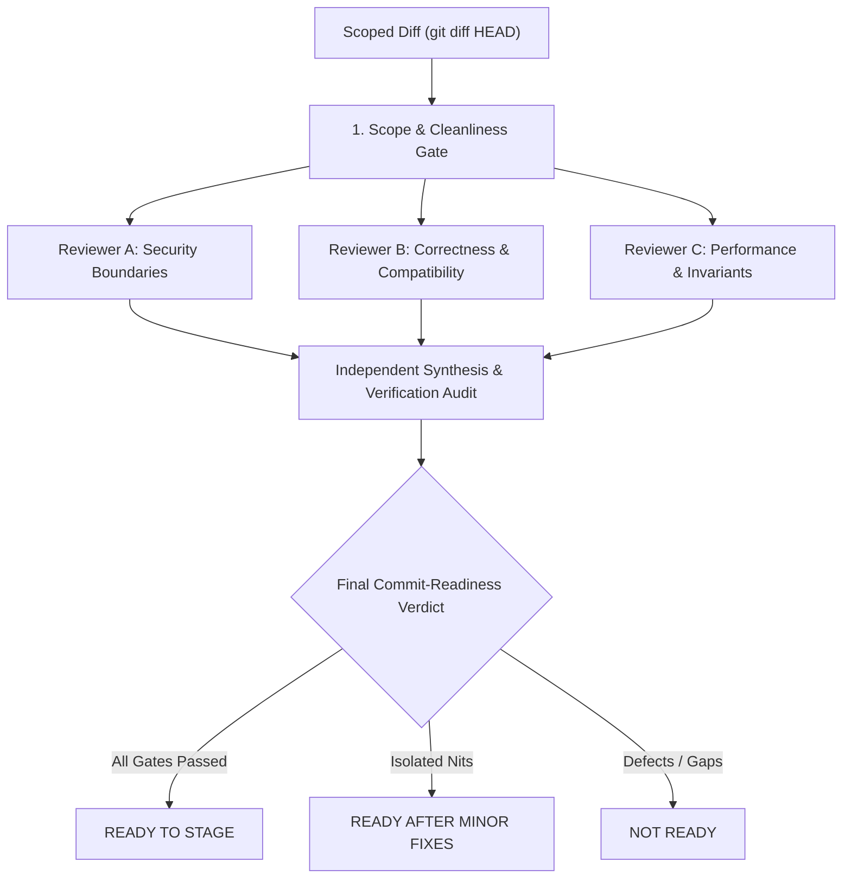

# Adversarial Code Review Protocol for Jarvis 2.0

The **Adversarial Code Review Protocol** enforces independent, evidence-backed inspection of code modifications prior to staging or committing.

This protocol assumes patches contain latent regressions, security bypasses, or compatibility breaks until proven otherwise by empirical tool output and static inspection.

> [!IMPORTANT]
> **READ-ONLY MANDATE:** During an adversarial review, reviewers MUST NOT edit files, stage changes (`git add`), commit, stash, or reset. Modifications require explicit user authorization after review completion.

---

## 1. Review Architecture & Perspectives



---

## 2. Review Phase Checklist

### Phase 1: Establish Scope Baseline
Execute and report exact working tree state:
```powershell
git status --short
git diff --stat
git diff --check
git diff --cached --stat
```
Verify:
- Whitespace errors or trailing spaces (`git diff --check` output must be empty).
- No unapproved files, temp scripts, or build artifacts are modified.
- All diffs belong strictly to the approved task scope.

---

### Phase 2: The Three Independent Review Passes

#### Reviewer A: Security Boundaries & Provenance
* **Ingestion Taint Tracking:** Are externally ingested payloads tagged with source provenance? Does provenance survive transforms?
* **URL & Credential Sanitization:** Does URL parsing strip credentials (`user:pass@host`) from recorded hostnames and metadata?
* **Sensitive Metadata Normalization:** Are metadata keys case-insensitively and delimiter-insensitively normalized before secret filtering?
* **SSRF & Egress Protection:** Do outbound network calls route through `validate_egress_url`? Are private IP blocks and loopback interfaces rejected fail-closed?
* **Path Confinement:** Are filesystem operations validated via `validate_confined_path`?
* **Exception Logging:** Does debug logging avoid disclosing sensitive raw arguments or exception messages? (Log exception type `type(e).__name__`, not raw `e`).

#### Reviewer B: Correctness & Backward Compatibility
* **Signature Compatibility:** Have existing public functions preserved argument orders and default values?
* **Re-export Shims:** Are callers importing from legacy shims still functional without breaking changes?
* **Error Handling:** Are exceptions caught specifically rather than via bare `except:` or `except Exception:`?
* **Resource & Handle Lifecycle:** Are OS handles, sockets, Win32 Job Objects, and files closed cleanly via context managers or explicit `try...finally`?
* **Negative Constraints:** Ensure no `subprocess.run(shell=True)` or raw string formatting in shell commands. Use structural AST scans (`python tools/diagnostics.py scan <path>` or `python tools/diagnostics.py search ...`) as supporting evidence, never as a substitute for manually reading and tracing security-critical execution paths.

#### Reviewer C: Performance, Threading & System Invariants
* **Thread Safety & Barge-In:** Does any change block the WASAPI playback or Kokoro synthesis worker threads? Is `GLOBAL_EPOCH_STATE` honored?
* **VRAM & Hardware Budget:** Are auxiliary ONNX models confined to `CPUExecutionProvider`? Does VRAM stay strictly under 2.5 GB?
* **Windows Process Containment:** Are sandboxed child processes spawned suspended with `CREATE_SUSPENDED` and assigned to Job Objects before execution?
* **Database & Memory Serialization:** Do SQLite write operations serialize strictly through `SingleWriterActor` with WAL mode enabled?

---

### Phase 3: Verification Evidence Audit
Never accept assertions of test passage without evidence:
1. Verify that every finding or bugfix has a dedicated, targeted regression test in `tests/`.
2. Verify that tests assert the actual intended behavior (not superficial tautologies or trivial mock assertions).
3. Confirm observable test execution results:
   ```powershell
   python tools/run_fast_tests.py <targeted_test>
   python tools/lint.py check <path>
   ```

---

## 3. Standard Review Verdict Output

Every review must conclude with an unambiguous verdict in this exact format:

```markdown
## Final Review Verdict

**Verdict:** [READY TO STAGE | READY AFTER MINOR FIXES | NOT READY]

### Key Verification Evidence
- Targeted tests: X passed, 0 failed
- Fast suite: Y passed, Z skipped
- Static diagnostics: 0 errors reported by tools/lint.py
- Whitespace check: git diff --check clean

### Findings Inventory
1. [Finding Title] - Severity: [Blocker | Major | Minor | Note]
   - Mechanism: Description of flaw.
   - Remediation: Concrete, minimal fix recommendation.

### Proposed File Inventory
- Exact list of uncommitted files to be included in the commit.
```
