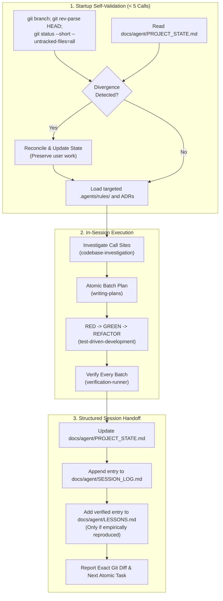

# Agent Engineering Continuity Protocol for Jarvis 2.0

The **Agent Continuity Protocol** governs the complete operational lifecycle of independent Antigravity software-engineering sessions working on the Jarvis 2.0 codebase.

Its objective is to eliminate cross-session amnesia, prevent stale state from being trusted, enforce pre-execution safety controls, and guarantee reliable handoffs between independent developer sessions.

---

## 1. Core Operating Principles



1. **Self-Validating State:** `docs/agent/PROJECT_STATE.md` is an empirical snapshot, not an independent source of ground truth. A fresh session must **never** trust recorded state without independently verifying the live Git baseline.
2. **Reconciliation Without Destruction:** If the live Git working tree diverges from `PROJECT_STATE.md`, reconcile the differences explicitly. **Never** overwrite, reset, stash, clean, or discard uncommitted user modifications.
3. **Append-Only History:** Historical session handoffs in `docs/handoffs/historical/` and past entries in `docs/agent/SESSION_LOG.md` are permanently immutable. Never rewrite past entries.
4. **Token-Efficient Progressive Disclosure:** Avoid unnecessary re-reads of unchanged documentation files. Once a rule or ADR is loaded in a turn, do not re-read it unless disk contents have changed.

---

## 2. Phase 1 — Startup Self-Validation Protocol

When beginning any new session or resuming work, execute this deterministic 5-step sequence before modifying code:

### Step 1: Capture Live Git Baseline
```powershell
git branch --show-current
git rev-parse HEAD
git status --short --untracked-files=all
```

### Step 2: Read Stored Project State
Read lines 1–60 of [`docs/agent/PROJECT_STATE.md`](../../../docs/agent/PROJECT_STATE.md) to inspect:
- The last validated HEAD commit and branch.
- The recorded staged, unstaged, and untracked file inventory.
- Current milestone focus and immediate next atomic task.

### Step 3: Self-Validation & Reconciliation Gate
Compare Step 1 live output against Step 2 stored state:
- **Case A (Aligned):** Branch, HEAD, and working-tree manifests match. Proceed directly to Step 4.
- **Case B (Diverged):** If new untracked files, modified files, or a different HEAD SHA are observed:
  1. Record the detected drift.
  2. Update Section 1 of `PROJECT_STATE.md` with the live baseline.
  3. Ensure no pre-existing user work is destroyed.

### Step 4: Load Targeted Subsystem Rules & ADRs
Load **only** the domain rule and ADR relevant to the requested task:
- **Audio & WASAPI:** `.agents/rules/audio_threading.md` + `docs/adr/ADR-003` / `ADR-005`
- **Memory & SQLite:** `.agents/rules/persistence_sqlite.md` + `docs/adr/ADR-001`
- **Security & Sandboxing:** `.agents/rules/security_boundaries.md` + `docs/adr/ADR-002` / `ADR-004` / `ADR-006`
- **Code Intelligence:** `.agents/rules/code_intelligence.md`
*(Note: All ADRs currently hold `PROPOSED` status; treat as design proposals, not accepted binding invariants).*

### Step 5: Establish Verification Baseline
Run the targeted test suite for the affected subsystem:
```powershell
python tools/run_fast_tests.py <test_path>
```
Record the baseline test status (passing vs. failing vs. environmental constraints) before authoring edits. Adhere strictly to the Evidence Hierarchy: live tool execution output strictly supersedes historical documentation. Never report historical passing counts as current execution results.

---

## 3. Phase 2 — In-Session Execution Protocol

During implementation, adhere strictly to these procedural standards:

1. **Investigate Before Editing:**
   - Follow [`codebase-investigation`](../codebase-investigation/SKILL.md) to map AST signatures, callers, and import paths.
   - For historical milestone provenance or conflict investigation, invoke [`evidence-first-context-recovery`](../evidence-first-context-recovery/SKILL.md).
2. **Structured Execution Planning:**
   - Follow [`writing-plans`](../writing-plans/SKILL.md) to partition multi-file changes into atomic batches of 1–3 files.
   - Define explicit verification gates after each batch.
3. **Test-Driven Implementation:**
   - Follow [`test-driven-development`](../test-driven-development/SKILL.md) (RED -> GREEN -> REFACTOR).
   - Author isolated reproduction or unit tests before touching production code.
4. **Preserve User Changes:**
   - Never touch unrelated modified or untracked files identified in the pre-flight check.
   - Keep modifications tightly scoped to the immediate milestone task.
5. **Verify Every Batch:**
   - Run syntax and static diagnostics: `python tools/lint.py check <path>` (<20ms).
   - Run targeted test suites: `python tools/run_fast_tests.py <test_path>`.
   - Run AST structural invariant rules: `python tools/diagnostics.py scan <path>`.
6. **Mechanically Constrained Specialist Delegation:**
   - When delegating code review, architecture evaluation, or security auditing to background subagents, dispatch strictly using verified read-only specialist profiles (`security-auditor`, `systems-architect`, `test-guardian`, or `research`).
   - Never dispatch evaluation or review tasks with `TypeName: "self"` (which inherits mutating tools).
   - Enforce the 7-Point Subagent Launch Contract in [`agent-evaluation`](../agent-evaluation/SKILL.md) prior to dispatch.

---

## 4. Phase 3 — Structured Handoff & Session Close Protocol

At the conclusion of each engineering session, execute this mandatory closeout sequence:

### Step 1: Update `docs/agent/PROJECT_STATE.md`
- Re-run `git status --short --untracked-files=all` and `git rev-parse HEAD`.
- Update Section 1 (Last Verified Git Baseline) with the current timestamp and file inventory.
- Update Section 2 (Active Engineering Focus) with the status of the completed task.
- Update Section 3 (Verified Test Health) with exact test command outputs, exit codes, and counts from live tool executions only; never copy historical counts from documentation.
- Update Section 6 (Immediate Next Action) with exactly one atomic task for the incoming session.

### Step 2: Append to `docs/agent/SESSION_LOG.md`
Append a new dated entry (`## Session YYYY-MM-DD.NN — [Objective]`) containing:
- Session timestamp with timezone.
- Agent model and reasoning level.
- Starting and ending Git HEAD SHA.
- Summary of actions and deliverables.
- Files created and files modified.
- Exact verification commands executed, exit codes, and test counts.
- Remaining blockers and technical debt.
- The next actionable task.

### Step 3: Gated Update to `docs/agent/LESSONS.md`
**Only** if a novel, reproducible engineering failure or platform limitation was verified during the session:
- Satisfy the strict 8-field lesson schema (`LES-XXX`, domain, observed problem, reproduction evidence, verified root cause, prevention rule, supporting files, confidence boundaries).
- Never add speculative, unverified, or hypothetical entries.

### Step 4: Final Working Tree & Diff Audit
- Verify whitespace and line endings: `git diff --check; git diff --cached --check`.
- Inspect unstaged modifications: `git diff --stat`.
- Confirm staged index is clean: `git diff --cached --stat` (0 staged changes).
- Present a concise, factual summary to the human developer. **Never** run `git commit` or `git push` without explicit developer instructions.
