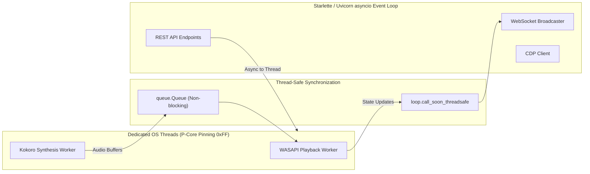

# Asynchronous & Concurrency Patterns for Jarvis 2.0

The **Async Python Patterns** skill governs concurrent programming, asynchronous task orchestration, and thread-to-event-loop bridging in the Jarvis 2.0 architecture.

---

## 1. Concurrency Model Architecture

Jarvis 2.0 operates a hybrid concurrency model:
1. **Dedicated OS Worker Threads:** P-Core pinned (affinity mask `0x55` / `0xFF`), high-priority threads for real-time hardware execution (`WASAPIPlaybackWorker`, `KokoroSynthWorker`, `WhisperWorker`). These threads must **never be blocked** by network I/O, disk writes, or Python async operations.
2. **Asynchronous Event Loop:** A single-threaded Starlette / Uvicorn `asyncio` event loop handling the Holographic HUD WebSocket, REST endpoints, and CDP JSON-RPC frames.
3. **Background Sidecars & Daemons:** Managed subprocesses (Ollama, Kokoro server, Antigravity CLI) communicating via non-blocking Win32 anonymous/named pipes.



---

## 2. Bridging OS Threads & Async Event Loops

### Pattern A: Dispatching from Worker Threads to the Async Event Loop
Worker threads (e.g. audio telemetry, STT transcript callbacks) must safely notify the async event loop without blocking their own execution.
* **Non-Coroutine Callbacks:**
  ```python
  # Safe to call from any background thread
  loop.call_soon_threadsafe(sync_callback, arg1, arg2)
  ```
* **Async Coroutines (e.g. WebSocket Broadcast):**
  ```python
  import asyncio
  from typing import Coroutine, Any

  def dispatch_async_from_thread(loop: asyncio.AbstractEventLoop, coro: Coroutine[Any, Any, Any]) -> None:
      """Safely schedule a coroutine on the running async event loop from an OS worker thread."""
      if loop.is_closed() or not loop.is_running():
          return
      asyncio.run_coroutine_threadsafe(coro, loop)
  ```

---

### Pattern B: Running Blocking Operations from the Async Event Loop
Never execute blocking Win32 API calls, SQLite queries, or heavy CPU operations directly inside an `async def` function.
* Use `asyncio.to_thread` for short, blocking I/O:
  ```python
  # Good: runs in the default thread pool executor, freeing the event loop
  result = await asyncio.to_thread(blocking_win32_call, hwnd)
  ```

---

### Pattern C: Non-Blocking Win32 Pipe Polling
Standard Python `os.read(pipe_fd, n)` or `pipe.readline()` will block the thread indefinitely if the child process does not emit data. In an async context or worker thread, use non-blocking `PeekNamedPipe`:
```python
import msvcrt
import ctypes
from ctypes import wintypes
import time
from typing import Generator

def iter_pipe_non_blocking(pipe_fd: int, poll_interval: float = 0.010, max_wait: float = 5.0) -> Generator[bytes, None, None]:
    """Poll a Win32 anonymous pipe non-blockingly without starving the thread."""
    handle = msvcrt.get_osfhandle(pipe_fd)
    bytes_avail = wintypes.DWORD(0)
    deadline = time.monotonic() + max_wait

    while time.monotonic() < deadline:
        res = ctypes.windll.kernel32.PeekNamedPipe(
            handle, None, 0, None, ctypes.byref(bytes_avail), None
        )
        if not res:
            break  # Pipe broken or closed
        
        if bytes_avail.value > 0:
            chunk = os.read(pipe_fd, min(bytes_avail.value, 4096))
            if chunk:
                yield chunk
                deadline = time.monotonic() + max_wait  # Reset timeout on data
        else:
            time.sleep(poll_interval)
```

---

## 3. Real-World Failure Modes & Mitigations

### Failure Mode 1: Event Loop Starvation via Synchronous Calls
* **Symptom:** UI HUD freezes; WebSocket disconnects with `1006 abnormal closure`; incoming speech commands are delayed by 2–5 seconds.
* **Root Cause:** A route handler or websocket listener calls a blocking function (e.g. `requests.get()`, `time.sleep()`, or synchronous SQLite WAL queries) directly in the event loop.
* **Mitigation:**
  - Audit all `async def` handlers.
  - Offload blocking operations to `await asyncio.to_thread(...)`.
  - Use non-blocking HTTP clients (`httpx.AsyncClient` or `aiohttp`) instead of `requests`.

### Failure Mode 2: Deadlock with `run_coroutine_threadsafe`
* **Symptom:** Thread hangs indefinitely on `future.result()`.
* **Root Cause:** Calling `future = asyncio.run_coroutine_threadsafe(coro, loop)` and immediately awaiting `future.result()` **from within the thread running the event loop**. The event loop is blocked waiting for `future.result()`, which can never complete because the event loop is blocked.
* **Mitigation:**
  - Never call `future.result()` from the main event loop thread.
  - If already on the event loop, simply `await coro`.
  - Check the active thread identity:
    ```python
    import threading
    if threading.current_thread() is loop_thread:
        # We are on the event loop thread: await directly
        return await coro
    else:
        # We are on an OS worker thread: schedule thread-safely
        future = asyncio.run_coroutine_threadsafe(coro, loop)
        return future.result(timeout=5.0)
    ```

### Failure Mode 3: Silent Background Task Destruction
* **Symptom:** Background jobs (e.g., periodic health checks or presence polling) silently stop executing without logging an error.
* **Root Cause:** Calling `asyncio.create_task(coro)` without holding a strong reference or attaching an exception callback. When an unhandled exception occurs, Python garbage collects the task and drops the traceback.
* **Mitigation:**
  - Hold a set of strong references to active background tasks:
    ```python
    _background_tasks = set()

    task = asyncio.create_task(coro)
    _background_tasks.add(task)
    task.add_done_callback(_background_tasks.discard)
    task.add_done_callback(log_task_exception)

    def log_task_exception(t: asyncio.Task) -> None:
        if not t.cancelled() and t.exception():
            logger.error("Background task failed: %s", t.exception(), exc_info=t.exception())
    ```
