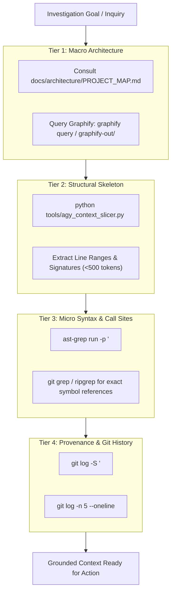

# Codebase Investigation Protocol for Jarvis 2.0

The **Codebase Investigation Protocol** governs how software engineering agents explore, analyze, and map the Jarvis 2.0 codebase before proposing architectural plans or modifying code.

Monolithic, blind file reads and unverified assumptions about call sites or types are strictly prohibited. Agents must follow a structured, token-efficient triaging hierarchy.

---

## 1. The 4-Tier Investigation Hierarchy



---

## 2. Investigation Tiers & Execution Procedures

### Tier 1: Macro Architecture (Subsystem Mapping)
Before looking at code, determine the architectural domain and owning subsystem:
1. **Canonical Subsystem Map:** Consult [`docs/architecture/PROJECT_MAP.md`](file:///C:/Users/Youssef/Projects/Jarvis_2.0/docs/architecture/PROJECT_MAP.md) to identify canonical modules vs. legacy re-export shims.
2. **Knowledge Graph Exploration:**
   - If `graphify-out/` exists, run:
     ```powershell
     # Query concept dependencies
     graphify query "<concept or subsystem>"
     # Trace relationship path between two components
     graphify path "<SubsystemA>" "<SubsystemB>"
     # Explain node role
     graphify explain "<NodeName>"
     ```
   - Navigate `graphify-out/wiki/index.md` or `graphify-out/GRAPH_REPORT.md` only for broad architecture surveys.

---

### Tier 2: Structural Skeleton (Token-Efficient Slicing)
Never read an entire >300-line file without inspecting its structural layout first:
1. **Run Context Slicer:**
   ```powershell
   python tools/agy_context_slicer.py jarvis/path/to/target.py
   ```
2. **Review Output:**
   - Identifies all classes, methods, top-level functions, argument types, and exact line ranges.
   - Reduces LLM context token consumption by 75%+.
3. **Targeted Read:**
   - Read only the specific line range needed (e.g. `read_file` with `StartLine` and `EndLine`).

---

### Tier 3: Micro Syntax & Call-Site Discovery
Identify all callers, consumers, and overrides across the repository before modifying a function signature:
1. **Structural AST Matching (`ast-grep`):**
   - Use tree-sitter AST queries rather than fragile regex:
     ```powershell
     # Find all calls to a specific method
     ast-grep run -p '$OBJ.record_ingestion($$$ARGS)' jarvis/

     # Find function declarations with parameters
     ast-grep run -p 'def validate_egress_url($$$PARAMS): $$$BODY' jarvis/
     ```
   - *PowerShell Invariant:* Always wrap patterns in single quotes (`'...'`) to prevent `$VARIABLE` interpolation.
2. **Text / Identifier Search:**
   - Search exact symbol references across test suites:
     ```powershell
     git grep -n "record_ingestion" tests/
     ```

---

### Tier 4: Git History & Historical Provenance
Understand why code exists in its current form to avoid re-introducing past defects:
1. **Symbol Inception & Evolution:**
   ```powershell
   # Find commits that added or removed the symbol
   git log -S "TurnTaintTracker" -p -n 3
   ```
2. **Recent Modifications to File:**
   ```powershell
   git log -n 5 --oneline -- <file>
   ```
3. **Line-Level Attribution:**
   ```powershell
   git blame -L <start>,<end> <file>
   ```

---

## 3. Negative Constraints (Prohibited Investigation Patterns)

1. **PROHIBITED:** Dumping unformatted files >500 lines into context without prior slicing.
2. **PROHIBITED:** Modifying a function signature without discovering and auditing all repository call sites.
3. **PROHIBITED:** Blindly importing from a compatibility shim when a canonical module exists (see `AGENTS.md` Canonical Module Map).
4. **PROHIBITED:** Assuming external service or dependency behavior without inspecting actual call signatures and error-handling blocks.

---

## 4. Investigation Delivery Checklist

Before proceeding to feature planning or code changes, verify:
- [ ] Subsystem domain and canonical module identified.
- [ ] Target file sliced via `python tools/agy_context_slicer.py`.
- [ ] All call sites and consumers surveyed across `jarvis/` and `tests/`.
- [ ] Governing architectural invariants from `AGENTS.md` noted.
- [ ] Working tree status verified clean via `git status --short`.
