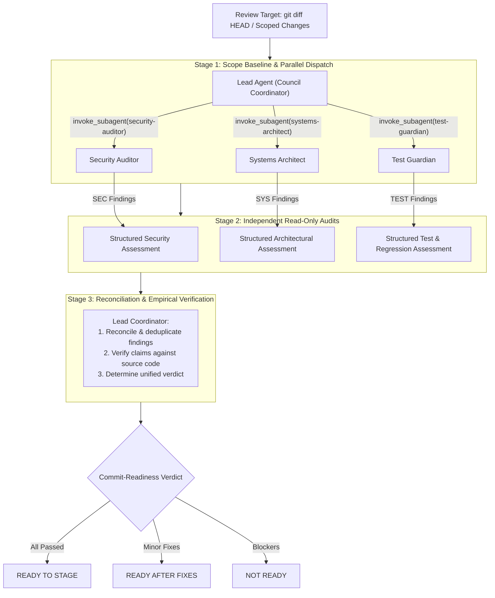

# Council LLM Protocol for Jarvis 2.0

The **Council LLM Protocol** governs high-stakes engineering decisions, architectural design, concurrency models, and security boundaries across the Jarvis 2.0 codebase.

Instead of relying on single-pass model reasoning—which can suffer from sycophancy, blind spots, or missed edge cases—this skill establishes a structured deliberation pipeline among specialized native Antigravity subagents before high-blast-radius code changes are staged or committed.

---

## 1. Activation Triggers & Thresholds

Convene the Council when any of the following conditions are met:

| Category | Trigger Conditions |
| :--- | :--- |
| **Security & Safety** | Changes to command execution, egress validation, subprocess Job Object containment, URL parsing, or untrusted external data ingestion. |
| **Concurrency & Async** | Modifying `asyncio` event loops, background worker threads, audio streaming pipelines (STT/TTS), or WebSocket broadcast channels in [`jarvis/ui/server.py`](file:///C:/Users/Youssef/Projects/Jarvis_2.0/jarvis/ui/server.py). |
| **Brain & Provider Routing** | Structural refactors to LLM provider fallbacks, specialist consultations, or context assembly in [`jarvis/core/brain.py`](file:///C:/Users/Youssef/Projects/Jarvis_2.0/jarvis/core/brain.py). |
| **Data Integrity & Memory** | Alterations to SQLite persistent memory schemas, vector recall logic, or state persistence in [`jarvis/core/memory.py`](file:///C:/Users/Youssef/Projects/Jarvis_2.0/jarvis/core/memory.py). |
| **Milestone Review Gates** | Prior to staging complex engineering milestones (e.g. M1, B2, C1) to ensure multi-angle pre-commit verification. |
| **User Request** | Explicit prompts such as *"Convene the council on..."*, *"Run a council review for..."*, or *"Get an independent review."* |

> [!NOTE]
> **Fast-Path Exclusion:** Do NOT convene the council for routine UI styling adjustments, simple regex tweaks, documentation updates, or isolated unit-test assertion fixes.

---

## 2. Specialized Council Reviewer Roles

The Council dispatches three distinct native subagents configured in `.agents/agents/`:

| Agent File | Role Identifier | Focus & Responsibilities | Tool Permissions |
| :--- | :--- | :--- | :--- |
| [`.agents/agents/security-auditor.md`](file:///C:/Users/Youssef/Projects/Jarvis_2.0/.agents/agents/security-auditor.md) | `security-auditor` | Trust boundaries, provenance propagation (`TurnTaintTracker`), secret scrubbing, SSRF/egress filtering, Windows Job Object containment, fail-closed gates. | Read-only (`read_file`, `search_web`) |
| [`.agents/agents/systems-architect.md`](file:///C:/Users/Youssef/Projects/Jarvis_2.0/.agents/agents/systems-architect.md) | `systems-architect` | Concurrency safety, non-blocking `asyncio` loops, audio thread starvation, atomic cancellation epochs, SQLite WAL single-writer serialization, handle lifecycles. | Read-only (`read_file`, `search_web`) |
| [`.agents/agents/test-guardian.md`](file:///C:/Users/Youssef/Projects/Jarvis_2.0/.agents/agents/test-guardian.md) | `test-guardian` | Observable behavior assertions, negative test fixtures, mock lifecycle cleanliness, boundary conditions, backwards compatibility, test evidence auditing. | Read-only (`read_file`, `search_web`) |

---

## 3. Deliberation Protocol & Execution Workflow



### Execution Procedure

1. **Establish Review Baseline:**
   - Execute and record:
     ```powershell
     git status --short
     git diff HEAD
     ```
   - Define exact target files, base revision, and operational context.

2. **Parallel Subagent Dispatch:**
   - Dispatch all three specialized reviewers concurrently using native `invoke_subagent`:
     ```python
     # Example dispatch contract
     invoke_subagent(
         TypeName="security-auditor",
         Role="Security Auditor",
         Prompt="<Target files, diff snippet, and review objectives>",
         Workspace="inherit"
     )
     ```
   - Provide the **identical review scope and diff baseline** to all three reviewers.

3. **Collect & Structure Findings:**
   - Collect responses from each subagent.
   - Every finding reported must follow the standard contract:
     - **Finding ID:** Stable identifier (e.g. `SEC-01`, `SYS-01`, `TEST-01`)
     - **Severity:** `HIGH` | `MEDIUM` | `LOW` | `INFORMATIONAL`
     - **File & Line:** Exact file path and line numbers
     - **Evidence & Technical Reasoning:** Concrete code pattern and explanation
     - **Failure Scenario:** Exploit, deadlock, crash, or regression mechanism
     - **Confidence:** `HIGH` | `MEDIUM` | `LOW`
     - **Remediation:** Surgical code adjustment
     - **Regression Test:** Proposed test case
   - If a reviewer identifies zero defects, it must state which files and invariants were examined.
   - Never equate silence, subagent timeout, or incomplete output with a clean audit.

4. **Reconcile Disagreements & Verify Claims:**
   - The Lead Coordinator cross-checks reported findings against the actual source code and tests.
   - Do not silently discard conflicting assessments; document trade-offs explicitly.
   - Verify any high-severity vulnerability or deadlock claim by inspecting call sites.

5. **Emit Decisive Synthesis Report:**
   - Deliver a single, consolidated Council Review Report with one unambiguous verdict:
     - **READY TO STAGE:** All reviewers report clean or informational-only notes; no blockers.
     - **READY AFTER FIXES:** Minor non-blocking issues or test coverage gaps identified; remediate before staging.
     - **NOT READY:** Architectural flaws, security vulnerabilities, or failing tests detected; must be resolved first.

---

## 4. Platform Security Boundaries & Limitations

- **Tool Allowlists:** Reviewers configure explicit tool allowlists (`read_file`, `search_web`), excluding `write_file`, `edit_file`, and `run_command`.
- **Inherited Workspace:** Reviews run with `Workspace="inherit"` to inspect the parent workspace without duplicating disk storage.
- **Limitation Transparency:** Agent tool allowlists restrict tool calling within Antigravity's model execution environment. They do not constitute an OS-level hypervisor boundary.
