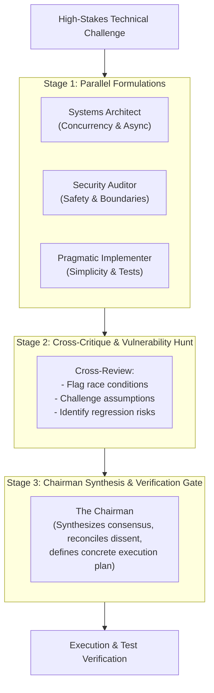

# Council LLM Protocol for Jarvis 2.0

The **Council LLM Protocol** governs high-stakes engineering decisions, architectural design, concurrency models, and security boundaries across the Jarvis 2.0 codebase.

Instead of relying on single-pass model reasoning—which can suffer from sycophancy, blind spots, or missed edge cases—this skill establishes a structured deliberation pipeline among specialized perspectives before high-blast-radius code changes are executed.

---

## 1. Activation Triggers & Thresholds

Convene the Council when any of the following conditions are met:

| Category | Trigger Conditions |
| :--- | :--- |
| **Concurrency & Async** | Modifying `asyncio` event loops, background worker threads, audio streaming pipelines (STT/TTS), or WebSocket broadcast channels in [`jarvis/ui/server.py`](file:///C:/Users/Youssef/Projects/Jarvis_2.0/jarvis/ui/server.py). |
| **Security & Safety** | Changes to command execution in [`jarvis/skills/dev_shell.py`](file:///C:/Users/Youssef/Projects/Jarvis_2.0/jarvis/skills/dev_shell.py), [`jarvis/core/safety.py`](file:///C:/Users/Youssef/Projects/Jarvis_2.0/jarvis/core/safety.py), MCP tool invocation, or handling untrusted user/web input. |
| **Brain & Provider Routing** | Structural refactors to LLM provider fallbacks, specialist consultations (`_consult_specialist`), or context assembly in [`jarvis/core/brain.py`](file:///C:/Users/Youssef/Projects/Jarvis_2.0/jarvis/core/brain.py). |
| **Data Integrity & Memory** | Alterations to SQLite persistent memory schemas, vector recall logic, or state persistence in [`jarvis/core/memory.py`](file:///C:/Users/Youssef/Projects/Jarvis_2.0/jarvis/core/memory.py). |
| **User Request** | Explicit prompts such as *"Convene the council on..."*, *"Run a council review for..."*, or *"Get a second opinion on this architecture."* |

> [!NOTE]
> **Fast-Path Exclusion:** Do NOT convene the council for routine UI styling adjustments, simple regex tweaks, documentation updates, or isolated unit-test assertion fixes.

---

## 2. Council Personas & Mandates

The Council is composed of three distinct advisor roles coordinated by the lead agent (**The Chairman**):

### 1. The Systems & Concurrency Architect
* **Focus:** Concurrency model, thread safety, latency, resource leaks, and lifecycle management.
* **Key Questions:**
  * Will this block the `asyncio` loop or starve TTS/STT audio streams?
  * Are background tasks, thread pools, and WebSocket clients cleanly shutdown on exit?
  * Does this introduce race conditions between the voice pipeline and incoming UI events?

### 2. The Security & Safety Auditor
* **Focus:** Blast radius, command injection, safety gates, and privilege boundaries.
* **Key Questions:**
  * Can untrusted external data (web text, tool outputs, email bodies) escape sanitation?
  * Does this bypass or weaken `SafetyGate` approvals for destructive actions?
  * Are API keys, secrets, or sensitive memory records exposed in logs or telemetry?

### 3. The Pragmatic Implementer & Test Guardian
* **Focus:** Backwards compatibility, implementation simplicity, minimal blast radius, and testability.
* **Key Questions:**
  * Can this be solved with fewer moving parts and less indirection?
  * Does this break existing interfaces in `SkillRegistry` or existing unit tests in `tests/`?
  * Is the proposed solution verifiable via concrete test commands?

---

## 3. Deliberation Protocol Workflow

When activated, the Council follows a 3-stage deliberation cycle:

### Stage 1: Independent Formulations & Deep Technical Research
* The Chairman presents the problem statement, affected files, and performance/safety constraints.
* **Mandatory Deep Failure-Mode Probing:** Advisors must actively research edge cases, OS error codes (e.g. Win32 ERROR_BUSY), thread contention (Kokoro audio workers vs LLM streaming), and API quota limits rather than reviewing surface code.
* **State-of-the-Art Research:** Each advisor evaluates production-grade systems patterns (lock-free buffers, CDP reconnection state machines, AST safety gates, sqlite-vec SIMD optimization) to find the most useful enhancements.
* Each persona generates an independent proposal without being influenced by the others.

### Stage 2: Cross-Critique & Vulnerability Hunt
* Proposals are cross-examined against each advisor's mandate.
* The Architect probes the Implementer's design for thread-safety and deadlocks.
* The Security Auditor checks all proposals for injection vectors or safety gate bypasses.
* The Implementer flags excessive complexity or unmaintainable abstractions.

### Stage 3: Chairman Synthesis & Comprehensive Intelligence Briefing
* The Chairman reviews all points of consensus, research discoveries, and unresolved dissent.
* Outputs a decisive **Council Report** formatted as:
  1. **Consensus Verdict:** Core architectural approach approved by the council.
  2. **Technical Discoveries:** Actionable, research-backed engineering patterns uncovered to enhance Jarvis's speed, memory, or intelligence.
  3. **Identified Failure Modes & Mitigations:** Explicit traps spotted during cross-critique and how they are countered.
  4. **Implementation Plan:** Contiguous, minimal file edits to be made.
  5. **Verification Gate:** Specific test commands (`.venv\Scripts\python.exe -m unittest discover tests`) to confirm zero regressions.

---

## 4. Execution Directives for the Agent

When executing this skill during a session:
1. **Spawn or Model the Personas:** Use `invoke_subagent` for parallel independent reviews, or explicitly delineate the three perspectives in your deliberation trace.
2. **Comprehensive Intelligence Feedback:** Never summarize away crucial technical nuance. Gather all specialized insights, research discoveries, and trade-offs from the Council and brief Sir with complete, non-generic clarity.
3. **Present Clear Findings:** Provide the synthesized Council Report to the user with actionable next steps before executing high-risk file modifications.
3. **Verify Empirically:** Never declare a council-approved implementation complete without executing the relevant test suites and checking tool outputs.
