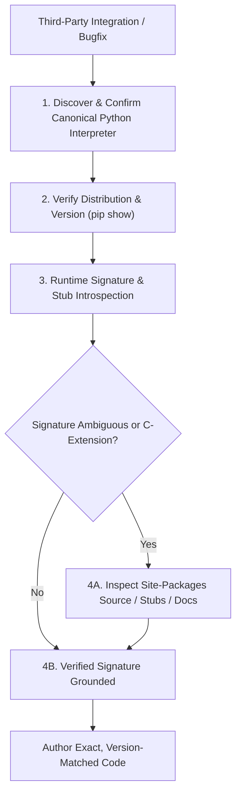

# Dependency API Verification Protocol for Jarvis 2.0

The **Dependency API Verification Protocol** governs how software engineering agents discover, verify, and ground external third-party libraries and runtime environments before authoring integration code in the Jarvis 2.0 codebase.

Language models frequently hallucinate obsolete or speculative method signatures, non-existent keyword arguments, or invented return types based on pre-training priors. Agents must discover and verify the project's canonical virtual environment and treat that environment as the sole physical source of truth for all third-party dependencies.

---

## 1. Core Principles: Environment Before Code



1. **Verify the Interpreter First:** Never assume the virtual environment path. Discover and confirm the active interpreter executable via `sys.executable` before querying packages or writing code.
2. **Never Guess API Signatures:** Verify function names, argument orders, keyword-only parameters, and return structures directly from installed distributions using runtime introspection, type stubs, or installed source.
3. **No Unauthorized Dependency Mutations:** Never execute `pip install`, `pip uninstall`, or modify `requirements.txt` / `pyproject.toml` without explicit user authorization.
4. **Distinguish Verified Behavior from Assumptions:** If a library's thread-safety, reentrancy, or non-blocking characteristics are not documented in the installed version, document it as an open question rather than assuming safety.
5. **Illustrative Examples Are Not Evidence:** Never reuse template examples from this skill as factual assertions about the current environment. Every claim must derive from observable command output in the active session.

---

## 2. The 4-Step Dependency Verification Procedure

### Step 1: Discover and Verify the Canonical Interpreter
Do not assume `.venv` lives inside the workspace root. In multi-project or parent workspaces, the virtual environment may reside in a parent directory (e.g. `..\.venv\Scripts\python.exe` or `C:\Users\Youssef\Projects\.venv\Scripts\python.exe`).

1. **Discover Candidate Virtual Environments:**
   ```powershell
   Get-Item -Path .venv\Scripts\python.exe, ..\.venv\Scripts\python.exe, $env:VIRTUAL_ENV\Scripts\python.exe -ErrorAction SilentlyContinue | Select-Object FullName
   ```
2. **Inspect Project Documentation & Configuration:**
   - Check `.agents/rules/code_intelligence.md` or `AGENTS.md` for documented virtual environment locations.
3. **Confirm the Candidate via `sys.executable`:**
   ```powershell
   & "<CANDIDATE_PYTHON_PATH>" -c "import sys; print(sys.executable, sys.version)"
   ```
4. **Handle Ambiguity Fail-Closed:**
   - If multiple virtual environments exist and have conflicting packages, or if no candidate contains the project's core dependencies (`scipy`, `numpy`, `sounddevice`, `fastapi`), **stop and report the ambiguity to the user**. Never silently pick an unverified interpreter.
5. **Set the Verified Interpreter Variable:**
   - Let `<PYTHON_EXE>` denote the confirmed absolute path (e.g. `C:\Users\Youssef\Projects\.venv\Scripts\python.exe`). Use `& "<PYTHON_EXE>"` for all subsequent commands.

---

### Step 2: Package Distribution vs. Import Name Mapping
Third-party package distribution names often differ from their import module names:

| Package Distribution | Import Module Name | Common Submodules |
| :--- | :--- | :--- |
| `PyYAML` | `yaml` | `yaml.safe_load`, `yaml.dump` |
| `pywin32` | `win32com`, `win32gui`, `win32api` | `win32com.client`, `win32con` |
| `sounddevice` | `sounddevice` | `sounddevice.OutputStream`, `sounddevice.InputStream` |
| `soundfile` | `soundfile` | `soundfile.read`, `soundfile.write` |
| `faster-whisper` | `faster_whisper` | `faster_whisper.WhisperModel` |
| `scipy` | `scipy.signal` | `scipy.signal.butter`, `scipy.signal.lfilter` |
| `psutil` | `psutil` | `psutil.Process`, `psutil.cpu_percent` |

Inspect the exact installed distribution version using the confirmed interpreter:
```powershell
& "<PYTHON_EXE>" -m pip show <distribution_name>
```

---

### Step 3: Runtime Introspection of Signatures & Module Paths
Before writing calls against an unfamiliar method, verify its exact runtime signature and source origin:
```powershell
# 1. Print module origin and exact signature
& "<PYTHON_EXE>" -c "
import <module>
import inspect
print('Module location:', getattr(<module>, '__file__', 'built-in / C-extension'))
try:
    print('Signature:', inspect.signature(<module>.<callable>))
except Exception as e:
    print('Signature introspection unavailable:', e)
"
```

#### Handling C-Extensions, CFFI, and Built-ins
When `inspect.signature()` raises `ValueError` (common with C-extensions, CFFI bindings, or built-in functions like PortAudio bindings or `win32com` dispatch objects):
1. **Inspect Docstrings and Help:**
   ```powershell
   & "<PYTHON_EXE>" -c "import <module>; help(<module>.<callable>)"
   ```
2. **Inspect Type Stubs (`.pyi`):**
   - Locate stub files in the package's site-packages directory (found from Step 2 `Location:` or `sys.path`).
3. **Inspect Site-Packages Source Directly:**
   - Read the relevant implementation file under `site-packages\<module>/` using `read_file` to confirm exact parameter names, keyword-only boundaries, and default values.

---

### Step 4: Version-Matched Documentation Consultation
When local introspection and docstrings are insufficient:
1. Note the exact installed version from Step 2 (e.g. `scipy==1.15.2`, `sounddevice==0.5.1`).
2. Consult official documentation matching that exact version. Do not apply documentation from older or newer major versions where breaking signature changes have occurred.
3. For Gemini API SDK questions, use the `gemini-api_gemini-api-docs` MCP tools (`gemini_search_docs`, `gemini_get_doc`).

---

## 3. Epistemic Classification for Library Integrations

> [!CAUTION]
> **ILLUSTRATIVE FORMAT TEMPLATE ONLY:**
> The snippet below illustrates how to format dependency verification findings in a report. Never cite or copy the specific version numbers, signatures, or behavior statements in this template as evidence for your active task. All assertions must come from live commands executed against the confirmed `<PYTHON_EXE>`.

```markdown
### [Verified API Contracts] — (Illustrative Template)
- Interpreter: Confirmed at `C:\Users\...\.venv\Scripts\python.exe` (Python 3.12.x) via `sys.executable`
- Package: `<package_name>` version `<X.Y.Z>` at `<site-packages-path>`
- Confirmed Signature: `<module>.<func>(arg1, arg2, *, kwarg=default)` verified via `inspect.signature`
- Confirmed Behavior: Verified from installed docstring / source lines `<path#L...>`

### [API Assumptions & Open Questions] — (Illustrative Template)
- Thread Safety: Calling `<module>.<func>` from a background OS worker thread; documentation does not explicitly guarantee reentrancy — bounded timeout required.
- Platform Constraints: Behavior under Windows audio engine vs Linux ALSA.
```

---

## 4. Negative Constraints (Prohibited Dependency Patterns)

1. **PROHIBITED:** Modifying dependencies (`pip install`, `pip install --upgrade`, `pip uninstall`) without explicit user instruction.
2. **PROHIBITED:** Running commands with bare system `python` or `pip` on Windows when a project virtual environment is available.
3. **PROHIBITED:** Assuming the virtual environment is always located at `./.venv` without verifying existence.
4. **PROHIBITED:** Assuming external functions accept arbitrary `*args` or `**kwargs` without checking the signature.
5. **PROHIBITED:** Assuming external library calls are non-blocking or thread-safe without empirical proof.
6. **PROHIBITED:** Reusing illustrative examples from this skill as evidence of installed packages or signatures.
7. **PROHIBITED:** Inventing exception classes (e.g. catching an exception type without confirming its import path).

---

## 5. Dependency Verification Checklist

Before writing code that invokes third-party libraries, verify:
- [ ] Canonical Python interpreter discovered, confirmed via `sys.executable`, and path verified.
- [ ] Any ambiguity in candidate virtual environments resolved or escalated to the user.
- [ ] Installed package version confirmed via `<PYTHON_EXE> -m pip show <pkg>`.
- [ ] Import module name verified against distribution name.
- [ ] Callable signature inspected via `inspect.signature`, type stubs, or site-packages source.
- [ ] Keyword arguments and defaults confirmed.
- [ ] No unapproved package installations or modifications performed.
- [ ] Findings partitioned into verified contracts vs assumptions/open questions.
