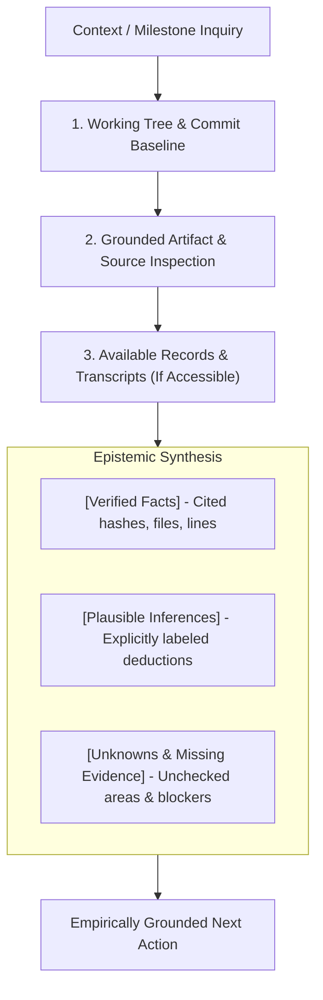

# Evidence-First Context Recovery Protocol for Jarvis 2.0

The **Evidence-First Context Recovery Protocol** governs how software engineering agents reconstruct repository state, milestone provenance, and architectural context from empirical evidence rather than memory or speculative inference.

When context has been truncated or past decisions are referenced, agents must never guess about previous choices, uninspected files, or unverified test results. Missing context must always trigger structured investigation or an explicit declaration of uncertainty.

---

## 1. Core Principles: Grounding Over Invention



1. **Empirical Grounding:** Every factual assertion regarding repository state, milestone completion, or architectural design must cite observable evidence (commit hash, file path, line range, or tool output).
2. **Never Invent Missing History:** If a file, transcript, or handoff note does not exist or does not mention a topic, state the absence plainly. Never extrapolate unrecorded discussions into historical "decisions."
3. **Fail-Closed on Uncertainty:** If evidence is missing, conflicting, or ambiguous, stop and ask the user or investigate further before executing consequential modifications.
4. **Credential & Privacy Scrubbing:** Never print secrets, API keys, passwords, or personal ambient conversation logs in context recovery reports.

---

## 2. The 4-Step Context Recovery Procedure

### Step 1: Active Working Tree & Head Grounding
Before analyzing any historical milestone or proposed change, establish the current repository state:
```powershell
# 1. Current commit hash and headline
git log -1 --oneline

# 2. Exact uncommitted file inventory
git status --short

# 3. Check for staged modifications
git diff --cached --stat

# 4. Review recent milestone commit sequence
git log -n 5 --oneline
```
*Verification Invariant:* Note whether the working tree contains active, uncommitted work that must be preserved. Never assume the repository is clean without inspecting `git status`.

---

### Step 2: Milestone Provenance & Commit Tracing
When investigating how a feature was implemented or why an invariant exists:
1. **Search Git Commit Messages & Diffs:**
   ```powershell
   # Find commits modifying a specific symbol
   git log -S "<symbol_name>" -p -n 3

   # Find commits touching a specific module
   git log -n 5 --oneline -- <path/to/file>

   # Inspect specific milestone commit details
   git show <commit_hash> --stat
   ```
2. **Consult Available Project Handoffs:**
   - If `docs/handoffs/` exists and contains files, inspect only the specific handoff corresponding to the milestone:
     ```powershell
     # List available handoffs without assuming contents
     Get-ChildItem -Path docs/handoffs -ErrorAction SilentlyContinue | Select-Object Name
     ```
   - Never assume a handoff file exists if the directory is missing or empty.

---

### Step 3: Verified Source Inspection
Never describe an architecture or API without inspecting current AST signatures and call sites:
1. **Verify File Existence & Outline Layout:**
   - Run the context slicer before reading large files:
     ```powershell
     python tools/agy_context_slicer.py jarvis/path/to/target.py
     ```
2. **Read Specific Line Ranges:**
   - Use `read_file` with targeted `StartLine` and `EndLine` to inspect the exact implementation.
3. **Verify Configuration Invariants:**
   - Confirm configuration keys against `config/config.yaml` (the canonical configuration file loaded by `jarvis.core.config_loader`).

---

### Step 4: Available Conversation Records Inspection (Optional & Conditional)
When investigating prior instructions or user corrections within the active conversation:
1. **Check Transcript Availability:**
   - Conversation logs may be located at `<appDataDir>\brain\<conversation-id>\.system_generated\logs\transcript.jsonl`.
   - Only query `transcript.jsonl` if it actually exists.
2. **Targeted Grep Search:**
   - Search for specific keywords (e.g. milestone names, error codes) rather than dumping raw JSONL files into context.
   - If a step contains `truncated_fields`, read only the specific step index in `transcript_full.jsonl`.
3. **Never Fabricate Transcript Findings:** If the transcript is absent, unreadable, or truncated, explicitly note that conversation records are unavailable.

---

## 3. Epistemic Tri-Partitioning Format

When delivering a context recovery assessment, milestone audit, or architectural history report, partition findings into three explicit categories.

> [!NOTE]
> This three-part format is mandatory for context recovery, milestone audits, and historical investigations. It is **not** required for routine, single-step coding responses where it adds no value.

### Standard Context Recovery Output Template

```markdown
### 1. [Verified Facts]
- Grounded in observable tool outputs, commit hashes, or read file contents.
- Example: "HEAD is at `ea3a143` ('test(runtime): align tool execution tests with execute_with_status dispatch')."
- Example: "Line 177 of `jarvis/audio/tts.py` instantiates `AudioRingBuffer(capacity_samples=48000 * 120, ramp_samples=120)`."

### 2. [Plausible Inferences]
- Logical deductions derived from facts, explicitly identified as deductions.
- Example: "Because `ramp_samples` is set to 120 and native WASAPI runs at 48kHz, the computed fade ramp duration is 2.5ms (120 / 48000)."

### 3. [Unknowns & Missing Evidence]
- Gaps, unread files, missing logs, or areas requiring user confirmation before action.
- Example: "The rationale for retaining 8 previous audio streams in `_retained_streams` is not documented in commit messages; further inspection of PortAudio driver leak history is needed."
```

---

## 4. Negative Constraints (Prohibited Recovery Patterns)

1. **PROHIBITED:** Asserting that a test suite passed in a past session without citing the logged exit code and observable test counts.
2. **PROHIBITED:** Inventing historical rationale or user agreements not confirmed by Git commits, source comments, or explicit transcript steps.
3. **PROHIBITED:** Assuming that an optional directory (e.g. `docs/handoffs/`) exists or contains relevant notes without first checking disk state.
4. **PROHIBITED:** Dumping unredacted transcripts, raw token dumps, or environment variables containing credentials into output.
5. **PROHIBITED:** Guessing function signatures, parameter names, or configuration defaults when the file is available to be read.

---

## 5. Context Recovery Checklist

Before finalizing any context recovery or milestone audit report, verify:
- [ ] Active working tree state verified via `git status --short`.
- [ ] Current HEAD commit hash confirmed via `git log -1 --oneline`.
- [ ] Source files cited have been directly inspected via targeted line reads.
- [ ] Unverified deductions are explicitly labeled as `[Plausible Inferences]`.
- [ ] Missing, unverified, or contradictory evidence is documented under `[Unknowns & Missing Evidence]`.
- [ ] No secrets, credentials, or personal conversation logs are exposed.
