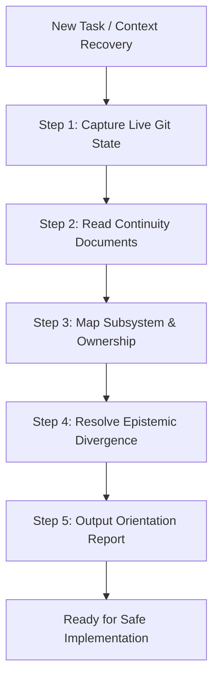

# Jarvis 2.0 Repository Orientation & Engineering Continuity Protocol

The **Jarvis Repository Orientation Protocol** governs how software-engineering agents establish ground truth, recover architectural context, and validate live working-tree conditions before proposing or executing code changes.

Long-running agentic development frequently suffers from cross-session amnesia, reliance on outdated reports, silent overwriting of uncommitted user work, and architectural drift. This skill enforces disciplined, read-only reconnaissance to guarantee that every engineering action begins from verified repository state.

---

## 1. Mission

Provide an empirical, read-only reconnaissance procedure that allows an agent to:
1. Reconcile the live Git baseline against persistent engineering records.
2. Recover subsystem architecture and ownership without hallucinating conventions.
3. Identify relevant test suites, frozen commits, and open constraints.
4. Establish clear boundaries between confirmed facts and technical assumptions.

---

## 2. When to Use

Activate this skill whenever:
- Starting any new engineering task or agent session in the Jarvis 2.0 repository.
- Resuming work after context truncation or session handoff.
- Investigating an unfamiliar subsystem, directory, or module.
- Determining whether prior milestones or workstreams have already resolved an issue.
- Resolving conflicting claims between source code, tests, and documentation.
- Establishing an empirical baseline before planning a multi-file refactoring or bugfix.

## When Not to Use

Do **not** activate this skill:
- As a substitute for implementation: when actively editing code, transition to `jarvis-safe-implementation`.
- For pure test execution: when executing or classifying tests, use `jarvis-test-governance`.
- For dedicated security audits: when evaluating authorization gates, use `jarvis-security-boundary-review`.
- For Win32 ctypes interop: when writing native Windows bindings, use `jarvis-windows-native-interop`.

---

## 3. Required Context & Epistemic Authority Hierarchy

When consulting documentation and repository state, adhere strictly to the 7-layer information hierarchy established in [`docs/architecture/INDEX.md`](../../docs/architecture/INDEX.md):

| Authority Tier | Category | Canonical Paths | Epistemic Reality |
| :---: | :--- | :--- | :--- |
| **Tier 1** | **Observable Execution** | Live test runs, tool outputs, exit codes | **Dynamic Ground Truth:** Live observable output strictly supersedes all written claims. |
| **Tier 2** | **Code Implementation** | `jarvis/`, `tools/` | **Structural AST Reality:** Establishes actual syntax and contracts on disk. |
| **Tier 3** | **Accepted ADRs** | `docs/adr/ADR-*.md` (`ACCEPTED`) | **Approved Invariant Contracts:** Binding architectural decisions. *(Draft `PROPOSED` ADRs are non-binding).* |
| **Tier 4** | **Master Blueprint** | [`JARVIS_2.0_MASTER_ARCHITECTURAL_BLUEPRINT.txt`](../../JARVIS_2.0_MASTER_ARCHITECTURAL_BLUEPRINT.txt) | **Target Architecture:** System design ideals, SLAs, and target specifications. |
| **Tier 5** | **Dynamic Engineering State** | [`docs/agent/PROJECT_STATE.md`](../../docs/agent/PROJECT_STATE.md), [`SESSION_LOG.md`](../../docs/agent/SESSION_LOG.md) | **Verified Snapshot:** Timestamped engineering memory; non-authoritative without live Git verification. |
| **Tier 6** | **Subsystem Map** | [`docs/architecture/PROJECT_MAP.md`](../../docs/architecture/PROJECT_MAP.md), `graphify-out/` | **Navigational Index:** Directory layout, entry points, and module boundaries. |
| **Tier 7** | **Roadmap & Plans** | [`ROADMAP.md`](../../ROADMAP.md), ephemeral notes | **Planning Context:** Aspirational roadmap; non-authoritative for code reality. |

---

## 4. Operating Procedure



### Step 1 — Establish the Live Repository State (Read-Only)

Execute the 3-point Git baseline capture:
```powershell
git branch --show-current
git rev-parse HEAD
git status --short --untracked-files=all
```

**Evaluate Working-Tree State:**
1. **Branch & HEAD:** Record current branch and exact HEAD commit hash.
2. **Historical Anchors:**
   - Phase 2 committed baseline: `c59c0165314106f10689f5cbcda456957e9fe73f`
   - Historical audit baseline: `8c395d3f2aa32effb5236ea716a4cba0b4803f8b`
   Verify how current HEAD relates to these anchors. Never rebase, reset, or alter commits.
3. **Working-Tree Modifications:** Distinguish pre-existing uncommitted modifications and untracked files from changes generated during your session. **Never discard, stash, clean, or overwrite pre-existing user work.**

### Step 2 — Read Targeted Project Continuity Documents

Inspect lines 1–100 of the following core governance documents:
1. [`docs/agent/PROJECT_STATE.md`](../../docs/agent/PROJECT_STATE.md): Current milestone, completed batches, active workstream, and immediate next tasks.
2. [`docs/agent/SESSION_LOG.md`](../../docs/agent/SESSION_LOG.md): Read the most recent session entries at the end of the file to understand recent decisions, test scores, and accepted pull requests.
3. [`docs/agent/LESSONS.md`](../../docs/agent/LESSONS.md): Inspect verified post-mortem failure rules relevant to the task.
4. Active Milestone Plan: e.g., [`ROADMAP.md`](../../ROADMAP.md) or [`docs/milestones/RELIABILITY_AND_ENGINEERING_GOVERNANCE_PLAN.md`](../../docs/milestones/RELIABILITY_AND_ENGINEERING_GOVERNANCE_PLAN.md).

**Identify Governance Invariants:**
- Frozen baselines and protected commits.
- Hard constraints (e.g., zero broad staging, mandatory approval gates).
- Explicit user restrictions or active task boundaries.

### Step 3 — Map the Relevant Subsystem

Consult [`docs/architecture/PROJECT_MAP.md`](../../docs/architecture/PROJECT_MAP.md) to locate canonical implementations:
- **Audio & WASAPI:** `jarvis/audio/` (tts.py, wake_word.py) + `jarvis/core/win32_affinity.py`
- **Cognition & Routing:** `jarvis/core/cognition/` + `jarvis/core/brain_antigravity.py` + `jarvis/core/brain_gemini.py`
- **Context & Memory:** `jarvis/context/context_orchestrator.py` + `jarvis/core/memory/`
- **Security & Authorization:** `jarvis/core/security_boundaries.py` + `jarvis/skills/job_object_sandbox.py`
- **UI & Telemetry:** `jarvis/ui/server.py`
- **Verification Tooling:** `tools/run_fast_tests.py`, `tools/lint.py`, `tools/diagnostics.py`

**Inspect Callers and Downstream Dependencies:**
- Use structural search (`python tools/diagnostics.py search ...`) or Python AST checks to identify call sites.
- Identify relevant test files in `tests/` covering the target module.
- Confirm actual runtime signatures on disk rather than guessing from memory.

### Step 4 — Resolve Epistemic Uncertainty

If documentation, tests, and source code diverge:
1. **Never guess or assume.**
2. Consult the authority hierarchy: Live tool execution > Code AST > Accepted ADRs.
3. If an ADR says `PROPOSED`, treat it as an unaccepted proposal, not a binding invariant.
4. If documentation claims a test passes, but live execution fails, the live failure is reality. Surface the discrepancy explicitly.

### Step 5 — Produce a Concise Orientation Report

Output the structured orientation summary before proposing or making any changes.

---

## 5. Safety and Scope Restrictions

This skill is strictly **read-only**. Agents executing this skill are explicitly **FORBIDDEN** from:
- Running destructive Git commands: `git reset`, `git clean`, `git restore`, `git checkout .`, `git branch -D`.
- Stashing or discarding user work: `git stash`.
- Modifying commit history: `git commit`, `git push`, `git rebase`, `git merge`, `git cherry-pick`.
- Unlinking untracked files or scratch directories.
- Editing production code, test files, or manifests while in orientation mode.
- Citing historical test pass counts as proof of current working tree health without live execution.

---

## 6. Verification Requirements

Before declaring orientation complete:
1. Git branch, HEAD SHA, and modified/untracked file counts must be empirically grounded via tool output.
2. Active milestone, workstream, and open blockers must be identified from `PROJECT_STATE.md`.
3. Canonical module paths for the task must be confirmed to exist on disk.
4. Targeted test files covering the relevant subsystem must be identified.

---

## 7. Required Reporting Format

When completing repository orientation, report findings in this standard structure:

```markdown
### Repository Orientation Summary
- **Repository Root:** <verified absolute path>
- **Branch:** <active branch>
- **HEAD Commit:** <commit SHA> (Status relative to Phase 2 anchor `c59c0165...`)
- **Working Tree:** <N> modified tracked files, <N> untracked items, 0 staged changes
- **Active Milestone:** <Milestone Name> — <Workstream / Task ID>
- **Target Subsystem:** <Canonical Module Paths>
- **Relevant Test Suite:** <tests/test_target.py>
- **Key Architectural Invariants:** <Applicable ADRs, rules, or constraints>
- **Unresolved Ambiguities:** <Any discrepancies surfaced during reconnaissance>
```
