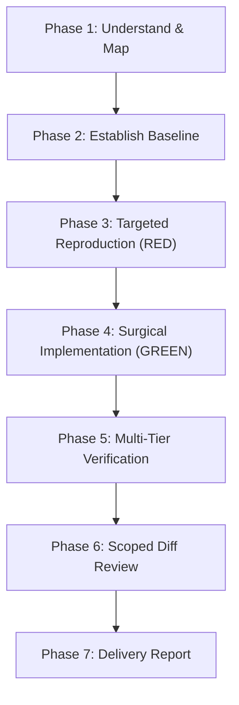

# Jarvis 2.0 Safe Implementation Protocol

The **Jarvis Safe Implementation Protocol** defines the mandatory workflow for authoring production code and tests within the Jarvis 2.0 repository.

Its primary objectives are to eliminate regressions, preserve established architectural and security contracts, prevent unrequested refactorings, and guarantee that every code change is backed by observable, reproducible verification.

---

## 1. Mission

Guide engineering agents through a disciplined, minimal-blast-radius implementation lifecycle:
1. Thoroughly map call sites and constraints before editing files.
2. Establish a dynamic pre-modification baseline.
3. Write targeted reproduction tests (RED) before production fixes (GREEN).
4. Apply surgical edits that preserve backward compatibility and canonical module paths.
5. Verify changes across the 5-tier testing ladder.
6. Conduct diff hygiene audits prior to task handoff.

---

## 2. When to Use

Activate this skill whenever:
- Implementing a new feature, capability, or user-requested behavior.
- Fixing an existing defect, unhandled exception, or edge-case bug.
- Applying a performance optimization or concurrency refactoring.
- Modifying a public interface, tool function, or integration adapter.
- Applying a security patch or input-validation hardening.

## When Not to Use

Do **not** use this skill in isolation when:
- Starting a session without knowing the repository state: run `jarvis-repo-orientation` first.
- Modifying security-sensitive gates: invoke `jarvis-security-boundary-review` to audit threat models and invariants.
- Executing broad suites or classifying tests: follow `jarvis-test-governance`.
- Authoring 64-bit ctypes Win32 bindings: consult `jarvis-windows-native-interop`.

---

## 3. Required Context & Architectural Boundaries

Before modifying code, consult:
- **Canonical Architecture Map:** [`docs/architecture/PROJECT_MAP.md`](../../docs/architecture/PROJECT_MAP.md) — Identify canonical module ownership and maintain compatibility shims (e.g., `jarvis.core.cancellation` vs legacy shims).
- **Security Boundaries:** [`jarvis/core/security_boundaries.py`](../../jarvis/core/security_boundaries.py) and [`.agents/rules/security_boundaries.md`](../../.agents/rules/security_boundaries.md).
- **Execution Invariants:**
  1. Win32 Job Object containment: child processes must spawn suspended (`CREATE_SUSPENDED`) and fail closed on assignment errors.
  2. Database mutations: all SQLite writes must serialize through `SingleWriterActor` with `PRAGMA journal_mode=WAL`.
  3. Preemptive cancellation: respect `GLOBAL_EPOCH_STATE` across synthesis and playback pipelines.
  4. Tool mutations: all mutating tools must bind through `DualKeyApprovalManager`.

---

## 4. The 7-Phase Implementation Workflow



### Phase 1 — Understand Requirements & Map Constraints
1. **Define Task Boundaries:** Identify the exact requested behavior, acceptance criteria, and explicit non-goals. Do not expand the scope into aesthetic cleanups.
2. **Inspect Call Sites & AST:** Read the target module, its callers, and downstream consumers. Use structural diagnostics:
   ```powershell
   python tools/diagnostics.py search "def target_function"
   ```
3. **Map Compatibility Shims:** Check `docs/architecture/PROJECT_MAP.md` Section 5. If modifying a canonical module, ensure re-export shims imported by `tests/` or external consumers remain functional.

### Phase 2 — Establish Dynamic Baseline
Before modifying production files, execute the existing test suite covering the affected module:
```powershell
python tools/run_fast_tests.py tests/test_<target>.py
```
Record the initial status:
- Note any pre-existing failures or environmental skips (e.g., Winsock loopback restrictions).
- Never attribute pre-existing failures to the current change; never claim a suite was clean without running it.

### Phase 3 — Targeted Reproduction (RED Test)
For bugfixes and behavioral extensions, write or update a targeted deterministic test before modifying production code:
1. Locate or create the targeted test in `tests/test_<subsystem>.py`.
2. Ensure the test exercises the defect or new requirement specifically.
3. Run the test and confirm it fails as expected (RED) or demonstrates the missing behavior.
*(Exception: Documentation updates, static typing annotations, or environment-only configuration do not require RED tests if automated reproduction is infeasible).*

### Phase 4 — Implement the Smallest Sufficient Change (GREEN)
Author the minimal surgical edit required to satisfy the requirement:
1. **Preserve Contracts:** Retain existing function signatures, default parameter values, and return types.
2. **Fail Closed:** Ensure all failure, timeout, and exception paths fail closed safely. Log errors with contextual telemetry (`logger.debug` or `logger.error`), but never leak secrets or raw unconfined paths.
3. **Zero Inlined Fallbacks:** Never replace an atomic operation with a non-atomic in-place copy (e.g., never use `shutil.copyfile` as a fallback for atomic file replacement).
4. **No Speculative Abstractions:** Do not create generic wrapper classes, extra helper files, or unused utilities.

### Phase 5 — Multi-Tier Verification Ladder
Execute verification in escalating tiers using the project's diagnostic tooling:
```powershell
# 1. Fast static syntax & undefined-name check (<20ms)
python tools/lint.py check <modified_files>

# 2. Structural AST invariant scanner
python tools/diagnostics.py check <modified_files>

# 3. Targeted test execution
python tools/run_fast_tests.py tests/test_<target>.py

# 4. Security regression runner (if modifying tools, sandbox, or auth)
python tools/run_fast_tests.py --security

# 5. Fast parallel regression suite (if modifying shared core/memory/pipeline)
python tools/run_fast_tests.py --fast -w 4
```

### Phase 6 — Review Final Working-Tree Diff
Audit all working-tree changes before declaring work complete:
```powershell
# Audit whitespace and line-ending hygiene (must return 0 output)
git diff --check

# Inspect full staged and unstaged diff
git diff <modified_files>
git status --short
```
**Verify Diff Invariants:**
- [ ] Zero unrelated file modifications.
- [ ] Zero weakened assertions or deleted test cases.
- [ ] Zero broad exception swallowing (`except:` without logging or re-raising).
- [ ] Zero hardcoded credentials, API keys, or absolute local paths.
- [ ] Zero newly introduced scratch scripts or orphan files in source directories.

### Phase 7 — Evidence-Based Delivery Reporting
Produce an objective technical report stating exact command outputs, exit codes, modified files, and verified behavior.

---

## 5. Safety and Scope Restrictions

Engineering agents operating under this protocol must adhere to these hard safety rules:
- **No Speculative Rewrites:** Never rewrite an entire module or subsystem to fix a localized bug.
- **No Weakened Tests:** Never change test assertions, remove test cases, or add skips merely to turn a test run green.
- **No Git Mutations:** Never run `git commit`, `git push`, `git reset`, `git checkout`, or `git clean` without explicit user instruction.
- **No Broad Staging:** Never run `git add -A` or `git add .`. Stage files explicitly by exact path.
- **No Silent Scope Expansion:** If an implementation requires changes outside authorized boundaries, stop and report the dependency to the user.

---

## 6. Verification Requirements

A task is verified **only** when supported by:
1. Observable tool output showing exit code `0` from `tools/lint.py check`.
2. Observable tool output showing exit code `0` from `tools/diagnostics.py check`.
3. Passing targeted unit test output from `tools/run_fast_tests.py`.
4. Clean `git diff --check` output with zero whitespace violations.

---

## 7. Required Reporting Format

When reporting completed implementation work, use this structured format:

```markdown
### Safe Implementation Summary
- **Objective:** <Short description of feature/fix>
- **Target Files Modified:**
  - `<file_path>` (<brief summary of surgical change>)
- **Verification Evidence:**
  - `tools/lint.py check`: Passed (0 errors, Exit code 0)
  - `tools/diagnostics.py check`: Passed (0 AST violations, Exit code 0)
  - `tools/run_fast_tests.py <test_path>`: Passed (<P> passed, <F> failed, <S> skipped in <X>s, Exit code 0)
  - `git diff --check`: Clean (0 whitespace errors)
- **Architectural Contracts Preserved:** <List verified shims, security gates, or interfaces>
- **Remaining Limitations / Unverified Areas:** <Explicit statement of any mock vs OS limitations>
```
