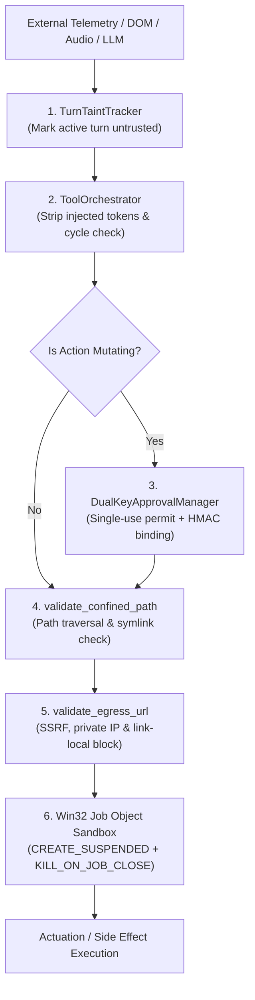

# Jarvis 2.0 Security Boundary Review Protocol

The **Jarvis Security Boundary Review Protocol** defines the defensive auditing standard for reviewing, modeling threats, and designing regression tests across security-critical subsystems in Jarvis 2.0.

Desktop AI assistants possess powerful actuation capabilities—launching child processes, reading the local filesystem, automating web browsers, and communicating with cloud LLM providers. This protocol ensures that authorization gates, provenance tracking, network egress filters, and process containment are audited rigorously against adversarial threat models before code changes are approved.

---

## 1. Mission

Provide a structured, multi-angle security auditing methodology that:
1. Traces untrusted data flows from external ingestion sinks to sensitive execution sinks.
2. Validates dual-key human approval binding and action-token single-use lifecycles.
3. Audits filesystem path confinement and SSRF network egress validation.
4. Verifies kernel-level Win32 Job Object containment and suspended child process creation.
5. Formulates deterministic security regression test specifications.
6. Maintains a strict separation between read-only security auditing and code implementation.

---

## 2. When to Use

Activate this skill whenever reviewing or planning modifications to:
- Mutating tool dispatch and action authorization gates ([`jarvis/core/security_boundaries.py`](../../jarvis/core/security_boundaries.py)).
- Human-in-the-loop approval mechanisms (`DualKeyApprovalManager`).
- Ambient telemetry, web content, or process output taint tracking (`TurnTaintTracker`).
- Local filesystem access, path validation, or reparse-point resolution (`validate_confined_path`).
- Outbound network requests, WebSockets, or HTTP clients (`validate_egress_url`).
- Child process spawning and sandbox containment ([`jarvis/skills/job_object_sandbox.py`](../../jarvis/skills/job_object_sandbox.py)).
- Memory prompt-injection envelopes and attention boundaries ([`jarvis/context/context_orchestrator.py`](../../jarvis/context/context_orchestrator.py)).
- Multi-provider failover deduplication and side-effect replay safety.

## When Not to Use

Do **not** use this skill:
- For general repository orientation: use `jarvis-repo-orientation`.
- To implement code modifications: conduct the review first, then use `jarvis-safe-implementation`.
- For standard unit test running: follow `jarvis-test-governance`.

---

## 3. Strict Review-Versus-Implementation Separation

> [!IMPORTANT]
> **READ-ONLY AUDIT MANDATE:** During a security boundary review, the agent acts strictly as an auditor.
> Reviewers must inspect ASTs, trace data flow, document findings, and propose regression tests.
> **Never silently modify production code during a security audit.** Code changes require explicit user authorization and must follow `jarvis-safe-implementation`.

---

## 4. Authoritative Security Invariants & Canonical Gates

All security audits must enforce the invariants codified in [`.agents/rules/security_boundaries.md`](../../.agents/rules/security_boundaries.md) and repository ADRs:



### Invariant 1: Action-Bound Dual-Key Approval (`DualKeyApprovalManager`)
- All mutating operations (file edits, process launches, system setting modifications) must route through `DualKeyApprovalManager` ([ADR-004](../../docs/adr/ADR-004-dual-key-tool-authorization-turn-taint.md)).
- Approval permits must be single-use, action-bound (binding exact tool name, canonical target path, and argument digests), and time-bounded.
- Replayed, forged, or expired permits must fail closed immediately with `Critical Authorization Gate`.
- Model-generated text or conversational confirmation never constitutes authority.

### Invariant 2: Filesystem Confinement (`validate_confined_path`)
- All file reads and writes must validate paths against authorized directory boundaries.
- Paths must be resolved to their real physical target (`Path.resolve()`) to neutralize path traversal (`../`) and Windows directory junction / symlink bypasses.

### Invariant 3: Network Egress & SSRF Protection (`validate_egress_url`)
- All outbound HTTP/WebSocket requests must validate the destination URL ([ADR-006](../../docs/adr/ADR-006-egress-validation-ip-pinning.md)).
- Must reject private IP ranges (RFC 1918), localhost loopbacks (`127.0.0.0/8`, `::1`), link-local addresses (`169.254.0.0/16`), and cloud metadata services (`169.254.169.254`).
- Sockets must pin the resolved IP address to defeat DNS rebinding TOCTOU attacks.

### Invariant 4: Taint Tracking & Provenance Isolation (`TurnTaintTracker`)
- All external inputs (web scrape DOMs, clipboard contents, subprocess stdout/stderr, user audio) are untrusted inert data.
- When an external tool executes, `TurnTaintTracker` marks the active turn tainted. Tainted turns must not drive mutating actions without explicit human re-authorization.
- Persistent writes to memory or calendar entries require explicit source origin recording.

### Invariant 5: Win32 Process Containment (Job Object Sandbox)
- Every child process managed by the sandbox must spawn suspended using `CREATE_SUSPENDED` ([ADR-002](../../docs/adr/ADR-002-win32-job-object-containment.md)).
- The process must be assigned to a Win32 Job Object configured with `JOB_OBJECT_LIMIT_KILL_ON_JOB_CLOSE` *before* execution resumes.
- If assignment fails, the suspended process must be immediately terminated (`TerminateProcess`), open handles closed, and execution failed closed (`RuntimeError`). Never permit an uncontained process to run.

### Invariant 6: Side-Effect Idempotency & Provider Cascade Safety
- Mid-turn tool execution must suppress duplicate failover: if a tool has already completed during a turn (`had_tool_call`), downstream provider errors must return the completed action result rather than cascading to a secondary provider and replaying side effects.

---

## 5. The 8-Step Review Procedure

### Step 1 — Establish Threat Model & Assets
Identify the assets at risk (local filesystem, OS processes, user credentials, memory databases) and define entry points (user prompts, untrusted web content, IPC pipes, ambient vision/screen data).

### Step 2 — Trace Complete Execution Path
Map data flow from source to sink:
1. Entry point -> normalization -> validation -> authorization gate -> tool actuation -> output capture.
2. Ensure no alternate code paths bypass authorization checks.

### Step 3 — Audit Authorization & Permit Binding
Verify:
- Is authorization checked at the true enforcement boundary, not in a superficial UI wrapper?
- Are approval tokens bound to exact argument hashes?
- Does an authorization rejection fail closed?

### Step 4 — Audit Taint & Provenance Propagation
Inspect whether:
- Taint flags survive data transformations.
- Untrusted content is properly encapsulated (e.g. within `<untrusted_content>` tags) to prevent indirect prompt injection.

### Step 5 — Audit Side-Effect Safety & Replay Resistance
Inspect retry loops and provider cascades:
- Can network timeouts cause a mutating tool to be called twice?
- Does the idempotency ledger correctly identify identical calls within the same conversational turn?

### Step 6 — Audit Resource & OS Sandbox Boundaries
Inspect native handles, files, and processes:
- Are file descriptors and Win32 handles closed on all exception paths?
- Is process execution contained in Job Objects without handle leakage?

### Step 7 — Formulate Security Regression Test Specifications
Design deterministic negative and positive tests:
1. **Positive Test:** Legitimate, authorized operation with valid permit succeeds.
2. **Negative Test A (Unauthorized):** Action attempted without permit fails closed.
3. **Negative Test B (Forged/Tampered):** Permit with altered arguments is rejected.
4. **Negative Test C (Replay):** Reused single-use permit is rejected.
5. **Negative Test D (Traversal/SSRF):** Malformed path or private IP is rejected.

### Step 8 — Produce Structured Security Audit Report
Compile findings into the standard reporting format.

---

## 6. Finding Severity & Classification Schema

Classify findings using the repository's standard risk criteria:
- **CRITICAL:** Remote code execution, arbitrary command injection, authorization bypass, sandbox escape, or credential theft.
- **HIGH:** Path traversal, SSRF to internal network, side-effect replay leading to state corruption, or silent failure to enforce approval gates.
- **MEDIUM:** Incomplete taint tracking, exception messages leaking sensitive file paths, or race conditions in handle cleanup.
- **LOW:** Inconsistent error reporting, missing audit log metadata, or redundant permission checks.
- **INFORMATIONAL:** Hardening suggestions, defense-in-depth opportunities, or documentation clarifications.

---

## 7. Safety and Scope Restrictions

- **Never Weaken Authorization:** Never propose bypassing, softening, or removing approval gates to make tests or developer workflows more convenient.
- **Never Trust Model Output:** Treat all LLM-generated arguments as untrusted inputs requiring strict validation.
- **No Blanket Grants:** Never authorize wildcards (`*`) or unrestricted directory traversal.
- **No In-Place Edits:** Do not edit production code while conducting a review under this skill.

---

## 8. Required Reporting Format

Conclude every security boundary review with this structured document:

```markdown
### Security Boundary Review Report
- **Subsystem / Target:** <Module path and primary classes>
- **Threat Model Scope:** <Protected assets and untrusted inputs evaluated>
- **Audit Findings:**
  | Finding ID | Severity | Confidence | Affected File & Line | Summary & Invariant Violated |
  | :--- | :--- | :--- | :--- | :--- |
  | SEC-01 | HIGH | CONFIRMED | `jarvis/core/...:123` | <Description of bypass or flaw> |
- **Detailed Finding Analysis (for each finding):**
  - **Preconditions:** <What must be true to trigger the flaw>
  - **Impact:** <Potential consequence to system security>
  - **Remediation Specification:** <Exact architectural fix required>
  - **Proposed Regression Test:** <Test scenario in tests/test_...py>
- **Review Verdict:** [READY TO IMPLEMENT | REJECTED - CRITICAL DEFECTS FOUND | NO VULNERABILITIES IDENTIFIED]
```
