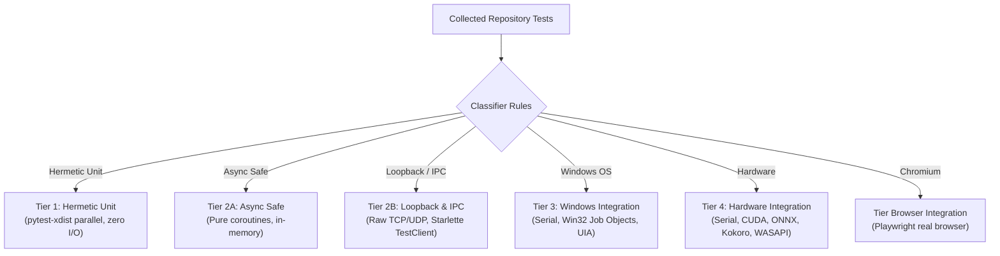

# Jarvis 2.0 Test Governance & Execution Protocol

The **Jarvis Test Governance Protocol** defines the operational standards for authoring, isolating, running, classifying, and reporting tests across the Jarvis 2.0 codebase.

In Jarvis 2.0, testing is not merely running `pytest`. It is a governed, parent-supervised multi-tier execution architecture designed to prevent test hangs, eliminate cross-test database corruption, enforce Win32 Job Object process containment, and guarantee complete manifest accounting.

---

## 1. Mission

Provide standard operating procedures for:
1. Selecting the correct test tier and execution command based on task blast radius.
2. Preserving strict hermetic environment isolation (SQLite memory, filesystem, Winsock loopback).
3. Maintaining test integrity without weakening assertions, deleting tests, or adding evasive skips.
4. Enforcing rigorous outcome classification (`PASSED`, `FAILED`, `SKIPPED`, `BLOCKED`, `NOT COLLECTED`).
5. Maintaining zero-orphan test manifest accounting via canonical classifier tooling.

---

## 2. When to Use

Activate this skill whenever:
- Writing new unit, integration, or regression tests in `tests/`.
- Diagnosing, reproducing, or fixing test failures.
- Executing targeted tests or broad regression suites via `tools/run_fast_tests.py`.
- Classifying test nodes and updating `data/test_classification_manifest.json`.
- Investigating flaky, hung, or environment-dependent tests (e.g. Winsock WSAEACCES 10013).
- Compiling formal verification scorecards for engineering session handoffs.

## When Not to Use

Do **not** use this skill:
- For general repository orientation: use `jarvis-repo-orientation`.
- For production implementation procedures: use `jarvis-safe-implementation`.
- For security boundary and threat modeling reviews: use `jarvis-security-boundary-review`.

---

## 3. The 4-Tier Test Architecture & Classifier Matrix

The repository governs all tests through [`tools/test_classifier.py`](../../tools/test_classifier.py) and [`tools/run_fast_tests.py`](../../tools/run_fast_tests.py) across distinct operational tiers:



| Tier Name | Constant in `test_classifier.py` | Characteristics & Execution Constraints |
| :--- | :--- | :--- |
| **Tier 1** | `tier1_hermetic_unit` | Fast, mock-isolated unit tests. Parallelized across worker processes (`-w 4`). Zero live network, zero hardware, zero real browser. |
| **Tier 2A** | `tier2a_async_safe` | Pure in-memory coroutines, event loops, and streaming parsers without raw loopback socket listeners. |
| **Tier 2B** | `tier2b_loopback_ipc` | Tests requiring real `127.0.0.1` sockets, named pipes, or Starlette server endpoints. Gated by `probe_loopback_available()`. |
| **Tier 3** | `tier3_windows_integration` | Serial execution only. Interacts with real Windows OS desktop handles, MMCSS elevation, or Win32 Job Objects. |
| **Tier 4** | `tier4_hardware_integration` | Serial execution only. Requires physical hardware devices: NVIDIA CUDA GPUs, ONNX neural models, or WASAPI audio endpoints. |
| **Browser** | `tier_browser_integration` | Real Chromium / Playwright process launches with network boundary guards. |

---

## 4. Canonical Test Execution Commands

Always use the project's canonical test supervisor tools. **Never invoke naked `pytest` or invent improvised test commands.**

```powershell
# 1. Targeted Unit / Subsystem Test (Fastest developer loop)
python tools/run_fast_tests.py tests/test_<target>.py

# 2. Canonical Security Regression Runner (14 core security suites)
python tools/run_fast_tests.py --security

# 3. Fast Parallel Suite (Tier 1 hermetic unit tests across 4 workers)
python tools/run_fast_tests.py --fast -w 4

# 4. Hardware Serial Suite (Tier 4 CUDA, ONNX, and Audio tests)
python tools/run_fast_tests.py --hardware

# 5. Full Repository Gate (Fast parallel suite + Serial hardware suite)
python tools/run_fast_tests.py --all

# 6. Re-execute Only Previously Failed Tests
python tools/run_fast_tests.py --failed

# 7. Manifest Integrity & Orphan Node Inspection
python tools/test_classifier.py --check-orphaned

# 8. Export Test Classification Manifest
python tools/test_classifier.py --export data/test_classification_manifest.json
```

---

## 5. Operating Procedure

### Step 1 — Classify the Test Scope
Before running tests:
1. Identify which source files and behaviors changed.
2. Determine the affected tier (Unit, Async, Loopback, Windows OS, Hardware).
3. Determine whether security gates were touched (requires `python tools/run_fast_tests.py --security`).
4. Begin with the smallest targeted test file before escalating to broader suites.

### Step 2 — Execute via Canonical Runners
Run the chosen command via `tools/run_fast_tests.py`. Inspect stdout, stderr, execution duration, and exit code.
- If running under sandbox conditions, verify whether environmental constraints apply (e.g. Winsock WSAEACCES 10013 loopback filtering).
- If a command times out or is backgrounded, await completion; never assume success without observable logs.

### Step 3 — Preserve Test Integrity
Tests must represent rigorous, independent verification.
- **Never delete failing tests** to force a passing build.
- **Never add `@unittest.skip` or `pytest.mark.skip`** merely to conceal a defect. Skips are strictly reserved for unfulfilled environmental dependencies (e.g., missing CUDA hardware or missing live integration credentials).
- **Never weaken assertions:** Do not change `assertEqual(res, expected)` to `assertIsNotNone(res)` or catch and ignore assertion failures.
- **Never mock away the code under test:** Mocks must isolate external dependencies (e.g. external network or GPU), never the core logic under validation.

### Step 4 — Enforce Hermetic Resource & SQLite Isolation
Any test exercising persistent memory, databases, or filesystem state must adhere to the hermetic isolation standard:
```python
import tempfile
import unittest
from pathlib import Path

class HermeticAuditTest(unittest.TestCase):
    def setUp(self) -> None:
        # Create dedicated isolated temporary directory per test instance
        self.temp_dir = tempfile.TemporaryDirectory()
        self.workspace = Path(self.temp_dir.name)
        # Point SQLite / Memory paths strictly to this temporary workspace
        self.db_path = self.workspace / "test_memory.db"
        # Explicitly instantiate isolated test objects

    def tearDown(self) -> None:
        # Explicitly close connections before unlinking directory
        if hasattr(self, "memory") and self.memory:
            self.memory.close()
        self.temp_dir.cleanup()
```
**Strict Isolation Rules:**
- **Zero writes to `data/jarvis_memory.db`:** Writing to the production database during a test run is a critical defect.
- **Safe under parallel execution:** Because `-w 4` executes tests concurrently across multiple worker processes, shared file paths cause immediate file-lock collisions on Windows NTFS. Every test instance must own its unique path.

### Step 5 — Rigorous Outcome Classification
Report test results using exact, evidence-grounded classifications:

| Status | Definition | Criteria |
| :--- | :--- | :--- |
| **PASSED** | Verification succeeded | The test executed, all assertions passed, and the process exited with code `0`. |
| **FAILED** | Defect or regression detected | The test executed and an `AssertionError` or unhandled exception was raised. |
| **SKIPPED** | Intentional platform/env bypass | The test was evaluated and skipped due to a documented precondition (e.g. `JARVIS_RUN_LIVE_INTEGRATION=1`). |
| **BLOCKED** | Environment/Sandbox restriction | Test execution was prevented by an external environment boundary (e.g. WSAEACCES 10013 loopback filter). |
| **NOT COLLECTED**| Out of scope | Test node was not included in the runner's collection filter. |

**Evidence Hierarchy:**
1. A zero exit code (`Exit code: 0`) does **not** prove success if stdout/stderr reports test failures.
2. Passing a mocked test does **not** prove real Windows OS or hardware functionality.
3. Never report historical passing counts from documentation as current test execution results.

### Step 6 — Manifest Accounting & Governance
When adding new test files or methods:
1. Run `python tools/test_classifier.py --check-orphaned` to detect unclassified nodes.
2. If new tests exist, export the refreshed manifest:
   ```powershell
   python tools/test_classifier.py --export data/test_classification_manifest.json
   ```
3. Verify that `check-orphaned` returns:
   `PASSED: Manifest integrity confirmed. 0 orphans, 0 duplicates, <N> nodes verified.`
4. Confirm 100% classification: zero unclassified nodes.

---

## 6. Safety and Scope Restrictions

- **No Assertions Without Logs:** Never assert that a test passed without citing the exact test name, execution time, and exit code from live tool output.
- **No Broad Staging:** Never stage test files with `git add .` or `git add -A`.
- **No Production Schema Alterations:** Never alter production SQLite schema definitions to satisfy test mock shortcuts.
- **No Destructive Operations:** Never run integration tests that delete user directories or terminate external system processes.

---

## 7. Required Reporting Format

When reporting test execution or governance updates, use this exact scorecard:

```markdown
### Test Execution Scorecard
- **Command:** `python tools/run_fast_tests.py <args>`
- **Exit Code:** <0 or non-zero>
- **Execution Time:** <X.XX>s
- **Test Counts:**
  - **Passed:** <count>
  - **Failed:** <count>
  - **Skipped:** <count> (List exact test names and skip reasons)
  - **Blocked:** <count> (List environmental or sandbox constraints)
  - **Total Collected:** <count>
- **Manifest Accounting:**
  - `tools/test_classifier.py --check-orphaned`: Passed (0 orphans, 0 duplicates, <total> nodes verified)
- **Isolation Verification:** Verified hermetic temporary databases; zero writes to `data/jarvis_memory.db`.
```
