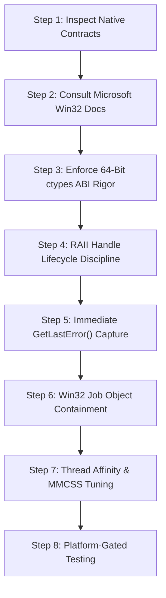

# Jarvis 2.0 Windows Native Interoperability & Win32 Systems Protocol

The **Jarvis Windows Native Interoperability Protocol** establishes the engineering standards for developing, auditing, and maintaining low-level Windows OS integrations, C foreign function interfaces (`ctypes`), kernel handle lifecycles, and Win32 filesystem operations in Jarvis 2.0.

Because Jarvis 2.0 interacts deeply with the Windows operating system—managing real-time audio threads via MMCSS, pinning CPU affinities across hybrid P/E-cores, sandboxing untrusted child processes in Win32 Job Objects, and performing atomic registry swaps—subtle errors in C calling conventions, 64-bit pointer sizing, handle ownership, or Win32 flag usage can cause catastrophic memory corruption, access violations (`0xC0000005`), or security vulnerabilities.

---

## 1. Mission

Provide standard operating procedures for:
1. Guaranteeing 64-bit ABI correctness and pointer integrity across all `ctypes` bindings.
2. Preventing memory leaks, handle exhaustion, and double-close crashes via RAII handle patterns.
3. Managing kernel-level Win32 Job Object process containment.
4. Implementing atomic filesystem operations with correct ACL preservation and durability semantics.
5. Accurately capturing and diagnosing Win32 error codes via `GetLastError()`.
6. Enforcing the distinction between mock-isolated test harnesses and real Windows OS execution evidence.

---

## 2. When to Use

Activate this skill whenever:
- Authoring, reviewing, or modifying `ctypes` bindings or `WinDLL` calls.
- Interacting with `kernel32.dll`, `user32.dll`, `ole32.dll`, `avrt.dll`, or `ntdll.dll`.
- Modifying Win32 Job Object sandbox process containment ([`jarvis/skills/job_object_sandbox.py`](../../jarvis/skills/job_object_sandbox.py)).
- Managing Windows OS handles (`HANDLE`, `HWND`, `HHOOK`, `HDC`, `HKEY`).
- Tuning thread scheduling, MMCSS Pro Audio elevation, or hybrid CPU core affinities ([`jarvis/core/win32_affinity.py`](../../jarvis/core/win32_affinity.py)).
- Implementing atomic file replacements (`ReplaceFileW`) or filesystem lock files ([`jarvis/core/antigravity_bridge.py`](../../jarvis/core/antigravity_bridge.py)).
- Handling Windows reparse points, junctions, or symbolic links.
- Debugging native Windows error codes (`ERROR_ACCESS_DENIED`, `ERROR_INVALID_HANDLE`, etc.).

## When Not to Use

Do **not** use this skill:
- For platform-independent Python logic: use `jarvis-safe-implementation`.
- For pure testing governance: follow `jarvis-test-governance`.
- For threat modeling and approval gates: use `jarvis-security-boundary-review`.

---

## 3. Critical Architectural Caution: `ReplaceFileW` & Atomic File Replacement

> [!CAUTION]
> **UNSUPPORTED DURABILITY FLAG WARNING (`ReplaceFileW`):**
> Microsoft's official Win32 documentation explicitly states that `REPLACEFILE_WRITE_THROUGH` (`0x00000001`) is **not supported** in `ReplaceFileW`.
> - **Never pass `0x00000001`** to `ReplaceFileW` under the assumption that it guarantees synchronous disk flushing.
> - **Always pass `dwReplaceFlags = 0`** for standard replacement with default metadata and DACL merging.
> - **Strictly exclude `REPLACEFILE_IGNORE_MERGE_ERRORS (0x02)` and `REPLACEFILE_IGNORE_ACL_ERRORS (0x04)`:** Including these flags permits `ReplaceFileW` to succeed while silently stripping the original file's security descriptors and DACLs.

### The Correct Durability & Namespace Replacement Architecture
Separate content durability from atomic namespace replacement:
1. **Staging Content Durability:** Write the temporary staging file (`.tmp`), invoke `f.flush()`, `os.fsync(f.fileno())`, and synchronously flush OS buffers to physical media via `ctypes.windll.kernel32.FlushFileBuffers(h_file)` using a valid `GENERIC_WRITE` handle (`msvcrt.get_osfhandle(f.fileno())`).
2. **Atomic Namespace Swap:** Close the staging handle and execute `tmp_lock.replace(lock_file)` or fallback to `kernel32.ReplaceFileW(lock_file, tmp_lock, None, 0, None, None)`.
3. **Handle Partial-Failure States Rigorously:**
   - **`1175` (`ERROR_UNABLE_TO_REMOVE_REPLACED`):** Both files retain original names. The existing destination is 100% intact; safely unlink staging `tmp_lock` and fail closed (`return False`).
   - **`1176` (`ERROR_UNABLE_TO_MOVE_REPLACEMENT`):** The replaced file no longer exists under its original name; the replacement retains its temporary name. **MUST NOT unlink `tmp_lock`**—it holds the only remaining valid copy! Preserve it as a recovery artifact.
   - **`1177` (`ERROR_UNABLE_TO_MOVE_REPLACEMENT_2`):** Both files may have altered names and attributes. **MUST NOT unlink `tmp_lock` or destination**. Preserve all artifacts for forensic recovery.
   - **Other Win32 errors:** Clean staging `tmp_lock` and preserve destination.
4. **Never Use Non-Atomic Fallbacks:** Never fall back to in-place truncation, `shutil.copyfile`, or manual read-write loops when replacement fails.

---

## 4. The 8-Step Operating Procedure



### Step 1 — Inspect Native Contracts & Call Sites
Inspect the foreign function signature, caller expectations, and memory ownership:
- Is the function imported via `WinDLL` or `CDLL`? (Win32 API uses `__stdcall`, requiring `WinDLL`).
- Are arguments passed as pointers, handles, or direct values?

### Step 2 — Verify Authoritative Microsoft Win32 Semantics
Never guess function signatures or flag bitmasks:
- Consult official Microsoft Learn documentation for the exact API.
- Verify supported flags on Windows 11 64-bit.
- Identify return value semantics (e.g., `BOOL` non-zero for success vs. pointer return values).

### Step 3 — Enforce 64-Bit ctypes ABI Rigor
Python's `ctypes` defaults to 32-bit `c_int` return types. On 64-bit Windows, pointer truncation causes silent high-memory truncation above `0x7FFFFFFF`, yielding intermittent crashes (`0xC0000005` Access Violation):
```python
import ctypes
from ctypes import wintypes

# 1. Always load WinDLL with last-error support
kernel32 = ctypes.WinDLL("kernel32", use_last_error=True)
user32 = ctypes.WinDLL("user32", use_last_error=True)

# 2. Always declare explicit argtypes and restype
kernel32.OpenProcess.restype = wintypes.HANDLE
kernel32.OpenProcess.argtypes = [wintypes.DWORD, wintypes.BOOL, wintypes.DWORD]

kernel32.CloseHandle.restype = wintypes.BOOL
kernel32.CloseHandle.argtypes = [wintypes.HANDLE]

# 3. For 64-bit pointer-sized return values, use correct types
user32.GetWindowLongPtrW.restype = ctypes.c_ssize_t
user32.GetWindowLongPtrW.argtypes = [wintypes.HWND, ctypes.c_int]
```

**Callback Garbage-Collection Guard:**
When passing callbacks (`WINFUNCTYPE`) to native hooks (`SetWinEventHook`, `SetWindowsHookExW`), store the delegate on an instance attribute (`self._delegate = WINEVENTPROC(self._callback)`). If stored only as a local variable, Python's garbage collector frees the function pointer, causing a fatal crash the next time the OS invokes the hook.

### Step 4 — Handle Lifecycle & RAII Discipline
Every created or duplicated handle must be closed exactly once:
```python
h_process = kernel32.OpenProcess(PROCESS_QUERY_INFORMATION, False, pid)
if not h_process:
    err = ctypes.get_last_error()
    raise OSError(f"OpenProcess failed: Win32 error {err}")
try:
    # Perform operations with h_process
    pass
finally:
    kernel32.CloseHandle(h_process)
```
- **Borrowed vs Owned Handles:** Never close pseudo-handles returned by `GetCurrentProcess()` or `GetCurrentThread()` (`-1` and `-2`). Never close borrowed handles managed by external subsystems.
- **Double-Close Defense:** Set closed handle variables to `None` or `INVALID_HANDLE_VALUE` immediately after closing.

### Step 5 — Immediate & Uncorrupted Error Handling
Win32 functions set thread-local error codes via `SetLastError`.
- Capture `ctypes.get_last_error()` or `kernel32.GetLastError()` **immediately** after the failing foreign call.
- Do not execute intermediate Python logging, formatting, or other foreign calls before capturing the error code; foreign calls can overwrite the error state.

### Step 6 — Win32 Job Object Process Containment
All child processes executed by Jarvis tools must be contained in kernel Job Objects ([ADR-002](../../docs/adr/ADR-002-win32-job-object-containment.md)):
1. Create Job Object: `CreateJobObjectW(None, None)`.
2. Configure Limit: Set `JOB_OBJECT_LIMIT_KILL_ON_JOB_CLOSE (0x2000)` via `SetInformationJobObject`.
3. Spawn Suspended: Pass `CREATE_SUSPENDED (0x00000004)` in `dwCreationFlags`.
4. Assign Process: Call `AssignProcessToJobObject(h_job, h_process)`.
5. Fail Closed: If assignment fails, immediately terminate the suspended process (`TerminateProcess(h_process, 1)`), close handles, and raise `RuntimeError`.
6. Resume Process: Only resume execution (`ResumeThread(h_thread)`) *after* assignment succeeds.

### Step 7 — Thread Affinity & MMCSS Audio Scheduling
In `jarvis/core/win32_affinity.py` ([ADR-005](../../docs/adr/ADR-005-win32-hardware-core-affinity.md)):
- Pin WASAPI real-time audio playback to Logical CPUs 0–1 (`0x0003`) with MMCSS Pro Audio elevation via `avrt.AvSetMmThreadCharacteristicsW("Pro Audio", ...)`.
- Pin Kokoro neural TTS synthesis to Performance Compute Cores (`0x00FC`).
- Pin background maintenance tasks to Efficiency Cores (`0xFF00`) with Windows EcoQoS power throttling (`PROCESS_POWER_THROTTLING_EXECUTION_SPEED`).

### Step 8 — Platform-Gated Testing
Always distinguish mock unit tests from real Windows OS execution:
- Tests using `FakeKernel32` or mocks verify control flow, not operating system semantics.
- Tests exercising real kernel handles, named pipes, or Job Objects must run serially and check `sys.platform == "win32"`.
- When reporting test results, clearly separate mock verification from host OS integration evidence.

---

## 5. Safety Restrictions and Prohibited Anti-Patterns

- **Never Guess API Signatures:** Declaring incorrect `argtypes` or `restype` leads to silent memory corruption.
- **Never Ignore Return Values:** Every foreign function return value must be checked for failure before proceeding.
- **Never Use In-Place File Fallbacks:** Do not substitute non-atomic file copies when an atomic replacement fails.
- **Never Close External Handles:** Do not close handles whose lifecycle belongs to another process or module.
- **No Swallowed Access Violations:** Never catch `OSError` or `Exception` to conceal access violations (`0xC0000005`) or invalid handle errors (`ERROR_INVALID_HANDLE`).

---

## 6. Verification Requirements

Before declaring native Win32 changes verified:
1. `argtypes` and `restype` must be explicitly declared for every Win32 foreign function.
2. 64-bit pointer and handle widths must be confirmed using `wintypes` or `ctypes.c_ssize_t`.
3. All resource acquisition must be bounded by `try...finally` cleanup.
4. Targeted unit tests must pass without handle leaks or unhandled Win32 error codes.
5. `tools/lint.py check` must report 0 errors on modified files.

---

## 7. Required Reporting Format

When reporting Windows native systems work, use this structured format:

```markdown
### Windows Native Systems Verification Report
- **Target Native APIs:** `<API_Name>` (`<dll_name>.dll`)
- **ABI & Signature Declarations:**
  - `argtypes`: `[<types>]`
  - `restype`: `<type>`
- **Handle Lifecycle & Ownership:** <Documented open/close pairing and RAII strategy>
- **Error Handling & Error Codes:** Verified immediate capture of `GetLastError()` (<codes handled>)
- **Durability & Filesystem Semantics:**
  - Staging Buffer Flush: `FlushFileBuffers` on `GENERIC_WRITE` handle
  - Replacement Flags: `dwReplaceFlags = 0` (No merge-ignore flags)
  - Partial-Failure States: Handled 1175 (clean), 1176 (preserve tmp), 1177 (preserve all)
- **Verification Method:** [Real Host OS Execution | Mocked Test Harness]
- **Targeted Test Execution:** `python tools/run_fast_tests.py <test_path>` (<P> passed, Exit code 0)
```
