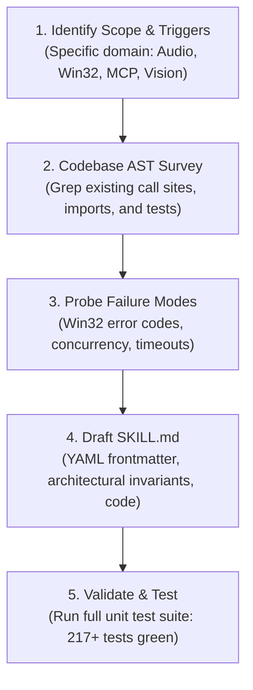

# Agent Skill Creator & Standardization Guide

This meta-skill defines the official engineering workflow for creating, structuring, and maintaining **Agent Skills** (`.agents/skills/<skill-name>/SKILL.md`) in the Jarvis 2.0 repository.

Agent Skills provide modular, progressive on-demand knowledge and procedures to AI coding assistants without polluting the core context window.

---

## 1. Skill Folder Anatomy & Standard Layout

Every skill must reside in its own subdirectory under `.agents/skills/<name>/`:

```
.agents/skills/<skill-name>/
├── SKILL.md            # Mandatory: Main instruction file with YAML frontmatter
├── scripts/            # Optional: Standalone Python or PowerShell automation tools
├── examples/           # Optional: Real production AST patterns and usage samples
└── references/         # Optional: Deep architectural manuals, Win32 specs, API tables
```

---

## 2. Mandatory YAML Frontmatter Schema

Every `SKILL.md` must begin with valid YAML frontmatter containing `name` and `description`:

```yaml
---
name: <kebab-case-name>
description: >-
  Clear, high-density 2-3 sentence overview describing precisely what the skill does
  and explicit trigger conditions ("Activate when...", "Use for...").
---
```

### Progressive Disclosure Rules
- **The Description is Public:** The agent reads only the `description` when listing available skills in the system prompt. Make trigger keywords explicit.
- **The Body is Lazy-Loaded:** The markdown body is loaded into context *only* when the agent or user invokes the skill. Keep instructions dense, practical, and devoid of conversational fluff.

---

## 3. Four Core Principles for High-Caliber Skills

1. **Anti-Generic Code Directive:**
   - Never write theoretical stubs, placeholder `pass` blocks, naive regexes, or toy code.
   - Ground all code examples in production typing (`typing.Dict`, `typing.Optional`, `typing.Callable`) and actual Jarvis subsystem calls.
2. **Reuse Local Infrastructure First:**
   - Tools $\to$ `@SkillRegistry.register` in `jarvis.skills.base`.
   - Local reflexes $\to$ `DynamicReflexEngine` in `jarvis.core.reflex_engine`.
   - Vector recall $\to$ `MemoryManager` with `sqlite-vec` + FTS5 BM25.
   - OS & Windows control $\to$ `pywinauto` UIA in `jarvis.skills.windows_uia` and `jarvis.skills.os_control`.
   - Subprocesses $\to$ `ManagedServiceManager` with `CREATE_NEW_PROCESS_GROUP`.
3. **Mandatory Deep Failure-Mode Probing:**
   - Every skill must document at least two specific failure modes (e.g. Win32 error codes, audio thread starvation, deadlock, unhandled COM apartment errors) and provide explicit mitigations.
4. **Closed-Loop Verification Gate:**
   - Include the exact terminal command to test and verify the subsystem:
     ```powershell
     .venv\Scripts\python.exe -m unittest tests/test_<feature>.py
     ```

---

## 4. Step-by-Step Skill Authoring Workflow



### Step 1: Define Precise Activation Triggers
Specify in the description exactly when the skill should activate (e.g., *"Activate when modifying Kokoro ONNX, WASAPI audio workers, or speech streaming pipelines"*).

### Step 2: Codebase Grounding
Before writing code inside a skill, inspect existing classes in `jarvis/`:
```powershell
Get-ChildItem -Path jarvis -Recurse -Filter "*.py" | Select-String "pattern"
```

### Step 3: Failure-Mode Analysis
Document real-world traps. For example:
- *Trap:* `OpenClipboard` failing with `ERROR_ACCESS_DENIED` if another app holds the clipboard.
- *Mitigation:* Implement exponential backoff retry loop with a 50ms cap.

### Step 4: Write Clean Markdown
Format code blocks with language identifiers (`python`, `powershell`, `json`). Use mermaid diagrams to visualize concurrency pipelines or state machines.

### Step 5: Test Verification
Execute the test runner to ensure no regressions:
```powershell
.venv\Scripts\python.exe -m unittest discover tests
```

---

## 5. Pre-Commit Quality Checklist

- [ ] Frontmatter YAML parses cleanly with `name` matching the folder name.
- [ ] Description clearly states trigger conditions.
- [ ] No generic boilerplate or placeholder `pass` blocks.
- [ ] Subprocess executions use `CREATE_NO_WINDOW | CREATE_NEW_PROCESS_GROUP`.
- [ ] Concurrency guidelines prevent blocking audio workers or the UI WebSocket.
- [ ] Test commands are empirically verified.
