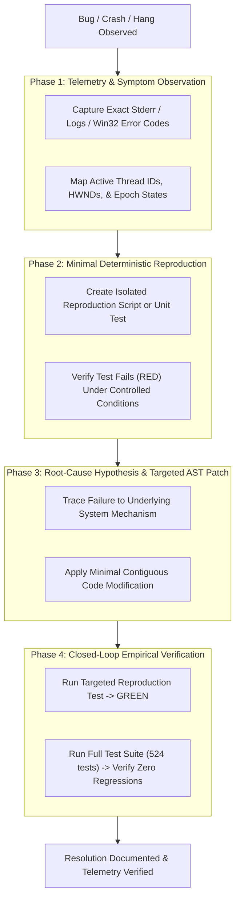

# Systematic Debugging Protocol for Jarvis 2.0

The **Systematic Debugging Protocol** establishes an empirical, four-phase root-cause investigation methodology for the Jarvis 2.0 codebase.

Shotgun debugging, speculative edits, and superficial symptom patching are strictly prohibited. Every investigation must isolate the precise failing AST node, reproduce the failure deterministically, and verify the patch with observable telemetry.

---

## 1. The 4-Phase Diagnostic Cycle



---

## Phase 1: Telemetry & Symptom Observation

Never attempt to patch a defect without inspecting raw telemetry and system state first.

1. **Capture Exact Stderr & Process Status:**
   - In PowerShell, run the module or test with full traceback output:
     ```powershell
     .venv\Scripts\python.exe -m unittest tests/test_<module>.py -v
     ```
   - For daemon or IPC communication failures, inspect the raw pipe buffer or log lines:
     ```powershell
     Get-Content data/logs/jarvis.log -Tail 100
     ```

2. **Inspect Win32 OS State & Thread Telemetry:**
   - When diagnosing deadlocks, hangs, or audio dropouts, verify whether threads are waiting on synchronization primitives:
     - Check P-Core pinning and MMCSS thread priorities (`GetThreadPriority`, `AvSetMmThreadCharacteristicsW`).
     - Check Win32 pipe handle state via `PeekNamedPipe` to see `bytes_avail` vs `bytes_left_this_message`.
     - Check foreground window state via `GetForegroundWindow()` and active UI Automation handles.

3. **Check Global State Invariants:**
   - Verify `GLOBAL_EPOCH_STATE.barge_in_epoch` to confirm whether a cancellation signal was propagated.
   - Inspect `managed_services` to ensure child processes (Ollama, Kokoro, Whisper, HUD) are alive and haven't exited with an unhandled exit code.

---

## Phase 2: Minimal Deterministic Reproduction

Never modify production code until you have a test or script that fails deterministically.

1. **Author an Isolated Repro in `tests/`:**
   - Construct a targeted test case inheriting from `unittest.TestCase`.
   - Mock only external boundaries (hardware soundcards, external LLM HTTP endpoints). Do NOT mock the internal logic under test.
   - Example structure for isolating IPC or threading deadlocks:
     ```python
     import unittest
     from unittest.mock import MagicMock, patch
     from jarvis.core.antigravity_bridge import AntigravityDaemon

     class TestReproAntigravityHang(unittest.TestCase):
         def test_reproduce_blocking_read_hang(self):
             daemon = AntigravityDaemon(daemon_mode=True)
             # Simulate pipe without available data
             mock_pipe = MagicMock()
             daemon._stdout_handle = mock_pipe
             
             # Assert that a read does not block indefinitely when no data is ready
             with patch("ctypes.windll.kernel32.PeekNamedPipe") as mock_peek:
                 # Return 0 bytes available
                 mock_peek.return_value = 1
                 # Should return cleanly without hanging
                 lines = list(daemon._iter_unbuffered_lines(max_seconds=0.1))
                 self.assertEqual(lines, [])
     ```

2. **Confirm Failure State (RED):**
   - Execute the test and confirm it fails for the exact reason observed in production.
   - If the test passes, your reproduction does not accurately capture the runtime failure condition. Do not proceed to Phase 3 until the failure is reliably isolated.

---

## Phase 3: Root-Cause Hypothesis & Targeted AST Patch

Root-cause problem solving means repairing the physical mechanism of failure rather than masking symptoms.

### Root Cause vs. Superficial Workaround
* **Superficial Workaround (PROHIBITED):** Adding `time.sleep(1.0)` to "let the thread finish", wrapping entire functions in empty `try...except Exception: pass`, or increasing timeouts indefinitely.
* **Root-Cause Solution (REQUIRED):** Replacing blocking I/O with non-blocking polling and explicit cancellation tokens, using proper synchronization events (`threading.Event`, `asyncio.Event`), or fixing inverted lock acquisition order.

### Mandatory Rules for AST Modifications:
1. **Contiguous Scope:** Confine edits to the exact function or block responsible.
2. **Preserve Surrounding Signatures:** Do not change public API signatures or return types unless explicitly mandated.
3. **Handle Edge Cases at the Boundary:** Check for `None`, closed pipes, terminated child processes, and OS error codes at the point of ingestion.

---

## Phase 4: Closed-Loop Empirical Verification

Verification is complete only when observable tool output proves the fix.

1. **Verify the Repro Test Passes (GREEN):**
   ```powershell
   .venv\Scripts\python.exe -m unittest tests/test_<repro>.py
   ```
2. **Verify the Full Test Suite Passes (Zero Regressions):**
   ```powershell
   .venv\Scripts\python.exe -m unittest discover tests
   ```
   *Baseline:* All 524 existing tests must remain 100% green.
3. **Verify Resource Cleanup:**
   - Confirm no lingering Python worker threads or child processes exist.
   - Confirm OS handles (files, pipes, sockets) are closed in `finally:` blocks or context managers.

---

## 2. Documented Real-World Failure Modes & Mitigations

### Failure Mode 1: Blocking I/O on Win32 Named Pipes
* **Symptom:** Jarvis hangs indefinitely when waiting for LLM or daemon output; audio stops streaming; UI becomes unresponsive; CPU drops to 0%.
* **Root Cause:** Calling blocking `os.read(pipe_fd, 4096)` or `sys.stdin.readline()` on a Win32 anonymous pipe when the child process is buffering output or waiting for input. Python's synchronous `read` holds the GIL and cannot be interrupted by Python signals on Windows.
* **Mitigation:**
  - Convert file descriptor to an OS handle via `msvcrt.get_osfhandle(pipe_fd)`.
  - Probe `ctypes.windll.kernel32.PeekNamedPipe` with a 10ms poll interval.
  - Check child process liveness (`proc.poll()`) and user barge-in epoch (`GLOBAL_EPOCH_STATE.barge_in_epoch`) on every poll iteration. Only invoke `os.read` when `bytes_avail.value > 0`.

### Failure Mode 2: Swallowed Exceptions on Background Workers
* **Symptom:** Audio playback or speech synthesis silently stops working. No error is printed to the console.
* **Root Cause:** Worker loop wrapped in a broad `except Exception:` block that catches fatal exceptions (e.g., `COMError`, `SoundcardError`, `MemoryError`) and silently breaks or passes without logging or alerting the supervisor thread.
* **Mitigation:**
  - Workers must capture the full traceback via `logger.error("Worker failed: %s", traceback.format_exc())`.
  - Store the exception instance on the worker object (e.g. `self.last_error = e`).
  - Signal the health check supervisor or dispatch an error event to the UI HUD (`{"type": "error", "message": str(e)}`).

### Failure Mode 3: Race Conditions Masked by Blind `time.sleep()`
* **Symptom:** Tests pass locally when run individually, but fail intermittently in full suite runs or on heavily loaded CPU cores.
* **Root Cause:** Relying on `time.sleep(0.05)` to wait for a thread or subprocess to initialize. Under CPU contention, initialization takes longer than 50ms, causing assertion failure.
* **Mitigation:**
  - Never use blind `time.sleep()` for synchronization.
  - Use `threading.Event.wait(timeout=2.0)` or condition variables.
  - Probe physical state with exponential backoff:
    ```python
    deadline = time.monotonic() + 2.0
    while time.monotonic() < deadline:
        if resource.is_ready():
            break
        time.sleep(0.005)
    else:
        raise TimeoutError("Resource failed to initialize within 2.0s deadline")
    ```
