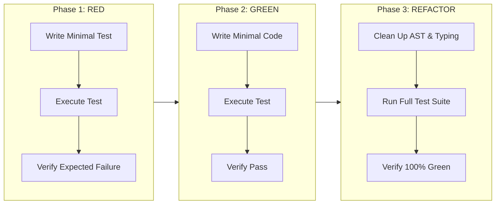

# Test-Driven Development (TDD) Protocol for Jarvis 2.0

The **Test-Driven Development (TDD) Protocol** establishes the mandatory workflow for introducing new capabilities, refactoring subsystems, and resolving bugs in the Jarvis 2.0 codebase.

Code written without a corresponding test is treated as unverified and cannot be merged or deployed.

---

## 1. The Three TDD Phases



### Phase 1: RED (Write the Failing Test First)
1. **Define the Specification:**
   - Locate or create the corresponding test module under `tests/` (e.g. `tests/test_<feature>.py`).
   - Write a single, focused test case demonstrating the desired behavior or reproducing the bug.
2. **Execute the Test:**
   ```powershell
   .venv\Scripts\python.exe -m unittest tests/test_<feature>.py -k "<test_method_name>"
   ```
3. **Verify the Failure:**
   - The test **must fail** with an assertion error or explicit missing behavior.
   - If the test fails due to a `SyntaxError`, `ImportError`, or test fixture misconfiguration, fix the test setup first. The failure must represent the missing production capability.

---

### Phase 2: GREEN (Write the Minimal Implementation)
1. **Implement Minimal Code:**
   - Modify or create the production file in `jarvis/`.
   - Write *only* the code required to make the failing test pass. Do not anticipate future features or add speculative abstractions.
2. **Execute the Targeted Test:**
   ```powershell
   .venv\Scripts\python.exe -m unittest tests/test_<feature>.py -k "<test_method_name>"
   ```
3. **Verify Green Status:**
   - Confirm the test passes cleanly without warnings, hangs, or unhandled output.

---

### Phase 3: REFACTOR (Optimize & Clean Up)
1. **Codebase Hardening:**
   - Add explicit Python type annotations (`typing.Optional`, `typing.Dict`, `typing.List`).
   - Remove temporary print statements or debug logs.
   - Ensure docstrings adhere to project standards.
2. **Full Regression Verification:**
   - Run the complete project test suite:
     ```powershell
     .venv\Scripts\python.exe -m unittest discover tests
     ```
   - **Baseline:** All 524 existing tests must remain 100% green. If any regression occurs, resolve it before proceeding.

---

## 2. Jarvis-Specific Testing Invariants

### Invariant 1: Zero Hardware Soundcard / COM Dependencies in Unit Tests
Unit tests must run in headless environments (such as CI or headless developer consoles) without physical audio hardware or active microphones.
* Always mock `sounddevice`, WASAPI endpoints, and Kokoro ONNX inference sessions:
```python
import unittest
from unittest.mock import MagicMock, patch

class TestAudioSubsystem(unittest.TestCase):
    @patch("sounddevice.OutputStream")
    @patch("sounddevice.InputStream")
    def test_audio_worker_start(self, mock_input, mock_output):
        # Hardware soundcard is isolated
        pass
```

### Invariant 2: Deterministic Teardown & Handle Cleanup
Leaked OS handles, background worker threads, or unclosed SQLite connections cause intermittent test hangs on Windows.
* Use `self.addCleanup()` inside `setUp()` or test methods to guarantee resource release even if assertions fail:
```python
def setUp(self):
    self.worker = MyBackgroundWorker()
    self.worker.start()
    self.addCleanup(self.worker.stop, timeout=1.0)
```

### Invariant 3: Clean Global State Isolation
Jarvis maintains several global states: `GLOBAL_EPOCH_STATE`, `SkillRegistry`, and database singletons.
* Reset global mutations before and after test execution:
```python
def setUp(self):
    from jarvis.core.antigravity_bridge import GLOBAL_EPOCH_STATE
    self.original_epoch = GLOBAL_EPOCH_STATE.barge_in_epoch
    self.addCleanup(self._reset_epoch)

def _reset_epoch(self):
    from jarvis.core.antigravity_bridge import GLOBAL_EPOCH_STATE
    GLOBAL_EPOCH_STATE.barge_in_epoch = self.original_epoch
```

---

## 3. Real-World Failure Modes & Mitigations

### Failure Mode 1: Leaked Background Thread Preventing Test Process Exit
* **Symptom:** `unittest` finishes all tests, prints `OK`, but the PowerShell prompt does not return because a Python worker thread is still running.
* **Root Cause:** Background threads spawned without `daemon=True` or without a coordinated shutdown event.
* **Mitigation:**
  - Mark test worker threads as `daemon=True`.
  - In `tearDown` or `addCleanup`, signal thread shutdown and call `thread.join(timeout=1.0)`.

### Failure Mode 2: Test Pollution via Shared SQLite Database File
* **Symptom:** Tests pass when run in isolation, but fail when run together as part of `unittest discover tests`.
* **Root Cause:** Multiple tests writing to `data/memory/jarvis.db` concurrently, resulting in dirty reads or SQLite WAL lock contention (`sqlite3.OperationalError: database is locked`).
* **Mitigation:**
  - In tests, configure `MemoryManager(db_path=":memory:")` or use `tempfile.NamedTemporaryFile` with automatic cleanup in `addCleanup`.
