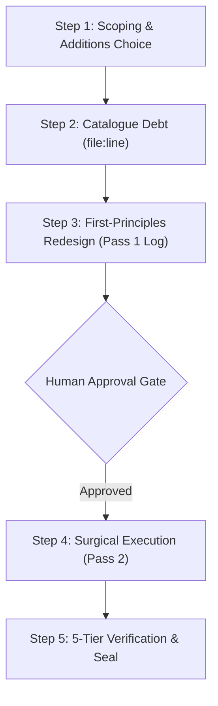

# Jarvis 2.0 — Untangle-Codebase Protocol

The **Untangle-Codebase Protocol** defines the disciplined, evidence-based refactoring workflow for decomposing high-coupling architectural hubs, monolithic services, and entangled subsystems within Jarvis 2.0.

It combines David Parnas's information-hiding principles and John Ousterhout's philosophy of deep interfaces with strict Jarvis 2.0 safety invariants, zero-regression test governance, and mandatory read-only human approval gates.

---

## 1. Mission & Foundational Philosophy

High-coupling entrypoints (such as central brains, telemetry/UI servers, and audio/lifecycle orchestrators) naturally accrue technical debt, ad-hoc flags, leaking abstractions, and sprawling responsibilities. 

Untangling is **not** superficial line-splitting or speculative rewriting; it is a first-principles restructuring that:
1. **Hides Secrets (Parnas):** Confines volatile implementation details, OS handles, and third-party quirks inside isolated modules behind stable interfaces.
2. **Builds Deep Modules (Ousterhout):** Keeps interfaces small and simple while maximizing the functionality hidden behind them.
3. **Guarantees Zero Test & Behavioral Regression:** Preserves 100% of existing unit/integration tests, test manifest node counts, and mock patch targets without breaking downstream callers.

---

## 2. Mandatory Jarvis 2.0 Guardrails

Every agent executing `untangle-codebase` must enforce these five non-negotiable repository guardrails:

### Guardrail 1: Strictly Bounded Subsystem Scoping
- **Never** attempt to untangle the whole repository or multiple top-level hubs in a single pass.
- `argument-hint` must explicitly target a single bounded subsystem or module (e.g. `jarvis/core/brain.py`, `jarvis/ui/server.py`, or `jarvis/core/orchestrator.py`).
- Decompose complex systems in discrete passes: establish a clean baseline commit between each subsystem.

### Guardrail 2: Two-Pass Execution Discipline
- **Pass 1: Read-Only Diagnosis & Decision Log:**
  - Produce zero code mutations.
  - Scan AST signatures, caller references, and test mock dependencies.
  - Catalogue architectural flaws with exact `file:line` evidence.
  - Present the First-Principles Redesign and wait for explicit human approval before touching code.
  - Offer the user three optional addition modes: `Comments`, `Tests`, or `Neither` (defaulting to `Neither` to maintain invariant test baselines).
- **Pass 2: Surgical Execution & Empirical Verification:**
  - Execute mutations only after Pass 1 is approved.
  - Verify every extracted component against linting, AST structural rules, targeted test suites, the Tier 1 fast test suite, and test manifest accounting.

### Guardrail 3: Test Manifest & Security Governance
- **Zero Test Churn:** Never delete, disable, rename, or weaken tests in `tests/test_milestone*`, `tests/test_p0_*`, `tests/test_p1_*`, or `tests/*_audit.py`.
- **Manifest Accounting Invariant:** The total collected test node count across `data/test_classification_manifest.json` must remain exact (e.g. `2,472` nodes) with `0` drift verified via:
  ```powershell
  python -m pytest tests/test_four_tier_runner.py -k test_17_accurate_total_test_accounting -v
  ```
- **Mock Patch Target Integrity:** Scan `tests/` for all `unittest.mock.patch` targets targeting the refactored module (e.g. `patch("jarvis.core.orchestrator.TextToSpeech")`). All patched symbols must remain imported, re-exported, and declared in `__all__` at the original module path.

### Guardrail 4: Win32/COM & Native Tooling Hardening
- Consult [`.agents/skills/jarvis-windows-native-interop/SKILL.md`](../jarvis-windows-native-interop/SKILL.md) whenever refactoring native systems code.
- **64-bit ABI Invariant:** Never call Win32 APIs without explicit ctypes `argtypes` and `restype` declarations. In particular, Win64 pseudo-handles like `kernel32.GetCurrentProcess()` return `(HANDLE)-1` (which truncates to `0xffffffff` under default 32-bit `c_int`, causing `STATUS_INVALID_HANDLE` `0xc0000008` in `EmptyWorkingSet`). Explicitly declare:
  ```python
  kernel32.GetCurrentProcess.restype = wintypes.HANDLE
  psapi.EmptyWorkingSet.argtypes = [wintypes.HANDLE]
  ```
- Guard against COM STA/MTA threading collisions by avoiding eager top-level Win32 imports; use idempotent lazy registration (`ensure_skills_loaded()`).

### Guardrail 5: Defensive Introspection on Partial/Mock Instances
- Unit tests frequently instantiate orchestrators or services via `object.__new__(cls)` or with partial mocks.
- Never write unguarded attribute accesses like `if hasattr(self.attr, "method"):` because if `self` lacks `attr`, accessing `self.attr` raises `AttributeError`.
- Always use `getattr(self, "attr", None)` before checking child attributes:
  ```python
  brain = getattr(self, "brain", None)
  if brain is not None and hasattr(brain, "cancel_active_turn"):
      brain.cancel_active_turn()
  ```

---

## 3. The 5-Step Protocol Workflow



### Step 1: Pre-Flight Scoping & Optional Additions
1. Validate active Git branch and confirm `git status --short` has `0` modified tracked files.
2. Map all test mock dependencies and downstream callers:
   ```powershell
   python -c "import ast, sys; ..." # or grep tests/ for target module imports
   ```
3. Prompt the user for optional additions:
   - **Comments:** Add explanatory architectural rationale on extracted modules.
   - **Tests:** Author new targeted unit tests for extracted boundaries (requires updating test manifest accounting).
   - **Neither (Standard):** Pure structural untangling preserving existing tests and manifest counts exactly.

### Step 2: Catalogue Structural Debt with `file:line` Citations
Inspect the target file and categorize all coupling flaws:
1. **Hidden Links:** Implicit shared global state, hidden singletons, mutable module variables, or out-of-band side-effects.
2. **Needless Links:** Tangled concerns (e.g. HTTP route handlers collecting NVML GPU metrics or orchestrators parsing VAD silence algorithms directly).
3. **Surplus:** Dead branches, redundant exception handlers, obsolete shim aliases, or unused helper functions.
4. **Special Cases:** Ad-hoc `if flag:` conditionals patching over architectural inconsistencies.

### Step 3: First-Principles Redesign (Pass 1 Decision Log)
Draft the target module decomposition plan:
- **Module Breakdown:** Name proposed new modules under appropriate packages (`jarvis/audio/`, `jarvis/core/cognition/`, `jarvis/ui/routes/`, etc.).
- **Responsibility Assignment:** Assign singular, cohesive ownership to each extracted module.
- **Facade Strategy:** Define how the original module retains backward compatibility, public API exports, and mock patch targets.
- **Pass 1 Decision Log Output:** Present the complete proposal to the user and **stop**. Do not touch code until authorized.

### Step 4: Pass 2 Surgical Execution
Upon receiving commit authorization for Pass 2:
1. Create newly extracted modules with strict type hints, full docstrings, and zero lint diagnostics.
2. Ensure extracted functions declare explicit 64-bit ctypes ABI types if touching Win32/COM.
3. Replace monolithic logic in the original file with clean delegations to extracted components.
4. Preserve all public symbols in `__all__` with thin delegation shims where needed.

### Step 5: Verification & Governance Seal
Execute the 5-tier verification protocol:
```powershell
# 1. Fast Static Linting (0 findings required)
python tools/lint.py check <modified_files>

# 2. AST Structural Invariant Scanning (0 findings required)
python tools/diagnostics.py check <modified_files>

# 3. Targeted Test Suites
& "C:\Users\Youssef\Projects\.venv\Scripts\python.exe" -m pytest <targeted_suites> -q

# 4. Full Tier 1 Fast Test Suite (1,492 tests green)
python tools/run_fast_tests.py --fast

# 5. Test Manifest Accounting Invariant (2,472 nodes, 0 drift)
& "C:\Users\Youssef\Projects\.venv\Scripts\python.exe" -m pytest tests/test_four_tier_runner.py -k test_17_accurate_total_test_accounting -v
```

After all verification commands pass:
1. Stage **only** the refactored files and commit with descriptive commit message.
2. Update `docs/agent/PROJECT_STATE.md` and `docs/agent/SESSION_LOG.md` and commit the governance seal.
3. Report the commit SHAs, line-count delta table, and verification evidence.

---

## 4. Empirical Case Studies & Reference Benchmarks

The effectiveness of this protocol is proven across the Jarvis 2.0 Core Triad untangling campaign:

| Subsystem | Baseline Lines | Refactored Lines | Reduction | Extracted Modules | Regressions |
| :--- | :---: | :---: | :---: | :--- | :---: |
| **`jarvis/core/brain.py`** | 1,498 | 874 | **-41.6%** | `cognitive_router.py`, `interim_bridge.py`, `ollama.py` | **0** |
| **`jarvis/ui/server.py`** | 2,431 | 699 | **-71.2%** | `security.py`, `metrics.py`, `telemetry.py`, `routes/` (6 mixins), `unlock.html` | **0** |
| **`jarvis/core/orchestrator.py`** | 1,003 | 707 | **-29.5%** | `speech_capture.py`, `orchestrator_lifecycle.py`, `intent_acknowledgments.py` | **0** |
| **Campaign Total** | **4,932** | **2,280** | **-53.8%** | **14 cleanly isolated modular files** | **0** |
