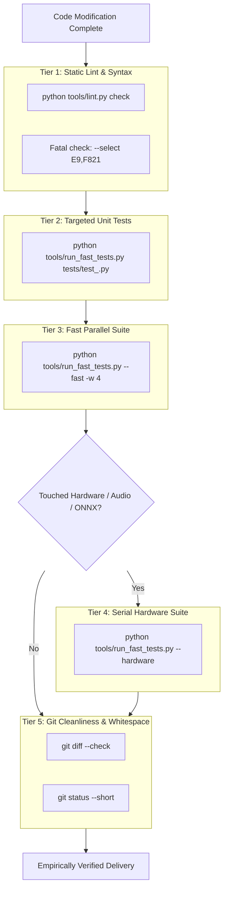

# Verification Runner Protocol for Jarvis 2.0

The **Verification Runner Protocol** defines the mandatory multi-stage test ladder and empirical reporting standard for validating code changes in the Jarvis 2.0 repository.

Under no circumstances may an agent assert that code is verified, tested, or ready for handoff without observable execution evidence from tools.

---

## 1. The 5-Tier Verification Ladder



---

## 2. Verification Steps & Commands

### Tier 1: Static Analysis & Structural Invariant Diagnostics
Run instant static checks on modified files using the cross-platform diagnostic workflow:
```powershell
# Canonical combined diagnostic procedure (Ruff linter + AST-Grep invariant scan)
python tools/diagnostics.py check <path>

# Focused lint diagnostics on modified files (Ruff)
python tools/lint.py check <path>

# Fatal syntax and undefined name gate across workspace
python tools/lint.py check --select E9,F821 jarvis tests tools

# Architectural invariant rule scan (.agents/rules/ast-grep)
python tools/diagnostics.py scan <path>
```
*Pass Criteria:* Exit code `0` with zero diagnostics.

---

### Tier 2: Targeted Unit Test Execution
Execute the specific test suite corresponding to the modified subsystem:
```powershell
python tools/run_fast_tests.py tests/test_<subsystem>.py
```
*Pass Criteria:* All tests pass; exit code `0`. If new behavior was introduced, confirm the test suite actually executed the new test assertions.

---

### Tier 3: Fast Parallel Suite (Regression Gate)
Whenever shared utilities, pipeline orchestration, memory, security, or skill base modules are altered, escalate to the fast parallel suite:
```powershell
python tools/run_fast_tests.py --fast -w 4
```
*Pass Criteria:* All parallel non-hardware test suites pass; zero regressions.

---

### Tier 4: Isolated Serial Hardware Gate
If changes modify audio capture, synthesis, WASAPI ring buffers, ONNX intent routing, whisper prosody, or Win32 COM/hook daemons:
```powershell
python tools/run_fast_tests.py --hardware
```
*Pass Criteria:* All serial hardware tests pass without GPU driver conflicts or audio endpoint crashes.

---

### Tier 5: Working Tree Cleanliness Audit
Before presenting verification results to the user:
```powershell
# Verify no trailing whitespace or patch corruptions
git diff --check

# Verify exact modified file manifest
git status --short

# Summary of lines added and removed
git diff --stat
```

---

## 3. Empirical Verification Reporting Format

Always present verification results using this standardized structure. Do not omit exit codes or skip counts:

```markdown
### Verification Summary

1. **Static Analysis (`tools/lint.py`):**
   - Command: `python tools/lint.py check <path>`
   - Exit code: `0`
   - Output: `All checks passed!`

2. **Targeted Tests:**
   - Command: `python tools/run_fast_tests.py <test_path>`
   - Exit code: `0`
   - Results: `X passed in Y.YYs`

3. **Fast Parallel Suite:**
   - Command: `python tools/run_fast_tests.py --fast -w 4`
   - Exit code: `0`
   - Results: `847 passed, 16 skipped in Z.ZZs`

4. **Working Tree Cleanliness:**
   - `git diff --check`: Clean (no whitespace issues)
   - Modified file count: N files
```

---

## 4. Negative Constraints

1. **PROHIBITED:** Asserting that a test passed if the command was not executed or resulted in non-zero exit code.
2. **PROHIBITED:** Using hyperbolic claims such as "100% bug-free", "zero vulnerability exposure", or "flawless execution".
3. **PROHIBITED:** Truncating working tree manifests with `etc.` or omitting unversioned files in audit reports.
