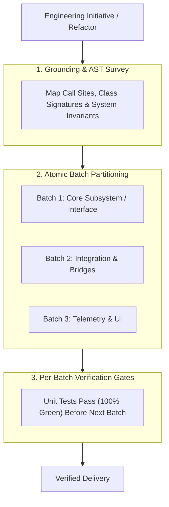

# Architecture & Execution Planning Protocol for Jarvis 2.0

The **Writing Plans Protocol** governs the design and breakdown of multi-file modifications, architectural refactors, and concurrency adjustments across the Jarvis 2.0 codebase.

Speculative, monolithic changes spanning dozens of files without intermediate verification gates are strictly prohibited. Every non-trivial engineering initiative must follow a structured execution plan.

---

## 1. Core Principles of Execution Planning



1. **Atomic Batches:** Break large tasks into self-contained batches of 1–3 closely related files. Each batch must leave the codebase in a compiling, fully-tested state.
2. **Zero-Assumption Pre-Read:** Never draft a plan that modifies a function or class without first viewing its existing definition, imports, and all call sites in the repository.
3. **Explicit Verification Milestones:** Every batch must conclude with an empirical test command (e.g. `.venv\Scripts\python.exe -m unittest tests/test_<subsystem>.py`).

---

## 2. Standard Execution Plan Format

When authoring an architectural plan (or markdown artifact), use this standardized structure:

### 1. Objective & Blast Radius
* **Goal:** 1–2 sentence description of the intended system capability or bugfix.
* **Blast Radius:** Classification of affected subsystems (Audio Engine, Memory, Web UI, Desktop OS, Brain).

### 2. Affected Subsystem Invariants
Review and list specific invariants from [`AGENTS.md`](file:///C:/Users/Youssef/Projects/Jarvis_2.0/AGENTS.md) that must be preserved:
* *Audio:* Never block WASAPI playback or Kokoro synthesis worker threads.
* *Memory:* Never dump bulk raw text into LLM prompts; maintain 4-tier memory boundaries.
* *OS Control:* Verify physical post-conditions (closed-loop verification).
* *Lifecycles:* Zero leaked child processes or dangling OS handles.

### 3. File Manifest
A bulleted table of every file to be created, modified, or deleted:

| File Path | Action | Description of Change |
| :--- | :--- | :--- |
| `jarvis/core/antigravity_bridge.py` | Modify | Implement non-blocking `PeekNamedPipe` polling. |
| `jarvis/core/brain.py` | Modify | Wire turn cancellation and streaming speech delivery. |
| `tests/test_antigravity_bridge.py` | Modify | Add unit tests for pipe polling and abort logic. |

### 4. Step-by-Step Batch Sequence
Detailed instructions divided into sequential batches. Each batch includes:
- Exact functions or classes to edit.
- Proposed implementation approach.
- Target test command to run immediately upon batch completion.

---

## 3. Real-World Failure Modes & Mitigations

### Failure Mode 1: The "Big-Bang" Monolithic Refactor
* **Symptom:** Editing 12 files concurrently across audio, memory, and UI. When running tests, 35 tests fail across 6 different files, making regression isolation extremely difficult.
* **Root Cause:** Committing to an all-or-nothing modification sequence without intermediate test gates.
* **Mitigation:**
  - Partition into strict atomic batches.
  - Run `unittest` after each batch. If tests fail, diagnose and fix immediately before touching the next file.

### Failure Mode 2: Signature Drift & Broken Imports
* **Symptom:** Refactoring a helper method in `jarvis.core.memory` causes silent failures in `jarvis.skills.document_ingest` or `jarvis.skills.productivity`.
* **Root Cause:** Modifying a function signature without searching for all call sites across the entire repository.
* **Mitigation:**
  - Mandatory pre-planning search before renaming or modifying signatures:
    ```powershell
    Get-ChildItem -Path jarvis -Recurse -Filter "*.py" | Select-String "function_name"
    ```
  - Maintain backwards-compatible parameter aliases or update all call sites within the same atomic batch.
