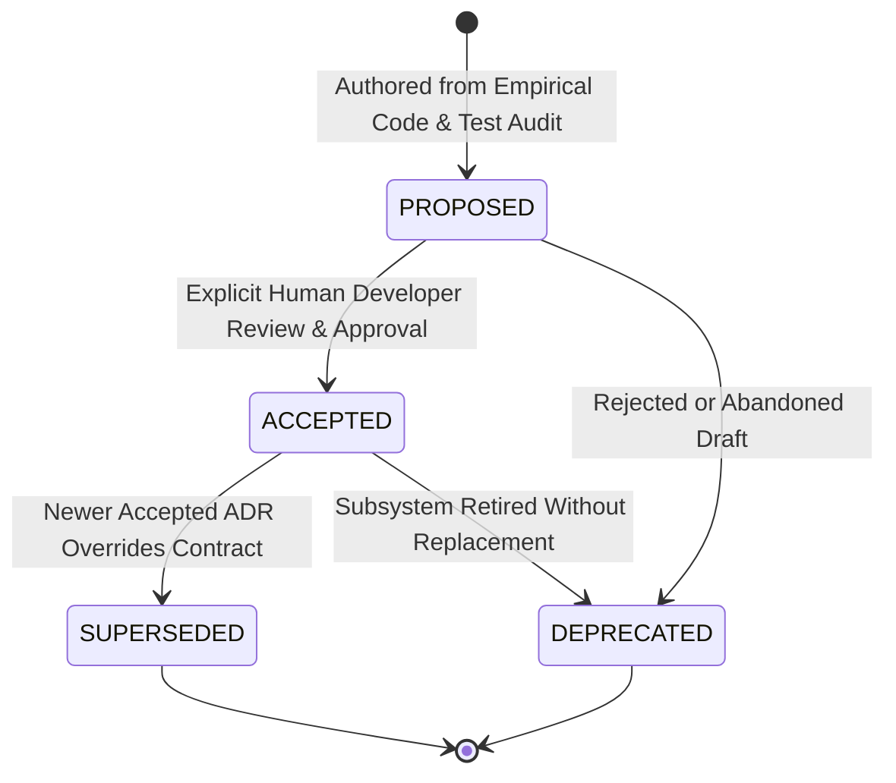

# Jarvis 2.0 — Architecture Decision Records (ADR)

> [!IMPORTANT]
> Architectural Decision Records (ADRs) capture significant architectural, concurrency, security, and persistence decisions made across Jarvis 2.0.
> 
> **Epistemic Invariant:** Only ADRs marked `ACCEPTED` constitute binding architectural contracts. All initial foundational ADRs remain in the `PROPOSED` state and become binding only following explicit human developer review and acceptance.

---

## 1. ADR Lifecycle Schema

Every ADR in this repository transitions through four strict, auditable lifecycle states:



- **`PROPOSED`**: The initial state for all newly authored ADRs. Documents existing implementation reality, contracts, and test evidence. Serves as a technical proposal awaiting formal human review. Non-binding on future architectural refactors.
- **`ACCEPTED`**: Formally reviewed and accepted by human developers. Establishes a binding architectural contract and invariant baseline that automated tests and future agent sessions must enforce.
- **`SUPERSEDED`**: A previously accepted decision that has been replaced by a newer accepted ADR. The superseded ADR is **never deleted or silently rewritten**; its status is changed to `SUPERSEDED`, and it links directly to its successor record (e.g., `Superseded by: ADR-007`).
- **`DEPRECATED`**: An architectural decision or subsystem pattern that has been retired without a direct drop-in architectural replacement.

---

## 2. Immutability & Modification Discipline

1. **Zero Silent Rewrites:** Once an ADR is marked `ACCEPTED`, its core decision, historical context, and trade-offs are permanently frozen. If the codebase evolves or concurrency models change, author a new successor ADR rather than retroactively mutating past records.
2. **Empirical Grounding:** Every ADR must cite concrete implementation paths, AST signatures, production call sites, and observable automated test evidence. Theoretical capabilities or unmeasured latency assertions are strictly prohibited.
3. **Historical Honesty:** Where historical motivations, rejected alternatives, or origin dates are unrecorded in Git commit history, mark them explicitly as `Historical rationale unavailable` rather than inventing speculative narratives.
4. **Link Portability:** All documentation references within ADRs must use portable, repository-relative paths (e.g., `../../jarvis/core/...`) rather than machine-specific absolute `file:///` URLs.

---

## 3. Canonical ADR Index

| ADR ID | Title | Status | Primary Implementation Path | Primary Test Suite Path | Scope / Domain |
| :---: | :--- | :---: | :--- | :--- | :--- |
| **[ADR-001](ADR-001-sqlite-single-writer-wal.md)** | SQLite Single-Writer Serialization and WAL Mode | `PROPOSED` | [`sqlite_base.py`](../../jarvis/core/memory/sqlite_base.py) | [`test_milestone2_memory_hardening.py`](../../tests/test_milestone2_memory_hardening.py) | Core Persistent Memory Stores |
| **[ADR-002](ADR-002-win32-job-object-containment.md)** | Win32 Job Object Process Containment and Orphan Reaping | `PROPOSED` | [`job_object_sandbox.py`](../../jarvis/skills/job_object_sandbox.py) | [`test_job_object_sandbox_hardening.py`](../../tests/test_job_object_sandbox_hardening.py) | Subprocess Execution & Containment |
| **[ADR-003](ADR-003-epoch-based-audio-cancellation.md)** | Epoch-Based Audio Cancellation and Barge-In Invalidation | `PROPOSED` | [`cancellation.py`](../../jarvis/core/cancellation.py) | [`test_milestone3_audio_invariants.py`](../../tests/test_milestone3_audio_invariants.py) | Voice Interruption & Audio Pipeline |
| **[ADR-004](ADR-004-dual-key-tool-authorization-turn-taint.md)** | Dual-Key Mutating Tool Authorization and Turn-Taint Tracking | `PROPOSED` | [`security_boundaries.py`](../../jarvis/core/security_boundaries.py) | [`test_milestone1_security_hardening.py`](../../tests/test_milestone1_security_hardening.py) | Tool Execution Gateway & Prompt Injection Defense |
| **[ADR-005](ADR-005-win32-hardware-core-affinity.md)** | Windows Hybrid CPU Core Affinity Partitioning | `PROPOSED` | [`win32_affinity.py`](../../jarvis/core/win32_affinity.py) | [`test_milestone5_windows_hardware.py`](../../tests/test_milestone5_windows_hardware.py) | Hardware Thread Scheduling & MMCSS |
| **[ADR-006](ADR-006-egress-validation-ip-pinning.md)** | Egress URL Validation and Outbound IP Pinning | `PROPOSED` | [`security_boundaries.py`](../../jarvis/core/security_boundaries.py) | [`test_milestone1_security_hardening.py`](../../tests/test_milestone1_security_hardening.py) | SSRF Defense & DNS Rebinding Mitigation |

---

## 4. ADR Authoring Template

When authoring future ADRs, strictly follow this structure:

```markdown
# ADR-XXX: [Title]

## Status
PROPOSED | ACCEPTED | SUPERSEDED | DEPRECATED

## Date
YYYY-MM-DD

## Scope
[Subsystems, modules, and execution boundaries covered by this decision]

## Context and Problem Statement
[Technical background, problem statement, and requirements]

## Decision
[Grounded technical specification of the chosen architecture]

## Alternatives Considered
[Documented alternatives with empirical trade-offs, or "Historical rationale unavailable"]

## Consequences and Trade-Offs
- Positive Consequences: [...]
- Negative Consequences / Operational Costs: [...]

## Binding Invariants
[Strict invariants that code and tests must honor]

## Implementation References
[Canonical repository-relative file paths and AST symbols]

## Production Call Sites
[Actual calling modules in jarvis/]

## Verification Evidence
[Targeted test suites, pass counts, and execution commands]

## Known Limitations and Unresolved Questions
[Documented operational boundaries and remaining technical debts]

## Related ADRs
[Links to related ADRs]
```
