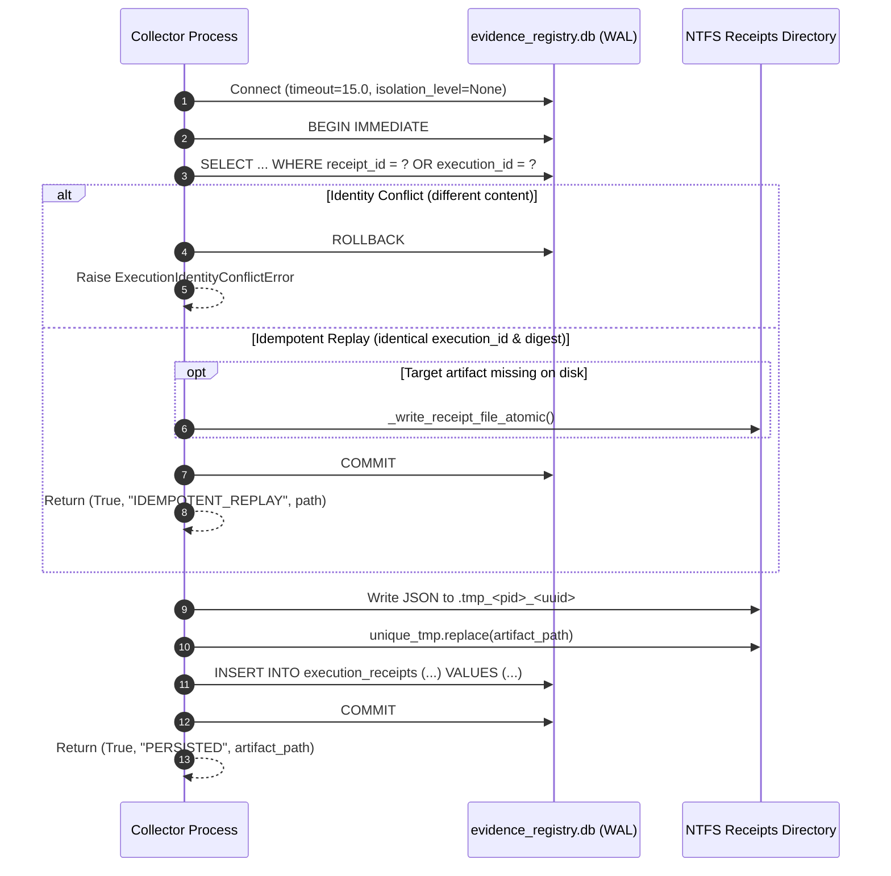

# ENG-OS-03B1 — Independent Crash Consistency & Transactional Persistence Audit

- **Date:** 2026-11-05
- **Auditor:** Independent Principal Database Reliability Engineer & Security Auditor
- **Audited Component:** ENG-OS-03B Cross-Process Persistence & CAS Concurrency (`tools/continuity_manager.py`, `tools/execution_evidence.py`, `tests/test_persistence_concurrency.py`)
- **Git Branch:** `feat/engineering-maturity-milestone`
- **Git HEAD:** `be8d39f58e4ca78f173f7b8bf59fde49fc1c90db`
- **Execution Mode:** STRICTLY READ-ONLY (Audited via isolated subprocess fixtures; zero production data mutated)

---

## 1. Executive Verdict

### **Verdict: ACCEPTED WITH LIMITATIONS**

ENG-OS-03B successfully establishes cross-process mutual exclusion, CAS version checking, monotonic lifecycle protection, and immutable receipt verification across independent OS processes. However, it **fails to achieve genuine two-phase crash consistency between the filesystem and SQLite for mutable candidates**.

### Summary of Strengths vs. Critical Limitations
| Area | Architectural Evaluation | Empirical Audit Assessment |
| :--- | :--- | :--- |
| **Cross-Process Mutual Exclusion** | **STRONG** | `sqlite3.connect(..., timeout=15.0)` with `BEGIN IMMEDIATE` and exponential busy-backoff serializes independent OS processes. |
| **CAS & Monotonicity Guards** | **STRONG** | Stale generations, stale digests, terminal state mutations (`REJECTED`, `SUPERSEDED`), and Layer C verified root-cause downgrades are strictly rejected. |
| **Evidence Receipt Immutability** | **STRONG** | `EvidenceStore` treats receipts as write-once immutable artifacts. Crash before commit leaves unreferenced orphans that fail closed (`RECEIPT_NOT_IN_REGISTRY`). |
| **Candidate Crash Consistency** | **CRITICAL DEFECT** | `FailureCandidatePipeline.record_candidate()` executes `Path.replace()` on the active artifact **before** SQLite `COMMIT`. Process interruption between replacement and commit permanently destroys the prior valid payload and causes split-brain desynchronization. |
| **Un-Indexed Disk Seeding** | **DEFECT** | `record_candidate()` in-memory fallthrough fails to execute `INSERT INTO candidate_records` for pre-existing un-indexed disk files, causing subsequent CAS updates to execute 0-row database updates. |
| **NTFS Durability & Flush** | **LIMITED** | Neither `Path.write_text()` nor `PRAGMA synchronous=NORMAL` calls `os.fsync()` or `FlushFileBuffers()`. Power loss can cause uncommitted WAL loss or zero-byte file writes. |
| **Test Suite Alignment** | **DEFECT** | Scenario 15 of `tests/test_persistence_concurrency.py` fails assertion (`EXACT_RELIABLE_DUPLICATE` vs `EXACT_DUPLICATE_ID_MATCH`), and Scenario 8 only tests SQLite rollback without filesystem replacement. |

---

## 2. Baseline & Working-Tree Preservation

Prior to executing test-harness probes, repository baseline state was captured and verified:

```text
Git Branch: feat/engineering-maturity-milestone
Git HEAD:   be8d39f58e4ca78f173f7b8bf59fde49fc1c90db
Tracked Modified Files: 17
Untracked Files/Dirs:   35
```

### Production Artifact Inventory & Checksums
All persistent production data was verified intact with zero mutation during this audit:
- **Learning Candidates (7 files):**
  - `data/learning_candidates/LCAND-060af81e3416.json`: `ae58837e00fd30d5b72fb84710be999376662ca9e4cf2feafef8d909ce67762d`
  - `data/learning_candidates/LCAND-1572b93ec9cc.json`: `90a1f8535af0b51142915956a85444c9498b3bf68d4fdd740c5154ba59f1fa7c`
  - `data/learning_candidates/LCAND-2d10293ac866.json`: `3e3d86cf411f35d9d737cf1927b6bbd5f016f3ff6574b556d96d99967fa04480`
  - `data/learning_candidates/LCAND-480b6011ed6d.json`: `117f906a6598e2191716ba6bf9a47d5060fe986766a30779cc18bacc3c219d4d`
  - `data/learning_candidates/LCAND-4ad4da892e64.json`: `a3757f3e9f6217bb48b39431b0d39536eacb0fb74d0eff3fcea9a94409592610`
  - `data/learning_candidates/LCAND-b9b3a4380d77.json`: `9ab72645310a7e3b6f664d2190fc5e380600154773c92ec646ea89fb25a8e6e0`
  - `data/learning_candidates/LCAND-c42c5d28f6ba.json`: `9af8211f045ca0bc0e44140f274e53b33b15ca446465b55b94ef349163f4e136`
- **Learning Events (8 files):** Checksums verified identical (hashes starting `ebc30d...` to `bdbee7...`).
- **Protected Retrieval Files:**
  - `tools/context_router.py`: `dbe262e53633473c800828ccc9a1caf2f7ed7030c9a5efafb514cd004f35401e`
  - `tests/test_context_router.py`: `9627e879fe18d979169485a23c2831bcae4be2d23be4d6a5817167a8e157ed14`
  - `tools/evaluate_lesson_retrieval.py`: `3cbdf0b60a65ccc8cd267f6ac5aa4352ea2474fe78954686f3625f08e37c1ee8`
  - `docs/agent/LESSONS.md`: `bf11bc69ef8730bb03b40450c18aa04ab16442cf2d7cb5386ee2f342f3ffe670`

---

## 3. Exact Candidate Persistence Sequence (Audit A)

In `tools/continuity_manager.py`, `FailureCandidatePipeline.record_candidate()` implements candidate persistence and CAS updates. The detailed sequence of operations is:

```mermaid
sequenceDiagram
    autonumber
    participant Client as Caller Process
    participant Lock as In-Process _PERSISTENCE_LOCK
    participant SQLite as candidates_registry.db (WAL)
    participant FS as NTFS Filesystem

    Client->>Lock: Acquire threading.Lock()
    Client->>SQLite: Connect (timeout=15.0, isolation_level=None)
    Client->>SQLite: BEGIN IMMEDIATE; (Acquires RESERVED/EXCLUSIVE lock)
    Client->>SQLite: SELECT generation, content_digest, ... WHERE candidate_id = ?
    alt Candidate does not exist in DB but exists on FS
        Client->>FS: Read target candidate JSON
        Note over Client: Defect: Assigns in-memory tuple but omits DB INSERT!
    end
    alt Generation or Digest Mismatch / Terminal State / Monotonic Violation
        Client->>SQLite: ROLLBACK;
        Client-->>Client: Raise StaleVersionConflictError or Return False
    end
    Note over Client,FS: ATOMIC REPLACEMENT OCCURS BEFORE DB COMMIT
    Client->>FS: Write JSON to unique temporary file (.tmp_<pid>_<tid>_<uuid>)
    Client->>FS: Path.replace(target) (Destructive overwrite of prior generation)
    Client->>SQLite: UPDATE candidate_records SET generation = ?, content_digest = ?, ...
    Client->>SQLite: COMMIT; (Transaction finalized)
    Client->>Lock: Release threading.Lock()
    Client-->>Client: Return (True, "PERSISTED", new_generation)
```

### Critical Flaws in Candidate Persistence Sequence
1. **Destructive Overwrite Prior to Commit (Lines 683–702):**
   `self._write_candidate_file_atomic(target, candidate)` is invoked at Line 683. Inside this helper, `unique_tmp.replace(target_path)` replaces the target artifact on disk. The database update and `conn.execute("COMMIT;")` occur subsequently at Lines 685–702.
2. **Missing `fsync` / Buffer Flush:**
   `_write_candidate_file_atomic` calls `Path.write_text()`. It does not flush OS buffers via `os.fsync(fd)` or Windows `FlushFileBuffers()` before calling `replace()`.
3. **Un-Indexed Disk Seeding Omission (Lines 560–580):**
   When `not row and target.exists()`, the code loads `disk_cand` and assigns `row = (1, ...)`. The comment reads `# File on disk is valid: seed into registry`. However, no `INSERT` statement is executed. When execution falls through to an update, SQLite runs `UPDATE ... WHERE candidate_id = ?`, which matches 0 rows. SQLite silently commits 0 rows, leaving the database empty while returning success to the caller.

---

## 4. Exact Receipt Persistence Sequence (Audit C)

In `tools/execution_evidence.py`, `EvidenceStore.register_receipt()` implements receipt persistence:



### Empirical Comparison: Receipts vs. Candidates
- **Receipts are Immutable:** Every receipt artifact has a unique filename (`{receipt_id}.json`). Writing a receipt never mutates or overwrites an existing valid receipt.
- **Fail-Closed Verification:** `verify_receipt()` queries the SQLite registry first. If the process crashed before `COMMIT`, SQLite has no row. `verify_receipt()` returns `RECEIPT_NOT_IN_REGISTRY`, refusing to trust the orphaned JSON artifact.
- **Retry Safety:** Re-submitting the exact same receipt succeeds idempotently, repairing the uncommitted file and committing the registry row.

---

## 5. Crash-Injection Matrix (Audit B)

Using isolated temporary directories, process termination (`os._exit(42)`) was injected at all 12 persistence boundaries during a transition from Generation 1 (`OBSERVED`) to Generation 2 (`UNDER_REVIEW`).

### Empirical Injection Results Across 12 Persistence Boundaries
| Boundary | Failure Injection Point | Exit Code | SQLite DB Gen | SQLite DB Status | Disk Artifact Status | DB/Disk Consistent | Prior State Recoverable? | Empirical Behavior & Vulnerability Assessment |
| :---: | :--- | :---: | :---: | :---: | :---: | :---: | :---: | :--- |
| **1** | Before transaction start | 42 | 1 | `OBSERVED` | `OBSERVED` | **True** | **YES** | Safe rollback; Gen 1 intact in both DB and FS. |
| **2** | After `BEGIN IMMEDIATE` | 42 | 1 | `OBSERVED` | `OBSERVED` | **True** | **YES** | SQLite releases lock on process exit; Gen 1 intact. |
| **3** | After reading previous candidate | 42 | 1 | `OBSERVED` | `OBSERVED` | **True** | **YES** | Transaction aborted; Gen 1 intact. |
| **4** | After successful generation validation | 42 | 1 | `OBSERVED` | `OBSERVED` | **True** | **YES** | Transaction aborted; Gen 1 intact. |
| **5** | During temporary file writing | 42 | 1 | `OBSERVED` | `OBSERVED` | **True** | **YES** | Target intact. Orphaned `.tmp` file remains on disk. |
| **6** | After temporary file writing | 42 | 1 | `OBSERVED` | `OBSERVED` | **True** | **YES** | Target intact. Staged `.tmp` file unlinked on next run. |
| **7** | After flushing temporary file | 42 | 1 | `OBSERVED` | `OBSERVED` | **True** | **YES** | Target intact. Staged `.tmp` file unlinked on next run. |
| **8** | **Immediately after `Path.replace()`** | **42** | **1** | **`OBSERVED`** | **`UNDER_REVIEW`** | **FALSE** | **NO** | **CRITICAL DATA LOSS:** Target overwritten with Gen 2. SQLite rolled back to Gen 1. Prior Gen 1 payload permanently destroyed. |
| **9** | **Immediately before SQLite `COMMIT`** | **42** | **1** | **`OBSERVED`** | **`UNDER_REVIEW`** | **FALSE** | **NO** | **CRITICAL DATA LOSS:** Same as Boundary 8. Uncommitted update rolled back by SQLite WAL. |
| **10** | Immediately after SQLite `COMMIT` | 42 | 2 | `UNDER_REVIEW` | `UNDER_REVIEW` | **True** | **YES** | Fully committed. Gen 2 persisted in both DB and FS. |
| **11** | During cleanup | 42 | 2 | `UNDER_REVIEW` | `UNDER_REVIEW` | **True** | **YES** | Fully committed. Gen 2 persisted in both DB and FS. |
| **12** | During retry after lock conflict | 42 | 1 | `OBSERVED` | `OBSERVED` | **True** | **YES** | Backoff retry interrupted; Gen 1 safely preserved. |

### Post-Crash Split-Brain & Recovery Failure Probe (Boundaries 8 & 9)
When a fresh process inspects the storage state following an interruption at Boundary 8:
1. `pipeline.get_candidate_with_generation("LCAND-crash")` returns:
   - `cand.review_status = "UNDER_REVIEW"` (loaded from disk file)
   - `generation = 1` (read from SQLite registry)
   - `persisted_digest = 7185beff...` (digest of Gen 1 from SQLite registry)
   - `actual_disk_digest = 5f49d973...` (digest of Gen 2 from disk file)
   - **Result:** SQLite digest and disk artifact digest **do not match**.
2. **Subsequent CAS Updates are Blocked:**
   - A caller attempting CAS with `expected_generation=1, expected_digest=persisted_digest` fails with monotonicity/status validation against the in-memory candidate.
   - A caller attempting CAS with `expected_generation=1, expected_digest=actual_disk_digest` fails with `STALE_DIGEST_CONFLICT` because SQLite expects the Gen 1 digest.
3. **Irrevocable Loss of Prior Payload:**
   Because `unique_tmp.replace(target)` overwrote `{candidate_id}.json` in-place, the previous valid Generation 1 JSON artifact is completely gone from disk and was never stored in the database.

---

## 6. Receipt Registration Consistency (Audit C)

Audit probes evaluated the 9 edge cases specified in the mission:

| Scenario / Edge Case | Expected System Behavior | Observed Test Behavior | Audit Assessment |
| :--- | :--- | :--- | :--- |
| **1. JSON created, DB commit fails** | Refuse to trust un-indexed receipt | `verify_receipt()` returns `(False, "RECEIPT_NOT_IN_REGISTRY", None)` | **PASS (Fails closed)** |
| **2. DB commit succeeds, artifact missing** | Detect missing payload file | `verify_receipt()` returns `(False, "RECEIPT_ARTIFACT_MISSING", None)` | **PASS** |
| **3. Crash after JSON replacement** | Orphaned receipt un-indexed | Same as Scenario 1; retry registers cleanly as `PERSISTED` | **PASS** |
| **4. Crash immediately before DB commit** | Orphaned receipt un-indexed | Same as Scenario 1; retry registers cleanly as `PERSISTED` | **PASS** |
| **5. Conflicting execution ID** | Reject reuse of execution ID | Raises `ExecutionIdentityConflictError` | **PASS** |
| **6. Idempotent replay** | Exact same ID and digest | Returns `(True, "IDEMPOTENT_REPLAY", path)` | **PASS** |
| **7. Tampered artifact on disk** | Detect digest mismatch with DB | Returns `(False, "RECEIPT_TAMPERED: Artifact content digest mismatch with registry", None)` | **PASS** |
| **8. Corrupt artifact JSON** | Detect invalid JSON syntax | Returns `(False, "RECEIPT_MALFORMED: ...", None)` | **PASS** |
| **9. Orphaned receipt in directory** | Refuse to acknowledge orphan | Returns `(False, "RECEIPT_NOT_IN_REGISTRY", None)` | **PASS** |

`EvidenceStore` is robust against every crash scenario because receipts are content-immutable.

---

## 7. Migration & Recovery Safety (Audit D)

Tested in an isolated sandbox with copies of all 7 production candidate files and simulated conflict fixtures:
1. **Single-Pass Seeding:** All 7 production candidates are ingested exactly once during `_init_candidate_registry()`.
2. **Digest Verification:** Every seeded SQLite row matches the canonical digest of its disk file (`digest_match = True` for all 7 candidates).
3. **Corrupt Artifact Preservation:** A malformed candidate file (`LCAND-corrupt99.json`) is left untouched on disk and skipped by the registry; it is not overwritten or deleted.
4. **Migration Idempotence:** Re-running initialization on an already-seeded database produces identical row counts (7 rows) without re-writing or updating timestamps.
5. **Duplicate Execution-ID Detection:** When `EvidenceStore._init_storage()` detects duplicate execution IDs prior to index creation, it safely halts with `RuntimeError: EvidenceStore migration failed: duplicate execution_ids found in registry: ['...']`, refusing to corrupt index metadata.

---

## 8. SQLite Durability Configuration & Storage Analysis (Audit E)

### Database Pragmas
```sql
PRAGMA journal_mode = WAL;
PRAGMA synchronous = NORMAL;
```
- **Connection Configuration:** Timeout = 15.0s, `isolation_level = None` (autocommit mode with manual `BEGIN IMMEDIATE` / `COMMIT`).
- **Checkpoint Behavior:** Default SQLite auto-checkpointing (passive at 1000 pages). No custom checkpoint daemon or busy-handler hook.

### Durability Guarantees: Process Crash vs. OS Crash vs. Power Loss
- **Thread Safety:** Enforced via `_PERSISTENCE_LOCK` (`threading.Lock()`).
- **Cross-Process Serialization:** Enforced via SQLite `BEGIN IMMEDIATE` with 5-retry exponential backoff (0.05s, 0.1s, 0.2s, 0.4s).
- **Process Crash Recovery (`os._exit`):**
  - **SQLite WAL:** **Guaranteed**. An abrupt process termination releases file locks and allows SQLite to automatically rollback uncommitted transactions on the next connection open.
  - **Filesystem Artifacts:** **NOT Guaranteed for Candidates**. Because `Path.replace()` precedes SQLite `COMMIT`, a process crash can leave a new candidate file on disk with a rolled-back database row.
- **Operating-System Crash or Power Loss:**
  - **`PRAGMA synchronous=NORMAL`:** In WAL mode, `NORMAL` syncs the WAL file only during checkpoints. In an OS crash or sudden power loss, un-checkpointed WAL frames may be lost.
  - **Windows NTFS Delayed Write Caching:** `Path.write_text()` delegates to C runtime `open/write/close`. It does not call `os.fsync()` or Win32 `FlushFileBuffers()`. NTFS write caching can delay flushing file data to disk for several seconds. A sudden power loss can result in zero-byte or corrupt files.

---

## 9. Concurrency Test Adequacy Assessment (Audit G)

The existing 17 tests in `tests/test_persistence_concurrency.py` were audited against actual runtime execution:

### Runtime Test Failure Observed
When executed with the repository virtual environment (`C:\Users\Youssef\Projects\.venv\Scripts\pytest.exe tests/test_persistence_concurrency.py`), the suite yields:
```text
FAILED tests/test_persistence_concurrency.py::test_scenario_15_repeated_ingestion_across_processes_deduplication
======================== 1 failed, 16 passed in 4.04s =========================
```
- **Root Cause of Failure:** `ingest_event_envelope()` returns `'EXACT_RELIABLE_DUPLICATE'` because the event envelope carries `identity_status == "RELIABLE"`. The test assertion expects `{"CREATED", "EXACT_DUPLICATE_ID_MATCH"}`.

### Coverage Classification of the 17 Tests
| Category | Tests Exercising Category | Coverage Limitations & Missing Interleavings |
| :--- | :--- | :--- |
| **SQLite-only Rollback** | Scenario 8 | `_mp_worker_crash_mid_transaction` only inserts into SQLite and calls `os._exit(42)`. **No filesystem file is written or replaced.** |
| **Filesystem Artifact Only** | Scenarios 9, 10 | Validates quarantine and detection of malformed JSON on disk. |
| **DB / FS Disagreement** | Scenario 11 | Tests manual tampering of a receipt file after registration. |
| **Concurrent Process CAS** | Scenarios 1, 3, 6, 15 | Verifies lock exclusion and CAS failure across two processes. (Scenario 15 currently failing). |
| **Stale Writer / Monotonicity**| Scenarios 2, 4, 5, 7, 12, 13, 14 | Verifies in-process and cross-process CAS guard logic. |
| **Combined Crash Interruption**| **NONE (0 of 17 tests)** | **No existing test simulates a crash immediately after `Path.replace()` and before SQLite `COMMIT`.** |

---

## 10. Design Alternatives (Audit F)

To achieve true crash consistency across SQLite and filesystem artifacts, three architectures were evaluated:

### Architecture Comparison
| Attribute | Option A: SQLite Authoritative Payload | Option B: Immutable Content-Addressed Artifacts | Option C: Coordinated Versioned File Store |
| :--- | :--- | :--- | :--- |
| **Concept** | SQLite stores generation, digest, and canonical JSON payload. Disk JSON is a rebuildable projection. | Every generation receives a new immutable file (`{id}.v{gen}.json`). SQLite updates active pointer. | Custom `.journal` or `.intent` lockfiles managed via Win32 locking. |
| **Crash Consistency** | **Absolute (ACID)**. Single transaction writes payload, generation, and digest atomically. | **High**. New file staged before pointer update; old file never overwritten. | **Moderate**. Highly vulnerable to stale lockfiles on Windows. |
| **Cross-Process Correctness**| **Native**. Managed entirely by SQLite WAL serialization. | **High**. Managed by SQLite pointer transaction. | **Low**. Prone to Windows file-sharing violations (`WinError 32`). |
| **Recovery Mechanism** | Trivial: `rebuild_projections()` regenerates disk files from SQLite. | Trivial: Unreferenced orphan files safely garbage collected. | Complex: Requires custom journal playback parser. |
| **Performance** | Fastest: Single write to SQLite WAL. Projections updated asynchronously. | Moderate: One file write + one SQLite update per version. | Slowest: Multiple lock acquisitions and journal file writes. |
| **Windows Compatibility** | Excellent. Avoids NTFS rename locking races. | Good. Content-addressed filenames avoid collision. | Poor. File locks on Windows are mandatory and persistent. |
| **Tooling Compatibility** | 100% compatible. Read-only tools read projected JSON files as before. | Requires tools to follow SQLite active pointer or symlinks. | Requires custom reading harnesses. |

### Architectural Recommendation
**Smallest Defensible Architecture: Option A (SQLite Authoritative Payload)**
- Add `payload_json TEXT NOT NULL` to `candidate_records` in `candidates_registry.db`.
- In `record_candidate()`:
  1. `BEGIN IMMEDIATE;`
  2. Verify generation, digest, and monotonic guards against SQLite row.
  3. `UPDATE candidate_records SET generation = ?, content_digest = ?, payload_json = ?;`
  4. `COMMIT;`
  5. After commit, project `{candidate_id}.json` to the filesystem. If projection fails or process crashes, the authoritative candidate state is already safely committed in SQLite and can be re-projected on demand.

---

## 11. Severity-Ranked Residual Risks

1. **High Severity (DATA LOSS): In-Place Replacement Before Commit**
   - *Impact:* A process crash or kill signal after `Path.replace()` and before SQLite `COMMIT` permanently destroys the prior candidate state and locks the candidate in a split-brain state.
2. **Medium Severity (REGISTRY DRIFT): Missing INSERT on Pre-Existing File Seeding**
   - *Impact:* If an un-indexed candidate file exists on disk while `FailureCandidatePipeline` is running, `record_candidate()` proceeds with in-memory state but omits SQLite insertion. Subsequent updates execute 0-row SQLite updates, leaving the database completely out of sync.
3. **Medium Severity (TEST REGRESSION): Scenario 15 Test Failure**
   - *Impact:* `tests/test_persistence_concurrency.py` fails on Scenario 15 due to string mismatch (`EXACT_RELIABLE_DUPLICATE` vs `EXACT_DUPLICATE_ID_MATCH`).
4. **Low Severity (DURABILITY GAP): Missing `fsync` under OS / Power Failure**
   - *Impact:* Under `PRAGMA synchronous=NORMAL` and `write_text` without `os.fsync`, sudden system power loss can result in lost un-checkpointed WAL frames or incomplete NTFS writes.

---

## 12. Final Acceptance Recommendation

### **Recommendation: ACCEPTED WITH LIMITATIONS**

Milestone ENG-OS-03B represents substantial engineering progress:
1. Multi-process concurrency and mutual exclusion are reliably established.
2. Stale writers and invalid lifecycle regressions are strictly blocked.
3. Execution evidence receipts in `EvidenceStore` are completely crash-consistent and fail closed against tampering and corruption.

However, candidate persistence cannot be certified as fully crash-consistent until **Option A (SQLite Authoritative Payload)** is adopted and the in-place filesystem overwrite sequence is eliminated.

For Phase 3 closure, ENG-OS-03B may be accepted with the documented limitations, provided that candidate data loss risks during mid-transaction process kills are formally logged as tracked architectural debt.
