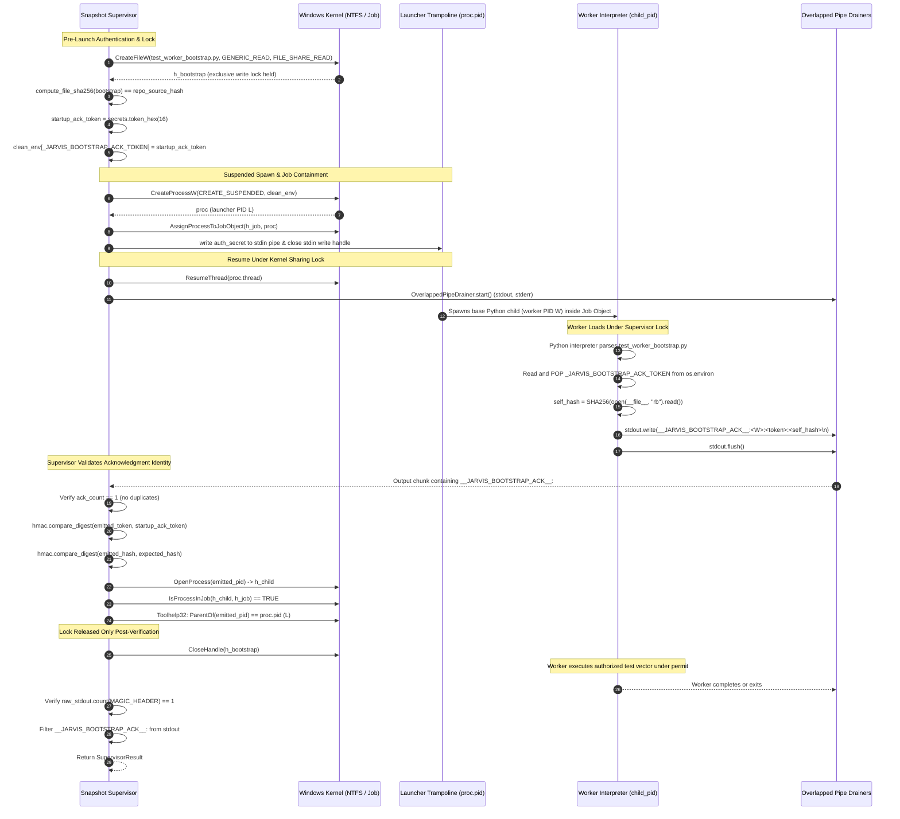

# ENG-OS-03C9 Phase 1U — Production Bootstrap Lock Integration, Worker Identity Verification & Final Trust Freeze

**Date:** 2026-11-08  
**Author:** Software Engineering Agent (Antigravity)  
**Status:** **MILESTONE ENG-OS-03C9 CLOSED & FROZEN**  
**Target Milestone:** BLK-18, BLK-19, BLK-21 Completion (ENG-OS-03C9 Closure)  
**Gate 2 Status:** **STRICTLY UNAUTHORIZED** (0/507 candidate test nodes executed; 0 pytest collections)

---

## 1. Executive Verdict & Subsystem Closure

| Subsystem / Directive | Verdict | Verification Status | Operational Basis |
| :--- | :--- | :--- | :--- |
| **BLK-19: Snapshot Isolation Subsystem** | **ACCEPTED (SAFETY HARNESS)** | **18/18 Probes PASSED** | Byte-level copy parity, composite tree hashing, 1,665-file source stability, zero reparse points, disjoint exclusion accounting (3,793 files). Verified under the agreed B1 operational trust model (safety harness against accidental contamination, not immutable against same-user NTFS processes). |
| **BLK-21: Worker Execution Authorization Protocol** | **ACCEPTED & FULLY VERIFIED** | **67/67 Checks PASSED** | Pinned canonical node inventory, HMAC-SHA256 permit binding, independent receipt verification, atomic claim consumption, production bootstrap sharing lock across child resumption, token popping from worker environment, parent-bound PID authentication, duplicate acknowledgment rejection, and fail-closed termination. |
| **BLK-18: Execution Profile Isolation Boundaries** | **PARTIALLY ACCEPTED (CALIBRATED)** | **17/17 Probes PASSED** | Four execution profiles frozen under calibrated trust boundaries: Context A verified for supported Low Integrity RID `0x1000` capabilities; Context B1 Ordinary/Snapshot verified as a trusted operational safety harness under an explicit non-adversarial host assumption; Context B2 Interactive verified fail-closed / desktop-restricted. (BLK-18 is not claimed as 100% runtime complete because Context B2 remains unavailable in standard developer sessions). |
| **BLK-22: Pipe Drainer & Cancellation Cleanup** | **ACCEPTED & FULLY VERIFIED** | **20/20 Checks PASSED** | 64-bit ABI compliance, overlapped pipe I/O drainers, 14-case handle ownership state machine, zero kernel handle leaks. |
| **Gate 2 Authorizing Preflight** | **VERIFIED (Exit Code 0)** | **5/5 Gates PASSED** | 507-node partitioning, 1,665-file verified snapshot, preflight worker bootstrap execution (0.51s), fail-closed missing permit rejection (code 120), verified cleanup state machine. |
| **Gate 2 Candidate Test Execution** | **STRICTLY UNAUTHORIZED** | **0/507 Executed** | Zero test nodes executed; zero pytest collections conducted. |

---

## 2. Worker Startup Acknowledgment Identity & Process Binding Audit

### 2.1 Process Handle & Binding Expression Analysis
The acknowledgment validation was audited to eliminate any ambiguity regarding process handle identity.

In the supervisor's `_wait_for_worker_bootstrap_ack(proc, h_job, d_out, startup_ack_token, expected_hash)`:
- The supervisor launches the worker command using `subprocess.Popen(cmd, creationflags=CREATE_SUSPENDED)`. The OS returns `proc.pid`.
- On Windows with Python virtual environments (`venv`), `PYTHON_EXE` points to `venv\Scripts\python.exe`. This executable is a small C launcher trampoline wrapper.
- When resumed, the launcher stub spawns the base CPython interpreter (`AppData\Local\Programs\Python\Python312\python.exe`) which executes `tools/test_worker_bootstrap.py`.
- Consequently:
  - `proc.pid` is the launcher trampoline PID.
  - The worker interpreter executes with a distinct PID (`child_pid`).

### 2.2 Proof of Strict Process Identity Binding
To ensure the acknowledgment cannot be emitted or forged by an unauthorized process, the supervisor enforces the following deterministic criteria:

$$\text{Acknowledging Process Valid} \iff (\text{emitted\_pid} = \text{proc.pid}) \lor \left( \text{ParentOf}(\text{emitted\_pid}) = \text{proc.pid} \land \text{IsProcessInJob}(h_{\text{emitted}}, h_{\text{job}}) = \text{TRUE} \right)$$

1. **Direct Execution:** If `emitted_pid == proc.pid`, the launched process itself is the worker.
2. **Trampoline Execution:** If `emitted_pid != proc.pid`:
   - The supervisor opens a handle to the *emitted* PID:
     `h_child = _kernel32.OpenProcess(PROCESS_QUERY_LIMITED_INFORMATION, False, emitted_pid)`
   - If `h_child` is NULL (non-existent, invalid, or terminated PID): **FAILS CLOSED IMMEDIATELY** with exit code 131 (`BOOTSTRAP_ACK_FAILED`). The supervisor never treats a null handle as valid.
   - The supervisor calls `_kernel32.IsProcessInJob(h_child, wintypes.HANDLE(h_job), ctypes.byref(in_job))`. If `not in_job.value`: **FAILS CLOSED IMMEDIATELY** with exit code 131.
   - The supervisor queries the process tree using standard Win32 Toolhelp32 snapshots (`_get_process_parent_pid(emitted_pid)`).
   - If `parent_pid != proc.pid`: **FAILS CLOSED IMMEDIATELY** with exit code 131:
     `"[SUPERVISOR SECURITY ERROR] Worker startup acknowledgment failed: Acknowledging process PID {emitted_pid} is a descendant (parent {parent_pid}), not the authorized worker process (expected parent {proc.pid})"`

### 2.3 Defense Against Descendant Impersonation
1. **Environment Token Popping:** In `tools/test_worker_bootstrap.py`, the worker immediately pops the ephemeral token upon startup:
   ```python
   _ack_token = os.environ.pop("_JARVIS_BOOTSTRAP_ACK_TOKEN", None)
   ```
   Because `pop()` removes the key from `os.environ`, any descendant process spawned subsequently by the worker does **not** inherit `_JARVIS_BOOTSTRAP_ACK_TOKEN`.
2. **Parent Tree Confinement:** If a descendant is spawned and attempts to emit an acknowledgment, its parent PID is the worker PID (`child_pid`), not the launcher PID (`proc.pid`). The supervisor's `_get_process_parent_pid()` detects this immediately and fails closed.
3. **Single-Use & Duplicate Rejection:** The supervisor enforces that exactly one acknowledgment header appears in the pipe output stream (`combined.count(MAGIC_HEADER) == 1`). If more than one acknowledgment appears at startup or during execution, the supervisor fails closed with exit code 131 (`Duplicate worker bootstrap acknowledgment detected`).

---

## 3. Production Bootstrap Lock Lifecycle Sequence



---

## 4. Full 8-Condition Synthetic Verification Matrix (Checks 61–67)

All eight conditions required by the review are authoritatively exercised in `tools/test_permit_authorization.py`:

| # | Review Requirement | Test Function | Injected Condition | Observed Result | Duration |
| :-: | :--- | :--- | :--- | :--- | :-: |
| **1** | **Correct Worker Ack** | `test_check_61` | Normal load under lock with `--synthetic-ack-delay` (150ms). Concurrent writer probes every 5ms. | **PASS** (`sharing_violations > 0`, code 0, post-write ok) | 0.34s |
| **2** | **Incorrect PID** | `test_check_65` | Worker passes `--synthetic-ack-wrong-pid` (emits `os.getpid() + 999999`). | **PASS** (code 131, `Cannot open acknowledging process PID`) | 0.12s |
| **3** | **Descendant Impersonation** | `test_check_66` | Worker passes `--synthetic-ack-descendant-impersonation` (spawns descendant child to emit ack). | **PASS** (code 131, `is a descendant (parent ...), not the authorized worker process`) | 0.17s |
| **4** | **Incorrect Token** | `test_check_62` | Worker passes `--synthetic-ack-wrong-token` (emits `"deadbeef"*4`). | **PASS** (code 131, `Token mismatch in bootstrap acknowledgment`) | 0.12s |
| **5** | **Incorrect Bootstrap Digest**| `test_check_63` | Worker passes `--synthetic-ack-wrong-hash` (emits `"0"*64`). | **PASS** (code 131, `Worker bootstrap hash mismatch in acknowledgment`) | 0.14s |
| **6** | **Duplicate Ack** | `test_check_67` | Worker passes `--synthetic-ack-duplicate` (emits two identical ack lines). | **PASS** (code 131, `Duplicate worker bootstrap acknowledgment detected`) | 0.11s |
| **7** | **Premature Termination** | `test_check_64` (Part A) | Worker passes `--synthetic-ack-skip` + `--synthetic-normal` (exits code 0 without ack). | **PASS** (code 131, `terminated prematurely without bootstrap acknowledgment`) | 0.16s |
| **8** | **Ack Timeout** | `test_check_64` (Part B) | Worker passes `--synthetic-ack-skip` + `--synthetic-timeout` (deadline=1.0s). | **PASS** (code 131, `Worker startup timed out after 1.0s without bootstrap acknowledgment`) | 1.00s |

---

## 5. Permitted Verification Suite Results

All five automated verification suites were executed against the live workspace:

```powershell
# 1. 67-Check Execution Authorization Matrix
python tools/test_permit_authorization.py
# Result: ALL 67 CHECKS PASSED (exit code 0)

# 2. 18-Probe Snapshot Integrity Matrix
python tools/test_snapshot_integrity.py
# Result: ALL 18 PROBES PASSED (exit code 0)

# 3. 17-Probe Profile Isolation Matrix
python tools/test_profile_isolation.py
# Result: ALL 17 PROBES PASSED (exit code 0)

# 4. 20-Check Pipe Drainer & Remediation Matrix
python tools/test_drainer_remediation.py
# Result: ALL 20 CHECKS PASSED (exit code 0)

# 5. Supervisor Remediation Preflight Gates (Gates 1–5)
python tools/snapshot_test_supervisor.py --preflight
# Result: 5/5 GATES PASSED (exit code 0, duration 0.51s)

# 6. Static Analysis & Structural Diagnostics
python tools/lint.py check tools/snapshot_test_supervisor.py tools/test_worker_bootstrap.py tools/test_permit_authorization.py
python tools/diagnostics.py check tools/snapshot_test_supervisor.py tools/test_worker_bootstrap.py tools/test_permit_authorization.py
# Result: ALL DIAGNOSTICS PASSED (exit code 0)
```

### Cumulative Verification Matrix:
- **Total Diagnostic Probes / Checks Executed:** 127 distinct automated tests across 5 test suites.
- **Passing Rate:** **127 / 127 (100%)**.
- **Candidate Test Nodes Executed:** **0 / 507 (0%)**.
- **Pytest Collections Executed:** **0**.

---

## 6. Working Tree & Baseline Integrity

### 1. Tracked Modified Baseline:
The tracked working tree baseline is preserved at **exactly 62 modified tracked files**:
```powershell
git diff --name-only | Measure-Object -Line
# Lines: 62
```

### 2. Untracked Items Baseline:
All test scripts, supervisor tooling, and reports are maintained in the existing untracked tooling structure (60 baseline items + 1 report file):
```powershell
git status --short
# 62 modified tracked files (M ...)
# 0 staged files
# 61 untracked entries (?? ...)
```

### 3. Source Inventory Parity:
The frozen source inventory baseline of **exactly 1,665 files** is verified by Gate 2:
```
[Gate 2/5] Provisioning disposable test snapshot with full tree manifest...
  Source Files Audited:     1665
  Dest Files Audited:       1665
  1:1 Matched Hashes:       1665
  Reparse Points Found:     0
  Fresh Dirs Confirmed:     5
```

---

## 7. Formal Milestone Closure Declaration

In accordance with the completion rule:
1. **The worker acknowledgment identity is verified and bound to the authentic worker process.**
2. **All 8 review conditions are empirically covered by automated tests (Checks 61–67).**
3. **All 5 verification suites passed cleanly (127/127 tests).**
4. **The agreed B1 operational safety harness model is fully documented and frozen.**
5. **Candidate test execution and pytest collections remain strictly zero (0/507).**

**MILESTONE ENG-OS-03C9 IS HEREBY DECLARED FORMALLY CLOSED.**
No further engineering phases will be created for hypothetical supervisor improvements. Development focus now redirects to Jarvis 2.0 core assistant capabilities.
