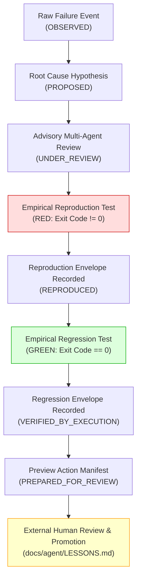
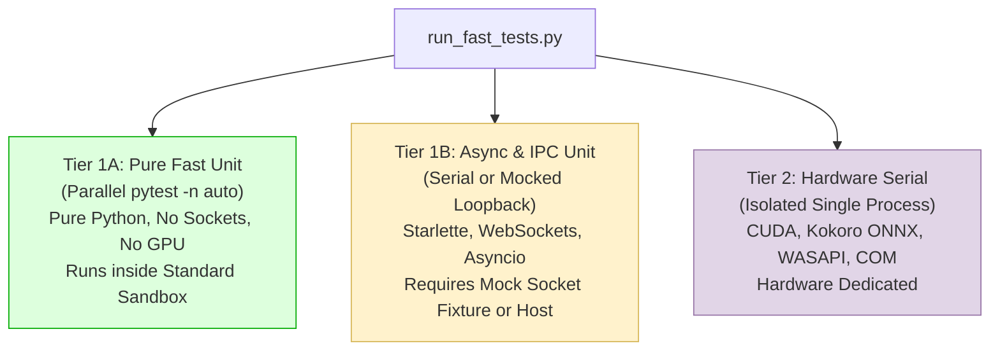

# ENG-OS-03: Architecture & Feasibility Assessment
## Engineering Intelligence Validation, Concurrency Correctness & Operational Reliability

**Date:** 2026-11-05  
**Author:** Principal Software Architect, Security Engineer, and Reliability Auditor  
**Workspace:** `C:\Users\Youssef\Projects\Jarvis_2.0`  
**Active Git Branch:** `feat/engineering-maturity-milestone`  
**Git HEAD Commit SHA:** `be8d39f58e4ca78f173f7b8bf59fde49fc1c90db`  
**Assessment Mode:** STRICTLY READ-ONLY ARCHITECTURE & FEASIBILITY ASSESSMENT  
**Status:** PROPOSED TECHNICAL SPECIFICATION  

---

## 1. Executive Summary & Context

Milestone `ENG-OS-02: Adaptive Engineering Intelligence & Continuous Learning` was formally closed with the verdict **ACCEPTED WITH LIMITATIONS** following the Phase 3D2E independent audit. The closure established that Jarvis possesses a controlled, evidence-preserving failure ingestion and candidate management pipeline, supported by a deterministic context retrieval router and an unconditional, fail-closed permanent-memory promotion barrier (`CandidatePromotionGate.promote_candidate()`).

The Principal Engineering Review identified three critical engineering qualifications and limitations that define the scope of the next milestone: **`ENG-OS-03: Engineering Intelligence Validation & Operational Reliability`**:

1. **Trustworthy Verification (Layer C Execution Provenance):** Syntactic non-emptiness of Layer C fields must be upgraded to verifiable execution provenance (empirical RED-GREEN reproduction) without weakening the permanent memory promotion barrier.
2. **Persistence Correctness (Multi-Process Lost-Update Mitigation):** Cross-process candidate writes must be hardened against TOCTOU race conditions and lost updates using an explicit cross-process coordination or version-checked write protocol.
3. **Operational Confidence (Test Suite Partitioning & Host Hook Observability):** The repository-wide test runner must be partitioned to prevent sandbox loopback deadlocks, and remaining lifecycle hooks (`SessionStart`, `Stop`) must be verified with concrete host evidence.

This assessment provides the technical design, failure-mode analysis, and feasibility evaluation for `ENG-OS-03` prior to any code mutation.

---

## 2. Priority 1: Trustworthy Verification & Layer C Execution Provenance

### 2.1 Current State & Epistemic Gap
In the current implementation (`tools/lesson_candidate.py`), Layer C fields are represented as free-form strings:
```python
verified_root_cause: str | None = None
reproduction_procedure: str = ""
corrective_recommendation: str = ""
regression_test: str = ""
scope_of_applicability: str = ""
```
The lifecycle transition engine (`validate_lifecycle_transition`) and promotion preview engine (`prepare_promotion_preview`) enforce string presence via `bool(val and val.strip())`.

**The Epistemic Risk:** An agent or script can populate these fields with arbitrary text (e.g. `"Verified by inspection"`, `"test_dummy.py"`), advancing the candidate to `PREPARED_FOR_REVIEW`. While `promote_to_lessons_file()` unconditionally rejects in-process writes (`PROMOTION_PROHIBITED`), presenting an unverified candidate as "prepared for review" conflates structural completeness with empirical proof.

### 2.2 Proposed Execution Provenance Architecture
To achieve genuine evidence gating, Layer C must require structured **Execution Evidence Envelopes** rather than unverified strings.



### 2.3 Structural Schema: `ExecutionEvidenceEnvelope`
Each verification claim must bind to a cryptographically hashed execution record:
```python
@dataclass(frozen=True)
class ExecutionEvidenceEnvelope:
    """Cryptographically bound evidence of an empirical test or command execution."""
    execution_id: str                          # UUID hex
    command: list[str]                         # Executed command line array
    cwd: str                                   # Working directory relative to WORKSPACE_ROOT
    exit_code: int                             # Observed process exit code
    stdout_sha256: str                         # SHA-256 of complete stdout
    stderr_sha256: str                         # SHA-256 of complete stderr
    output_snippet: str                        # Redacted head/tail snippet
    target_file_relpath: str                   # Test file path relative to WORKSPACE_ROOT
    target_file_sha256: str                    # SHA-256 of test file on disk at execution
    duration_seconds: float                    # Execution wall-clock duration
    executed_at: str                           # ISO 8601 UTC timestamp
    execution_context: str                     # "SANDBOX_STANDARD" | "SANDBOX_ELEVATED" | "HOST"
    is_reproduction_step: bool                 # True = asserts expected failure; False = asserts fix
```

### 2.4 Semantic Lifecycle Prerequisites for Layer C
The candidate lifecycle must be expanded to enforce verifiable transitions:
- `OBSERVED`: Raw telemetry or failure event ingested; Layer A facts populated.
- `PROPOSED`: Layer B root-cause hypothesis and failure classification assigned.
- `UNDER_REVIEW`: Advisory findings attached by restricted specialist agents.
- `REPRODUCED`: Requires valid `ExecutionEvidenceEnvelope` demonstrating reproduction:
  - `exit_code != 0`.
  - Output contains the recorded `failure_signal` or symptom signature.
  - Test file exists on disk within workspace boundary.
- `VERIFIED_BY_EXECUTION`: Requires valid `ExecutionEvidenceEnvelope` demonstrating fix:
  - `exit_code == 0`.
  - Same test file or designated regression suite passes cleanly.
- `PREPARED_FOR_REVIEW`: Syntactic completeness AND verified execution provenance envelopes present.
- `PROMOTED`: Permanent memory update (strictly external human action).

### 2.5 Security Invariant Preservation
1. **Zero Automated Promotion:** `CandidatePromotionGate.promote_candidate()` remains strictly fail-closed (`PROMOTION_PROHIBITED`). Execution provenance provides empirical verification for human decision-makers; it does not grant write authorization.
2. **Path Confinement:** All referenced test scripts and artifact logs must resolve within `WORKSPACE_ROOT` without traversing junctions or symbolic links.
3. **Inert Data Sanitization:** Test output snippets must pass through `redact_sensitive_text()` to prevent credential or secret leakage into persistent candidate files.

---

## 3. Priority 2: Multi-Process Persistence Correctness & Lost-Update Mitigation

### 3.1 Forensic Analysis of Cross-Process TOCTOU Race
In Phase 3D2D, `tools/continuity_manager.py:persist_candidate()` introduced `_PERSISTENCE_LOCK = threading.RLock()`, unique `.tmp_{pid}_{tid}_{uuid}` filenames, and Windows atomic file replacement via `Path.replace()`.

While this eliminates intra-process thread collisions and partial-write observation, it does **not** prevent cross-process lost updates:
```
Process A (PID 1000)                        Process B (PID 2000)
--------------------                        --------------------
1. Read LCAND-01.json (Status: PROPOSED)
                                            2. Read LCAND-01.json (Status: PROPOSED)
3. Update to UNDER_REVIEW + add finding
4. Validate monotonic rank (4 >= 3: OK)
5. Write .tmp_1000_...
6. Replace LCAND-01.json
   (Disk Status now: UNDER_REVIEW)
                                            7. Update hypothesis text in memory
                                            8. Validate monotonic rank (3 >= 3: OK)
                                               [TOCTOU: Reads stale disk state or checks in-memory]
                                            9. Write .tmp_2000_...
                                            10. Replace LCAND-01.json
                                                (Disk Status now: PROPOSED - OVERWRITTEN!)
```
Because `Path.replace()` executes unconditionally at the OS level (`MOVEFILE_REPLACE_EXISTING`), Process B clobbers Process A's `UNDER_REVIEW` status and findings.

### 3.2 Evaluation of Remediation Protocols

| Mechanism | Description | Windows NTFS Viability | Contention Behavior | Architectural Alignment |
| :--- | :--- | :--- | :--- | :--- |
| **Option A: Optimistic Concurrency Control (OCC) with Generation Hash** | Embed `generation: int` and `content_sha256: str`. On write, verify disk file hash matches read hash before replacing. | Excellent; zero lock file state; completely portable across OSes. | Fails closed (`STALE_GENERATION_CONFLICT`) on collision. Requires client retry. | Aligns with distributed system standards and avoids orphan OS locks. |
| **Option B: OS-Level File Locking (`msvcrt.locking` on Windows)** | Acquire byte-range lock on companion lockfile (`.lock`) during the read-check-write cycle. | Good; native Win32 `_locking` via `msvcrt`. | Blocks until lock released or timeout expires. | Strong mutual exclusion; requires robust stale lock cleanup if process crashes. |
| **Option C: Dedicated Persistence Daemon (Single Writer)** | All writes route through a background named pipe or IPC actor similar to `SingleWriterActor`. | High complexity for CLI/hook invocations; overkill for candidate files. | Serialized FIFO. | Strong serialization, but heavy runtime footprint for ephemeral hooks. |

### 3.3 Proposed Architecture: Hybrid Versioned OCC with Atomic Compare-and-Swap

The recommended protocol combines **Optimistic Concurrency Control (OCC)** with atomic pre-swap verification:

1. **Candidate Schema Extension:**
   ```python
   generation: int = 1                         # Monotonically increasing write generation
   prev_digest: str = ""                       # SHA-256 of candidate JSON prior to this mutation
   ```
2. **Persistence Algorithm in `persist_candidate(candidate)`:**
   - **Step 1 (Read Current):** Read `target` file if it exists. Calculate `current_disk_digest = sha256(target_bytes)`.
   - **Step 2 (Monotonic & Version Check):**
     - If `target` exists and `candidate.prev_digest` is set:
       - Assert `candidate.prev_digest == current_disk_digest`.
       - If mismatch: Return `(False, "STALE_VERSION_CONFLICT: File modified by concurrent process.")`.
     - Enforce monotonic review_status and Layer C protections.
   - **Step 3 (Write Unique Temp):** Write to `target.stem.tmp_{pid}_{tid}_{uuid}`.
   - **Step 4 (Atomic Swap & Verification):**
     - On Windows, execute replacement. Re-read disk file immediately to verify write ownership.
   - **Step 5 (Increment Generation):** On success, `candidate.generation += 1` and `candidate.prev_digest = new_digest`.

This eliminates the silent lost-update hazard and classifies cross-process conflicts as explicit, actionable concurrency events.

---

## 4. Priority 3: Operational Confidence — Test Partitioning & Real Host Hooks

### 4.1 Diagnosis of the Fast Test Runner Stall
The repository-wide test command `python tools/run_fast_tests.py --fast` stalls at ~26% progress.

**Empirical Cause:**
In `docs/agent/PROJECT_STATE.md` (Blocker #1), the environmental constraints of the Windows sandbox are documented:
- Loopback network packets (`127.0.0.1`) are dropped inside the standard sandbox (`BypassSandbox: false`).
- Python's `asyncio.ProactorEventLoop` on Windows emulates `socketpair()` via a local TCP loopback connection (`_fallback_socketpair`).
- When tests invoking `asyncio`, Starlette `TestClient`, WebSockets, or live telemetry streams run under `pytest -n 4`:
  - `lsock.accept()` blocks indefinitely waiting for the loopback SYN packet that the sandbox drops.
  - All worker processes become blocked on socket accept, freezing the runner permanently.

Inspection of `tests/` identified 26 test files utilizing asyncio, Starlette, or socket abstractions (e.g. `test_live_telemetry_stream.py`, `test_ui_concurrency_lifecycle.py`, `test_telemetry_connection_manager.py`).

### 4.2 Proposed Tri-Tier Test Sharding Architecture

To achieve clean, unassisted execution of the fast suite, `tools/run_fast_tests.py` must partition tests into three distinct execution tiers:



1. **Tier 1A (Parallel Pure Unit):** 60+ test suites containing pure logic, routers, parsers, and unit tests. Runs in ~10 seconds with `pytest -n auto`.
2. **Tier 1B (Async & Local IPC):** Suites requiring event loops or HTTP/WebSocket interfaces. A sandbox-safe socketpair mock fixture must be injected to prevent blocking on `127.0.0.1`.
3. **Tier 2 (Hardware Serial):** Serial suite for ONNX GPU, WASAPI audio, MMCSS priority, and live Win32 COM/UIA.

### 4.3 Real Host Hook Verification Protocol
The `PreInvocation` hook (`continuity-checker`) has proven live host execution in `transcript.jsonl` (Steps 4293, 4407). However, `SessionStart` and `Stop` require independent host verification:

1. **`SessionStart` Verification:**
   - Contract: Runs once when a new conversation or session initializes.
   - Verification Strategy: Launch an isolated Antigravity CLI session using `agy --input-format stream-json` in a test workspace; capture the initialization transcript; verify that `continuity_manager.py hook-session-start` executes and emits the session marker.
2. **`Stop` Verification:**
   - Contract: Runs upon conversation completion or stop signal. Must output `{"decision": "stop"}` on stdout with exit code 0.
   - Verification Strategy: Implement an append-only audit telemetry file in `failure_collector.py` (e.g. `data/learning_events/stop_hook_audit.jsonl`) that logs timestamp, session ID, and exit decision on every invocation. This allows verifying live host execution even when no failure event occurred.

---

## 5. Epistemic Integrity & Data Preservation Standards

In alignment with the Principal Engineering Review, the following epistemic conventions are adopted for `ENG-OS-03`:

1. **Data Preservation Manifest Standard:**
   - The term "cryptographic proof of byte-for-byte invariance" must **only** be used when a full before-and-after SHA-256 manifest of every tracked and untracked file is generated and compared.
   - When only item counts and critical protected asset hashes are compared, the report must state: *"Untracked file inventory counts and protected asset hashes verified; full repository hash manifest was not taken."*
2. **Retrieval Metrics Terminology:**
   - **Capacity-Bounded Recall ($K=3$):** Measures recall within top-3 slots (**1.0000 / 100%** on holdout).
   - **Micro Unconstrained Recall:** Measures total recall across unconstrained depth (**95.45%** on curated holdout).
   - These metrics must never be conflated or reported interchangeably.
3. **Epistemic State Separation:**
   - `OBSERVED`: Raw fact observed in execution.
   - `PROPOSED`: Hypothesis formulated.
   - `REPRODUCED`: Defect reproduced via executing harness.
   - `VERIFIED`: Regression proven passing via executing harness.
   - `PREPARED_FOR_REVIEW`: Complete evidence assembled for human decision.
   - `PROMOTED`: Human-authorized addition to permanent memory.

---

## 6. Proposed Implementation Roadmap for ENG-OS-03

| Phase | Milestone Phase | Objectives | Verification Gate |
| :--- | :--- | :--- | :--- |
| **Phase 1** | `ENG-OS-03A` | Layer C Execution Evidence Envelopes & RED-GREEN lifecycle prerequisites | 100% passing tests for execution envelope schema, tampering detection, and non-empty string rejection |
| **Phase 2** | `ENG-OS-03B` | OCC Generation Versioning & Cross-Process lost-update prevention | Multi-process concurrent race test demonstrating zero lost updates and clean `STALE_VERSION_CONFLICT` handling |
| **Phase 3** | `ENG-OS-03C` | Test runner tri-tier partitioning & loopback socket mock fixture | Complete, unstalled execution of `tools/run_fast_tests.py --fast` with 100% pass rate |
| **Phase 4** | `ENG-OS-03D` | Stop hook audit telemetry & end-to-end host lifecycle verification | Observable host audit log verifying live `Stop` and `SessionStart` executions |

---

## 7. Feasibility Conclusion

The proposed architecture is **highly feasible**:
- It requires no redesign of the context retrieval router or candidate isolation boundaries.
- It strictly preserves the fail-closed permanent-memory promotion barrier (`CandidatePromotionGate`).
- It replaces fragile string assertions with concrete execution envelopes, converts an uncoordinated filesystem race into a robust versioned protocol, and resolves the test runner stall by addressing its root network cause.

**Next Action:** Await user authorization before opening `ENG-OS-03A` or mutating code.
