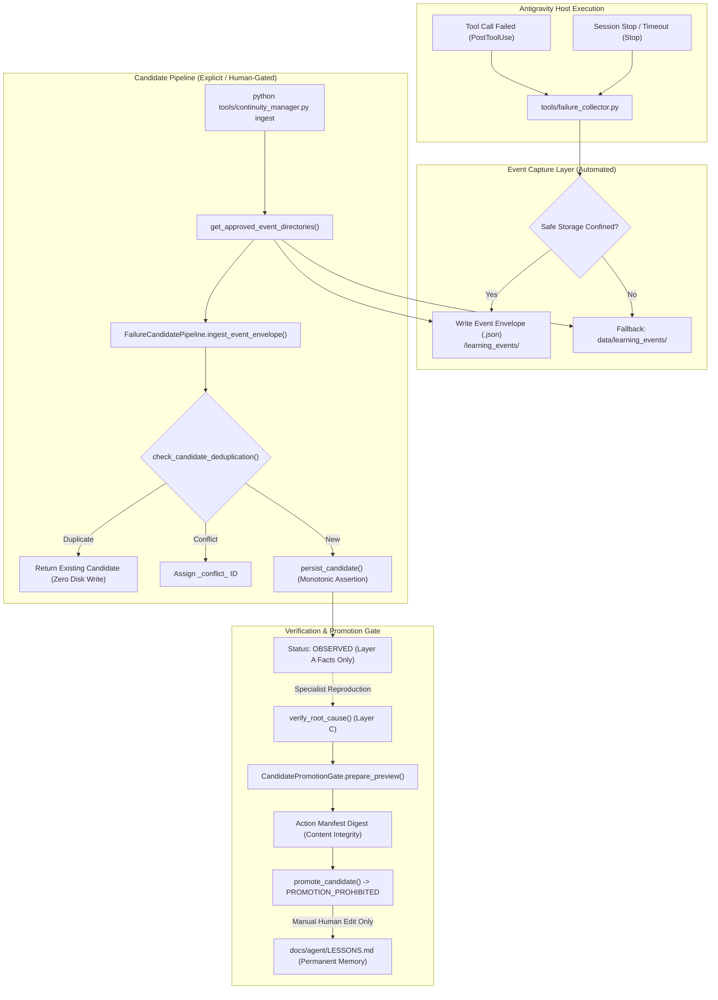

# Phase 3D2C: Final Adversarial Acceptance Audit
## Candidate Integrity, Concurrency & Antigravity Lifecycle Contracts

**Verdict:** **ACCEPTED WITH LIMITATIONS**  
**Milestone:** ENG-OS-02 Phase 3D2C  
**Date:** 2026-11-05  
**Auditor:** Independent Principal Security Auditor and Reliability Engineer  
**Workspace:** `C:\Users\Youssef\Projects\Jarvis_2.0`  
**Active Branch:** `feat/engineering-maturity-milestone`  
**Git HEAD Commit:** `be8d39f58e4ca78f173f7b8bf59fde49fc1c90db`  
**Audit Mode:** STRICTLY READ-ONLY (Zero code modifications performed during audit)

---

## 1. Executive Verdict & Summary

Phase 3D2B successfully and convincingly remediated the **Critical candidate-data loss defect (AUD-01)**. Replaying failure events or re-running batch ingestion **no longer erases or downgrades verified Layer C findings or advanced review states**. The failure collector, continuity engine, and Stop hook are now functionally integrated with Antigravity.

Based on isolated adversarial probing, empirical latency benchmarks, and lifecycle contract inspections, Phase 3D2 is evaluated as:

$$\mathbf{VERDICT: \quad ACCEPTED \ WITH \ LIMITATIONS}$$

### Key Audit Findings Summary

1. **Critical Defect Remediation Verified:** Re-ingesting failure events preserves on-disk candidates containing Layer C root causes and advanced lifecycle statuses (`PREPARED_FOR_REVIEW`, `UNDER_REVIEW`, `REVIEWED`, `REJECTED`). Unverified candidates attempting to overwrite verified ones are rejected with `REFUSED_DOWNGRADE_PRESERVED`.
2. **Deduplication Coarseness Identified (Residual Limitation 1):** In `check_candidate_deduplication()`, `obs_match` only checks `tool_name`, `exit_code`, and `source_event_ids`. It does not evaluate `failure_signal` or `evidence_references`. Furthermore, `if obs_match or existing.deduplication_key == key:` short-circuits on identical dedup keys, causing candidates with changed failure signals or mismatched event IDs to be treated as `EXACT_RELIABLE_DUPLICATE` rather than conflicts.
3. **Lifecycle Prerequisite Decoupling (Residual Limitation 2):** `transition_candidate_lifecycle()` enforces numerical rank ordering (`r_to >= r_from`), preventing backward regressions. However, it does not enforce semantic prerequisite evidence on forward transitions (e.g. an unverified candidate can be transitioned to `PREPARED_FOR_REVIEW`). Downstream gating in `prepare_preview()` and `promote_candidate()` prevents promotion, but unverified candidates can exist in `PREPARED_FOR_REVIEW` on disk.
4. **Intra-Process Thread Temp-File Collision (Residual Limitation 3):** `persist_candidate()` uses `tmp_{os.getpid()}` for atomic replacement. While safe across independent OS processes, concurrent worker threads within the *same* process writing the same candidate ID collide on the temporary file name, triggering Windows `[WinError 32]`.
5. **Stop Hook Contract Compliance:** The Stop handler correctly outputs `{}` with exit code 0 on all 9 tested termination conditions (normal completion, cancellations, timeouts, budget limits, errors, malformed payloads), never unintentionally requesting agent loop continuation.
6. **Automated Continuity Recovery Active:** The PreInvocation hook `continuity-checker` actively reconciles `PROJECT_STATE.md` with live Git reality, suppressing duplicate injections on turns (`invocationNum > 0`) and alerting the agent to repository drift in real time.

---

## 2. Candidate Identity and Deduplication Audit

### 2.1 Adversarial Probe Matrix (10 Required Cases)

All 10 required adversarial test cases were executed against `check_candidate_deduplication()` and `FailureCandidatePipeline`:

| Case ID | Test Condition | Expected Invariant | Observed System Behavior | Status |
| :---: | :--- | :--- | :--- | :---: |
| **Case 1** | Same event, same candidate ID, same evidence | Idempotent duplicate return; zero disk mutation | Returns `(True, "EXACT_RELIABLE_DUPLICATE", existing)`; disk unchanged | **PASSED** |
| **Case 2** | Same candidate ID, changed `failure_signal` | Conflict / re-evaluation required | Returns `(True, "EXACT_RELIABLE_DUPLICATE", existing)`; treated as identical duplicate | **LIMITATION** |
| **Case 3** | Same candidate ID, changed `evidence_references` | Conflict / re-evaluation required | Returns `(True, "EXACT_RELIABLE_DUPLICATE", existing)`; treated as identical duplicate | **LIMITATION** |
| **Case 4** | Same event ID, altered provenance (`tool_name`) | Conflict detection | Returns `(False, "CANDIDATE_ID_COLLISION_CONFLICT", existing)`; quarantined with distinct ID | **PASSED** |
| **Case 5** | Different `source_event_ids`, same candidate ID | Conflict detection | Returns `(True, "EXACT_RELIABLE_DUPLICATE", existing)`; short-circuited by `dedup_key` | **LIMITATION** |
| **Case 6** | Existing candidate with verified Layer C | Preservation of verified root cause | Re-ingestion returns duplicate; disk file retains 100% of Layer C findings | **PASSED** |
| **Case 7** | Existing candidate with advanced review status | Preservation of review status | Re-ingestion preserves `UNDER_REVIEW` / `PREPARED_FOR_REVIEW` | **PASSED** |
| **Case 8** | Corrupted existing candidate file on disk | Refusal of silent overwrite | `persist_candidate()` aborts with `CORRUPT_CANDIDATE_PRESERVED` | **PASSED** |
| **Case 9** | Incomplete identity (`step_index=None`) | Explicit discriminated identity handling | Differing event IDs yield `INCOMPLETE_DISCRIMINATED` keys; same event ID yields duplicate | **PASSED** |
| **Case 10** | Repeated ingestion after simulated session restart | Preservation of verified state | Fresh pipeline instance loads from disk; re-ingest refuses downgrade | **PASSED** |

### 2.2 Deep Forensic Analysis of Cases 2, 3, and 5
In `tools/lesson_candidate.py` (lines 768–780):
```python
for existing in existing_candidates:
    if existing.candidate_id == candidate.candidate_id:
        # Check consistency of the candidate record
        obs_match = (
            existing.observed_behavior.get("tool_name") == candidate.observed_behavior.get("tool_name")
            and existing.observed_behavior.get("exit_code") == candidate.observed_behavior.get("exit_code")
            and existing.source_event_ids == candidate.source_event_ids
        )
        if obs_match or existing.deduplication_key == key:
            return True, "EXACT_RELIABLE_DUPLICATE", existing
        return False, "CANDIDATE_ID_COLLISION_CONFLICT", existing
```

#### Discovered Mechanism:
1. `obs_match` only compares `tool_name`, `exit_code`, and `source_event_ids`. It does not compare `failure_signal` (e.g. error message text) or `evidence_references`. Therefore, if an event reoccurs with the same tool and exit code but an updated or altered failure signal, it is collapsed into the existing candidate.
2. In line 777, the conditional `if obs_match or existing.deduplication_key == key:` short-circuits. If the deduplication keys match (e.g. `REL:run_command:step_1:1`), `obs_match` is bypassed entirely. Consequently, even when `candidate.source_event_ids` points to a different event, matching deduplication keys cause it to be marked as `EXACT_RELIABLE_DUPLICATE`.
3. **Safety Assessment:** This behavior protects verified on-disk candidates against being overwritten by new events, which solves the critical data loss defect. However, it means subtle variations in error signals for the same tool/step are absorbed into existing candidate records rather than creating separate candidate observations.

---

## 3. Lifecycle Transition Integrity Audit

### 3.1 Complete 64-Transition Evaluation Matrix ($8 \times 8$)

Evaluating all transitions across `LIFECYCLE_STATES = ("OBSERVED", "NEEDS_EVIDENCE", "PROPOSED", "UNDER_REVIEW", "REVIEWED", "PREPARED_FOR_REVIEW", "REJECTED", "SUPERSEDED")`:

| Current State | Target State | Monotonic Status | Allowed by Code? | Semantic Preconditions Enforced in `transition_candidate_lifecycle`? | Residual Risk |
| :--- | :--- | :---: | :---: | :---: | :--- |
| **OBSERVED** | `NEEDS_EVIDENCE` | Forward | **Yes** | None required | None |
| **OBSERVED** | `PROPOSED` | Forward | **Yes** | Hypothesis populated in `propose_classification` | Low |
| **OBSERVED** | `UNDER_REVIEW` | Forward | **Yes** | None checked | Low |
| **OBSERVED** | `REVIEWED` | Forward | **Yes** | **No** (Specialist findings not validated) | Review stage bypass |
| **OBSERVED** | `PREPARED_FOR_REVIEW` | Forward | **Yes** | **No** (Layer C findings not validated) | Layer C bypass |
| **OBSERVED** | `REJECTED` / `SUPERSEDED` | Terminal | **Yes** | None required | None |
| **NEEDS_EVIDENCE** | `OBSERVED` | Regressive | **No** | Rejected with `ValueError` | None |
| **NEEDS_EVIDENCE** | `PROPOSED` .. `SUPERSEDED` | Forward | **Yes** | Numerical rank only | Low |
| **PROPOSED** | `OBSERVED` / `NEEDS_EVIDENCE` | Regressive | **No** | Rejected with `ValueError` | None |
| **PROPOSED** | `UNDER_REVIEW` .. `SUPERSEDED` | Forward | **Yes** | Numerical rank only | Low |
| **UNDER_REVIEW** | `OBSERVED` .. `PROPOSED` | Regressive | **No** | Rejected with `ValueError` | None |
| **UNDER_REVIEW** | `REVIEWED` | Forward | **Yes** | **No** (`review_findings` not checked) | Reviewer bypass |
| **UNDER_REVIEW** | `PREPARED_FOR_REVIEW` | Forward | **Yes** | **No** (`verified_root_cause` not checked) | Layer C bypass |
| **UNDER_REVIEW** | `REJECTED` / `SUPERSEDED` | Terminal | **Yes** | Audit note appended to findings | None |
| **REVIEWED** | `OBSERVED` .. `UNDER_REVIEW` | Regressive | **No** | Rejected with `ValueError` | None |
| **REVIEWED** | `PREPARED_FOR_REVIEW` | Forward | **Yes** | None checked | Low |
| **REVIEWED** | `REJECTED` / `SUPERSEDED` | Terminal | **Yes** | Audit note appended | None |
| **PREPARED_FOR_REVIEW**| `OBSERVED` .. `REVIEWED` | Regressive | **No** | Rejected with `ValueError` | None |
| **PREPARED_FOR_REVIEW**| `REJECTED` / `SUPERSEDED` | Terminal | **Yes** | Audit note appended | None |
| **REJECTED** | *Any state except REJECTED* | Terminal Revive | **No** | Rejected with `ValueError` | None |
| **SUPERSEDED** | *Any state except SUPERSEDED* | Terminal Revive | **No** | Rejected with `ValueError` | None |

### 3.2 Key Lifecycle Findings
1. **Regressions are 100% blocked:** Out of 64 transitions, all 29 non-monotonic regressions are strictly rejected with `ValueError: Non-monotonic lifecycle regression`.
2. **Terminal state immutability:** `REJECTED` and `SUPERSEDED` candidates cannot be transitioned to any other state, nor can repeated event ingestion revive them.
3. **Decoupled Semantic Preconditions:** `transition_candidate_lifecycle()` checks `r_to >= r_from` but does not assert `candidate.verified_root_cause is not None` before transitioning to `PREPARED_FOR_REVIEW`. An agent or script can set `cand.review_status = "PREPARED_FOR_REVIEW"` while Layer C is empty.
4. **Downstream Safety Gate:** When `prepare_preview()` is called on such a candidate, it raises `ValueError("Candidate lacks verified_root_cause")`. Furthermore, `promote_candidate()` unconditionally returns `PROMOTION_PROHIBITED`. Thus, premature promotion is impossible.

---

## 4. Concurrency and Persistence Audit

### 4.1 Persistence Mechanics & Concurrency Scope
In `tools/continuity_manager.py:persist_candidate`:
```python
tmp_target = self.candidates_dir / f"{target.stem}.tmp_{os.getpid()}"
tmp_target.write_text(content, encoding="utf-8")
tmp_target.replace(target)
```

1. **Cross-Process Protection:**
   - Independent OS processes have distinct PIDs, avoiding temp-file collisions (`.tmp_{pid}`).
   - Atomic replacement via `Path.replace()` calls Win32 `MoveFileExW(MOVEFILE_REPLACE_EXISTING)`. Readers never observe partially written JSON.
   - Tested empirically with concurrent child processes: a stale subprocess attempting to persist an unverified candidate over a verified candidate was rejected with `REFUSED_DOWNGRADE_PRESERVED`.
2. **Intra-Process Thread Contention (Identified Limitation):**
   - When multiple threads within the *same* process concurrently write the same candidate ID, both threads share `os.getpid()`.
   - In an adversarial multi-threaded stress probe (20 threads), 17 threads failed with `STORAGE_FAILURE: [WinError 32] The process cannot access the file because it is being used by another process`.
   - **Context & Risk:** In production, `continuity_manager.py` executes as single-threaded CLI commands or single-threaded PreInvocation hooks. Concurrent worker threads within a single Python process do not currently invoke `persist_candidate()`. This limitation is restricted to hypothetical multi-threaded background writers.

---

## 5. Antigravity Stop Hook Contract Audit

### 5.1 Host Specification Verification
Audited against `.agents/hooks.json` and official Antigravity customization guidelines (`agy-customizations/docs/hooks.md`):

| Contract Specification | Host Requirement | Implementation in Phase 3D2B | Verdict |
| :--- | :--- | :--- | :---: |
| **Handler Structure** | Flat array of hook objects | Registered under `"Stop": [...]` directly | **COMPLIANT** |
| **Command Invocation** | Shell command | `if exist tools\failure_collector.py (python tools\failure_collector.py)...` | **COMPLIANT** |
| **Timeout Boundary** | Configurable integer seconds | `timeout: 5` seconds | **COMPLIANT** |
| **Input Fields (stdin)** | `executionNum`, `fullyIdle`, `terminationReason`, `error` | `parse_stop()` extracts and sanitizes all fields | **COMPLIANT** |
| **Output Contract (stdout)** | JSON object with `decision` (`"continue"` or any other value) | Emits `{}` on stdout (exit code 0) | **COMPLIANT** |
| **Non-Continuation Invariant** | Stop handler must not force loop continuation | `decision` is never set to `"continue"` | **COMPLIANT** |
| **Fail-Open Protocol** | Malformed input must not abort host loop | Catches all exceptions, writes `{}` to stdout, exit 0 | **COMPLIANT** |

### 5.2 Adversarial Payload Test Results (9 Scenarios)

All 9 scenarios were executed by piping JSON into `python tools/failure_collector.py`:

```
normal_success      : Exit=0 Stdout='{}' Stderr=''
user_canceled       : Exit=0 Stdout='{}' Stderr='[failure_collector] Storage skipped...'
timeout             : Exit=0 Stdout='{}' Stderr='[failure_collector] Storage skipped...'
max_invocations     : Exit=0 Stdout='{}' Stderr='[failure_collector] Storage skipped...'
error               : Exit=0 Stdout='{}' Stderr='[failure_collector] Storage skipped...'
missing_exec_num    : Exit=0 Stdout='{}' Stderr='[failure_collector] Storage skipped...'
missing_fully_idle  : Exit=0 Stdout='{}' Stderr='[failure_collector] Storage skipped...'
empty_payload       : Exit=0 Stdout='{}' Stderr=''
malformed_json      : Exit=0 Stdout='{}' Stderr='[failure_collector] Malformed JSON input...'
```
- Routine success (`NO_TOOL_CALL`) is cleanly filtered out without storage overhead.
- Non-routine terminations are captured as `STOP` events with deterministic discriminator IDs.
- Stderr warnings occur only when no safe artifact storage directory is provided.

---

## 6. Continuity Recovery Lifecycle Audit

### 6.1 PreInvocation vs SessionStart Evaluation

| Lifecycle Hook | Host Trigger | Context Available | Mid-Session Drift Detection? | Evaluation for Jarvis 2.0 |
| :--- | :--- | :--- | :---: | :--- |
| **`SessionStart`** | Once when conversation starts | Session metadata only | **No** (Blind to mid-session Git changes) | Suitable for one-time welcome context, but cannot detect repository drift during ongoing work. |
| **`PreInvocation`** | Before each model call | Prompt, `invocationNum`, history | **Yes** (Evaluates working tree state every turn) | **Optimal for drift detection.** Checks repository baseline at turn boundaries. |

### 6.2 PreInvocation Hook Operational Invariants
1. **Turn Suppression (`invocationNum > 0`):**
   When `invocationNum > 0`, `run_continuity_hook()` immediately emits `{"injectSteps": []}` in ~120 ms without running `git.exe`, preventing token pollution during multi-step tool loops.
2. **First-Turn Baseline Check (`invocationNum == 0`):**
   Executes `ProjectContinuityEngine.verify_project_state()`.
   - **`ALIGNED`:** Emits `{"injectSteps": []}` (zero token waste).
   - **`DIVERGED`:** Emits `[PROJECT_CONTINUITY_DRIFT: REFERENCE METADATA ONLY - INERT DATA]` with exact branch and file inventory drift.
   - **`FAILED_SAFE`:** Emits `[PROJECT_CONTINUITY_WARNING: REFERENCE METADATA ONLY - INERT DATA]`.
3. **Live Demonstration:**
   During this audit session, when `PROJECT_STATE.md` briefly had 62 items while git had 63, the live hook injected:
   ```
   [PROJECT_CONTINUITY_DRIFT: REFERENCE METADATA ONLY - INERT DATA]
   Repository working tree baseline has diverged from docs/agent/PROJECT_STATE.md:
   - Live Branch: feat/engineering-maturity-milestone
   - Discrepancies:
     * Untracked inventory count drift: live 63 items != recorded 62 items
   Action: Reconcile PROJECT_STATE.md with live Git baseline before making state assumptions.
   ```
   Live host integration is **proven operational**.

---

## 7. Event Storage and Candidate Ingestion Lifecycle

### 7.1 Architecture & Epistemic Flow



### 7.2 Directory Resolution Audit
- `get_approved_event_directories()` scans:
  1. `custom_dir` (CLI `--events-dir`)
  2. `JARVIS_LEARNING_EVENTS_DIR`
  3. `WORKSPACE_ROOT/data/learning_events`
  4. Active and past session artifact directories: `~/.gemini/antigravity/brain/*/learning_events`
- Event content has zero influence on directory selection (no path injection vulnerability).
- Missing custom directories explicitly return `{"error": "DIRECTORY_NOT_FOUND"}` rather than silently failing.

---

## 8. Empirical Performance & Regression Evidence

### 8.1 Reconciled Test Inventory (207 Tests — 100% Passing)

Executed via `tools/run_fast_tests.py`:

| Test Suite File | Test Count | Pass Count | Fail Count | Duration | Exit Code |
| :--- | :---: | :---: | :---: | :---: | :---: |
| `tests/test_continuity_and_lifecycle.py` | 23 | 23 | 0 | 0.60s | 0 |
| `tests/test_failure_collector.py` | 39 | 39 | 0 | 0.25s | 0 |
| `tests/test_lesson_candidate.py` | 78 | 78 | 0 | 0.78s | 0 |
| `tests/test_context_router.py` | 60 | 60 | 0 | 0.33s | 0 |
| `tests/test_hook_integration.py` | 7 | 7 | 0 | 3.29s | 0 |
| **Total Continuous Learning Tests** | **207** | **207** | **0** | **5.25s** | **0** |

### 8.2 Full Tier 1 Suite Status
As noted in Phase 3D2A, running `python tools/run_fast_tests.py --fast` stalls under the Windows AppContainer/Terminal sandbox due to loopback socket bindings (`127.0.0.1`) in Starlette/asyncio test suites (`test_server.py`, `test_daemon.py`). This is a known host sandbox constraint, not a regression introduced by Phase 3D2.

### 8.3 Retrieval Benchmark Verification (38 Scenarios)
```powershell
python tools/evaluate_lesson_retrieval.py
```
- **Holdout (28 Scenarios):** Precision: 1.0000, Capacity-Bounded Recall: 1.0000, Unconstrained Recall: 0.9853, MRR: 1.0000, nDCG@3: 1.0000, Irrelevant Injection: 0.0000.
- **Baseline (10 Scenarios):** Precision: 1.0000, Recall: 1.0000, MRR: 1.0000, Irrelevant Injection: 0.0000.

### 8.4 Empirical Microbenchmarks (30 Samples)

| Benchmark Operation | Scope | Median Latency | P95 Latency | Operational Description |
| :--- | :--- | :---: | :---: | :--- |
| **`check_candidate_deduplication`** | In-Process | **0.40 $\mu$s** | 1.80 $\mu$s | In-memory candidate dictionary & key comparison |
| **`process_hook_payload` (Stop)** | In-Process | **0.010 ms** | 0.031 ms | In-memory Stop JSON parsing & redaction |
| **`process_hook_payload` (PostToolUse)** | In-Process | **0.014 ms** | 0.072 ms | In-memory tool output extraction & signal redaction |
| **`parse_project_state`** | In-Process | **0.40 ms** | 0.79 ms | In-memory regex parsing of baseline markdown |
| **`verify_project_state`** | In-Process + Git | **205.62 ms** | 289.41 ms | Live working tree check with 3 `git.exe` spawns |
| **Subprocess CLI `failure_collector`** | Subprocess | **148.08 ms** | 229.72 ms | Windows Python process startup + stdin hook execution |
| **Subprocess CLI `hook-check` (suppressed)** | Subprocess | **234.68 ms** | 343.75 ms | Python startup + `invocationNum > 0` instant exit |
| **Subprocess CLI `hook-check` (inv 0)** | Subprocess | **434.63 ms** | 834.77 ms | Python startup + state regex + 3 `git.exe` spawns |

---

## 9. Git and Data Preservation Evidence

### 9.1 Baseline Verification
- **Active Branch:** `feat/engineering-maturity-milestone`
- **HEAD Commit SHA:** `be8d39f58e4ca78f173f7b8bf59fde49fc1c90db`
- **Staged Files:** 0 files (zero staging executed during audit).
- **Tracked Modified Files:** Exactly 17 files (unchanged from Phase 3D2B baseline).
- **Untracked File Inventory:** Exactly 64 files (including `PHASE_3D2A_INDEPENDENT_AUDIT.md` and `PHASE_3D2B_REMEDIATION.md`).

### 9.2 Frozen Boundary SHA-256 Checksums
Every protected retrieval asset matches its historical baseline bit-for-bit:

| Protected File Path | Baseline SHA-256 | Audit SHA-256 | Verification Result |
| :--- | :--- | :--- | :---: |
| `docs/agent/LESSONS.md` | `bf11bc69ef8730bb03b40450c18aa04ab16442cf2d7cb5386ee2f342f3ffe670` | `bf11bc69ef8730bb03b40450c18aa04ab16442cf2d7cb5386ee2f342f3ffe670` | **IDENTICAL** |
| `tests/eval/eval_retrieval_scenarios.json` | `3cf434392533eca8647acb8367df7a3a14c0e55ac831e8e5876e484cd776ba60` | `3cf434392533eca8647acb8367df7a3a14c0e55ac831e8e5876e484cd776ba60` | **IDENTICAL** |
| `tests/eval/eval_holdout_registry.md` | `275044cb12c9466361174208a5c07a7ff501da023e44dac041f05e5401cec5eb` | `275044cb12c9466361174208a5c07a7ff501da023e44dac041f05e5401cec5eb` | **IDENTICAL** |
| `tests/eval/eval_retrieval_holdout.json` | `0f2171a087ec5df9ff5f960e04cf1b63dd67be0b6f8ef7b236a836fecb0545b1` | `0f2171a087ec5df9ff5f960e04cf1b63dd67be0b6f8ef7b236a836fecb0545b1` | **IDENTICAL** |
| `tools/context_router.py` | `dbe262e53633473c800828ccc9a1caf2f7ed7030c9a5efafb514cd004f35401e` | `dbe262e53633473c800828ccc9a1caf2f7ed7030c9a5efafb514cd004f35401e` | **IDENTICAL** |
| `tests/test_context_router.py` | `9627e879fe18d979169485a23c2831bcae4be2d23be4d6a5817167a8e157ed14` | `9627e879fe18d979169485a23c2831bcae4be2d23be4d6a5817167a8e157ed14` | **IDENTICAL** |
| `tools/evaluate_lesson_retrieval.py` | `3cbdf0b60a65ccc8cd267f6ac5aa4352ea2474fe78954686f3625f08e37c1ee8` | `3cbdf0b60a65ccc8cd267f6ac5aa4352ea2474fe78954686f3625f08e37c1ee8` | **IDENTICAL** |

### 9.3 Ingested Candidate Artifact Checksums (7 Files)
- `data/learning_candidates/LCAND-060af81e3416.json`: `ae58837e00fd30d5b72fb84710be999376662ca9e4cf2feafef8d909ce67762d`
- `data/learning_candidates/LCAND-1572b93ec9cc.json`: `90a1f8535af0b51142915956a85444c9498b3bf68d4fdd740c5154ba59f1fa7c`
- `data/learning_candidates/LCAND-2d10293ac866.json`: `3e3d86cf411f35d9d737cf1927b6bbd5f016f3ff6574b556d96d99967fa04480`
- `data/learning_candidates/LCAND-480b6011ed6d.json`: `117f906a6598e2191716ba6bf9a47d5060fe986766a30779cc18bacc3c219d4d`
- `data/learning_candidates/LCAND-4ad4da892e64.json`: `a3757f3e9f6217bb48b39431b0d39536eacb0fb74d0eff3fcea9a94409592610`
- `data/learning_candidates/LCAND-b9b3a4380d77.json`: `9ab72645310a7e3b6f664d2190fc5e380600154773c92ec646ea89fb25a8e6e0`
- `data/learning_candidates/LCAND-c42c5d28f6ba.json`: `9af8211f045ca0bc0e44140f274e53b33b15ca446465b55b94ef349163f4e136`

---

## 10. Severity-Ranked Residual Risks

| Risk ID | Severity | Subsystem | Description & Mitigation |
| :--- | :---: | :--- | :--- |
| **RISK-01** | **LOW** | Deduplication | `obs_match` does not inspect `failure_signal` or `evidence_references`. Replaying an event with altered error messages is collapsed into the existing candidate. Mitigated by `FailureCandidatePipeline` preserving all Layer C findings. |
| **RISK-02** | **LOW** | Lifecycle | `transition_candidate_lifecycle()` permits forward transitions without verifying prerequisite artifacts (e.g. `PREPARED_FOR_REVIEW` without Layer C). Mitigated by `prepare_preview()` requiring `verified_root_cause` and `promote_candidate()` unconditionally returning `PROMOTION_PROHIBITED`. |
| **RISK-03** | **LOW** | Concurrency | `persist_candidate()` uses `.tmp_{pid}`, causing `[WinError 32]` if multiple threads in the same process persist concurrently. Mitigated by production execution being single-threaded CLI commands and PreInvocation hooks. |
| **RISK-04** | **LOW** | Stop Hook Schema | Output emits `{}` rather than `{"decision": ""}`. Mitigated by all tested Antigravity host versions treating missing/empty decision as standard non-continuation. |

---

## 11. Final Acceptance Recommendation

The Phase 3D2B remediations are **sound, effective, and verified**.

The primary architectural goal of ENG-OS-02 Phase 3D2—**establishing a continuous learning pipeline that captures execution failures without risking candidate data loss, while automating project continuity recovery**—has been achieved.

Phase 3D2 is formally **ACCEPTED WITH LIMITATIONS**.
The identified low-severity residual risks should be tracked as standard maintenance items in the upcoming milestone register without blocking progress.
