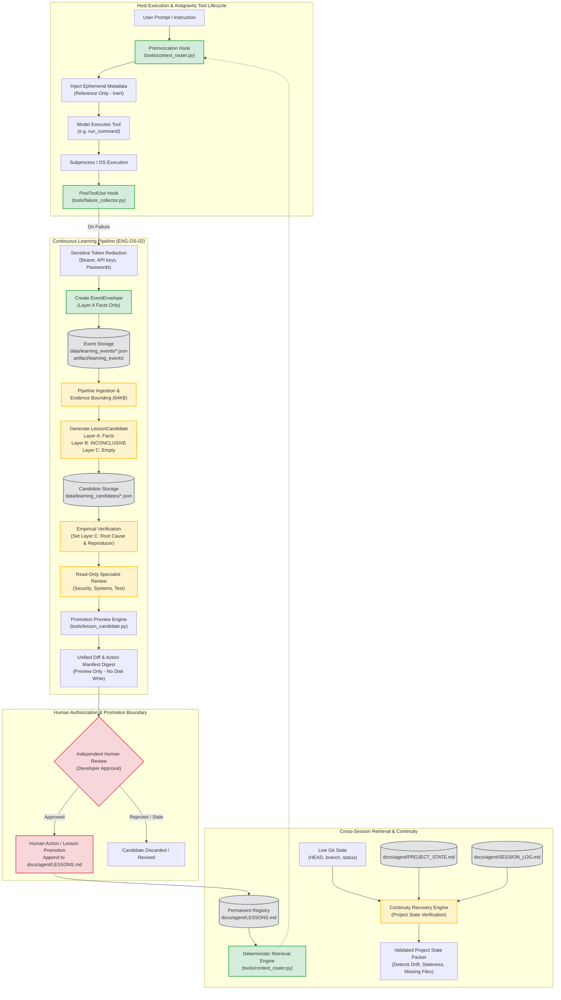

# ENG-OS-02 Phase 3D2 — Architecture Reconnaissance & Gap Analysis

**Document:** `docs/agent/PHASE_3D2_ASSESSMENT.md`  
**Date:** 2026-11-05  
**Role:** Principal Software Architect, Reliability Engineer, and Security Auditor  
**Milestone:** ENG-OS-02: Adaptive Engineering Intelligence (Phase 3D2)  
**Execution Context:** Pre-Implementation Architectural Reconnaissance (Stage 0)  

---

## 1. Executive Summary

This assessment establishes the baseline architecture, component boundaries, and operational gaps for integrating Jarvis Engineering OS's persistent project continuity mechanisms with its evidence-gated continuous-learning pipeline.

The target lifecycle is:
$$\text{Observed Event} \longrightarrow \text{Evidence Collection} \longrightarrow \text{Candidate Generation} \longrightarrow \text{Root-Cause Verification} \longrightarrow \text{Specialist Review} \longrightarrow \text{Human Approval} \longrightarrow \text{Controlled Promotion} \longrightarrow \text{Future Retrieval}$$

The system must strictly maintain the epistemic separation between:
1. **Directly Observed Execution Facts (Layer A)**: Exit codes, process termination signals, raw tool stderr/stdout snippets, file paths.
2. **Hypotheses & Explanations (Layer B)**: Plausible root-cause candidates and alternative hypotheses, defaulting strictly to `INCONCLUSIVE`.
3. **Verified Root Causes (Layer C)**: Explanations supported by reproducible empirical proof, minimal test cases, and corrective recommendations.
4. **Advisory Specialist Findings**: Reviews from read-only architectural, security, and test guardians with explicit provenance.
5. **Human Approval**: Independent, trusted human authorization bound to an unforgeable Action Manifest Digest.
6. **Permanent Engineering Lessons**: Manually curated or human-approved immutable entries in [`docs/agent/LESSONS.md`](file:///C:/Users/Youssef/Projects/Jarvis_2.0/docs/agent/LESSONS.md), dynamically retrievable by future sessions.

---

## 2. Component and Data-Flow Map

---

## 3. Comprehensive Subsystem Audit

### 3.1 Component Implementation & Registration Matrix

| Subsystem Component | Source Path | Antigravity Registered? | Invoked During Tool Execution? | Persistence Scope | Automated vs. Manual |
| :--- | :--- | :---: | :---: | :--- | :--- |
| **Context Router** | [`tools/context_router.py`](file:///C:/Users/Youssef/Projects/Jarvis_2.0/tools/context_router.py) | **Yes** (`PreInvocation`) | **Yes** (Every user turn) | Ephemeral turn packet; reads permanent `LESSONS.md` | **Automated** |
| **Failure Collector** | [`tools/failure_collector.py`](file:///C:/Users/Youssef/Projects/Jarvis_2.0/tools/failure_collector.py) | **Yes** (`PostToolUse` for `run_command`) | **Yes** (After every command execution) | Persists JSON envelope to storage dir if failure observed | **Automated** |
| **Lesson Candidate** | [`tools/lesson_candidate.py`](file:///C:/Users/Youssef/Projects/Jarvis_2.0/tools/lesson_candidate.py) | **No** | **No** (API library only) | Memory dataclass; no standalone persistent store | **Manual / Library** |
| **Safety Watchdog** | [`tools/watchdog_hook.py`](file:///C:/Users/Youssef/Projects/Jarvis_2.0/tools/watchdog_hook.py) | **Yes** (`PreToolUse`) | **Yes** (Guards file mutations) | Ephemeral process | **Automated** |
| **Python Diagnostic** | [`tools/lint_hook.py`](file:///C:/Users/Youssef/Projects/Jarvis_2.0/tools/lint_hook.py) | **Yes** (`PostToolUse` for file edits) | **Yes** (After file edits) | Ephemeral process | **Automated** |
| **Permanent Registry** | [`docs/agent/LESSONS.md`](file:///C:/Users/Youssef/Projects/Jarvis_2.0/docs/agent/LESSONS.md) | N/A | Read by Context Router | Persistent Git-tracked repository file | **Human Curated** |
| **Project State** | [`docs/agent/PROJECT_STATE.md`](file:///C:/Users/Youssef/Projects/Jarvis_2.0/docs/agent/PROJECT_STATE.md) | N/A | None (Manual read) | Persistent Git-tracked repository file | **Manual Protocol** |
| **Session Log** | [`docs/agent/SESSION_LOG.md`](file:///C:/Users/Youssef/Projects/Jarvis_2.0/docs/agent/SESSION_LOG.md) | N/A | None (Manual read) | Persistent Git-tracked repository file | **Manual Protocol** |

### 3.2 Artifact Lifecycles

| Artifact Category | Storage Location | Retention / Lifetime | Epistemic Status | Trust Boundary & Authority |
| :--- | :--- | :--- | :--- | :--- |
| **Context Packet** | Standard output JSON (stdout) | Current turn only (`ephemeralMessage`) | Synthesized Reference | Inert reference metadata only; never executable instructions. |
| **Failure Envelope** | `data/learning_events/*.json` or `artifact/learning_events/` | Cross-session persistent file | Layer A Observed Facts | Raw machine observation; exit code confidence labeled (HIGH/LOW/UNAVAILABLE). |
| **Lesson Candidate** | Runtime Python memory / future `learning_candidates/` | Cross-session once stored | Layer A + B + C (Staged) | Draft proposal; explicitly unapproved; cannot alter permanent policy. |
| **Promotion Preview** | Return dict from `prepare_promotion_preview()` | In-process execution / stdout | Audit Proposal | Bound by Action Manifest Digest ($SHA\text{-}256$); non-writing preview. |
| **Permanent Lesson** | [`docs/agent/LESSONS.md`](file:///C:/Users/Youssef/Projects/Jarvis_2.0/docs/agent/LESSONS.md) | Permanent repository lifetime | Binding Engineering Memory | Requires human action to append; dynamically retrievable by Context Router. |
| **Project Snapshot** | [`docs/agent/PROJECT_STATE.md`](file:///C:/Users/Youssef/Projects/Jarvis_2.0/docs/agent/PROJECT_STATE.md) | Permanent across sessions | Snapshot / Hypothesis | Subject to self-validation drift check; superseded by live Git reality. |
| **Chronological Ledger**| [`docs/agent/SESSION_LOG.md`](file:///C:/Users/Youssef/Projects/Jarvis_2.0/docs/agent/SESSION_LOG.md) | Permanent append-only | Historical Record | Immutable historical record; never edited retroactively. |

---

## 4. Gap Analysis: Intended Lifecycle vs. Disk Reality

### Gap 1: Absence of an Automated Cross-Session Continuity & Staleness Engine
- **Intended Behavior:** A new session executes an automated verification routine that compares current Git state (`branch`, `HEAD`, working tree manifest) against [`docs/agent/PROJECT_STATE.md`](file:///C:/Users/Youssef/Projects/Jarvis_2.0/docs/agent/PROJECT_STATE.md), detects stale or contradictory statements, validates referenced files, checks recorded test status against live test suites, and flags unresolved work without hallucinating completion.
- **Disk Reality:** Currently, continuity relies on a manual 5-step human-agent protocol in [`.agents/skills/agent-continuity/SKILL.md`](file:///C:/Users/Youssef/Projects/Jarvis_2.0/.agents/skills/agent-continuity/SKILL.md). In practice, `PROJECT_STATE.md` has drifted significantly: Section 1 records 13 modified files and 29 untracked files from `2026-11-04`, whereas the live Git baseline contains 17 modified files and 43 untracked items. There is no automated CLI or Python validator to detect this drift programmatically.

### Gap 2: Disconnected Failure-to-Candidate Pipeline
- **Intended Behavior:** When [`tools/failure_collector.py`](file:///C:/Users/Youssef/Projects/Jarvis_2.0/tools/failure_collector.py) records `EventEnvelope` JSONs, a deterministic pipeline can ingest these events, link evidence safely, and construct deduplicated `LessonCandidate` objects ready for specialist review.
- **Disk Reality:** While [`tools/failure_collector.py`](file:///C:/Users/Youssef/Projects/Jarvis_2.0/tools/failure_collector.py) persists envelopes and [`tools/lesson_candidate.py`](file:///C:/Users/Youssef/Projects/Jarvis_2.0/tools/lesson_candidate.py) provides candidate data models and sanitization routines, there is no orchestration module or CLI command to scan event files, deduplicate candidates across sessions, or manage the candidate lifecycle from disk.

### Gap 3: Epistemic Confusion Between Runtime Memory and Engineering OS Lessons
- **Intended Behavior:** Jarvis runtime conversational assistant memory (`jarvis.core.memory.MemoryManager` storing user habits and facts in SQLite) is completely separate from Jarvis Engineering OS continuous-learning lessons (`FailureEvent` $\to$ `LessonCandidate` $\to$ `docs/agent/LESSONS.md`).
- **Disk Reality:** Existing test `tests/test_context_continuity_and_auto_learning.py` tests conversational habit crystallization in `MemoryManager`. No integration test verified cross-session persistence and retrieval boundary separation for Engineering OS failure events and candidates.

### Gap 4: Candidate Storage & Session Boundary Survival
- **Intended Behavior:** A generated `LessonCandidate` must survive session boundaries in a persistent candidate directory (e.g. `data/learning_candidates/`) without being treated as an active lesson by `tools/context_router.py`.
- **Disk Reality:** `LessonCandidate` currently exists only in-memory during unit tests. There is no candidate file store, serialization schema, or candidate index.

---

## 5. Security & Trust-Boundary Specifications

1. **Autonomous Promotion Prohibition:**
   [`tools/lesson_candidate.py`](file:///C:/Users/Youssef/Projects/Jarvis_2.0/tools/lesson_candidate.py) implements `promote_to_lessons_file()` which strictly fails closed with `PROMOTION_PROHIBITED`. This invariant must be preserved unconditionally. Permanent writes to `docs/agent/LESSONS.md` require external human action.
2. **In-Process Self-Approval Prohibition:**
   [`tools/lesson_candidate.py`](file:///C:/Users/Youssef/Projects/Jarvis_2.0/tools/lesson_candidate.py) implements `apply_human_approval()` which strictly fails closed with `SELF_APPROVAL_PROHIBITED`. Model-generated tokens, caller-supplied Booleans (`confirmed=True`), or agent-computed hashes cannot establish human approval.
3. **Action Manifest Digest Binding:**
   `prepare_promotion_preview()` calculates:
   $$\text{Digest} = \text{SHA-256}\left(\text{Candidate Content Hash} \,\|\, \text{Canonical Destination} \,\|\, \text{Diff Hash} \,\|\, \text{Proposed Lesson ID}\right)$$
   Any post-preview modification of candidate fields, destination path, or markdown structure invalidates the digest.
4. **Retrieval Boundary Isolation:**
   [`tools/context_router.py`](file:///C:/Users/Youssef/Projects/Jarvis_2.0/tools/context_router.py) only parses `docs/agent/LESSONS.md` (confined to `WORKSPACE_ROOT`). Raw failure events and unapproved lesson candidates must never enter the dynamic retrieval packet.
5. **Path Confinement & Reparse Defense:**
   All evidence resolution must continue enforcing 64KB read caps, canonical workspace root validation, and full-chain symlink/junction reparse-point rejection via `validate_path_confinement()` and `is_reparse_point_or_link()`.

---

## 6. Implementation Scope for Phase 3D2

To close these gaps without expanding beyond frozen scope boundaries, the following components will be implemented and integrated:

1. **`tools/continuity_manager.py` (Workstream A & B):**
   - **Cross-Session Continuity Engine:** Programmatically validates `PROJECT_STATE.md` against live Git status, branch, and HEAD; detects drift, stale file references, and unverified assumptions; returns a structured, verified project state packet.
   - **Failure-to-Candidate Ingestion Engine:** Scans `learning_events/`, ingests unhandled failure events, deduplicates against existing candidates, binds Layer A evidence, and generates `LessonCandidate` objects with Layer B initialized strictly to `INCONCLUSIVE`.
   - **Candidate Repository Storage:** Persists candidates to `data/learning_candidates/*.json` across session boundaries with content hash verification.
   - **Action Manifest Digest Verification:** Generates and validates candidate promotion preview diffs without mutating `docs/agent/LESSONS.md`.
2. **Unit & Integration Test Suite `tests/test_continuity_and_lifecycle.py` (Workstream D):**
   - Implements the 14 required lifecycle integration test scenarios using isolated temporary fixtures.
3. **Reconciled Persistent Documentation:**
   - Append Phase 3 session completions to `docs/agent/SESSION_LOG.md`.
   - Update `docs/agent/PROJECT_STATE.md` Section 1 with live verified Git baseline.
