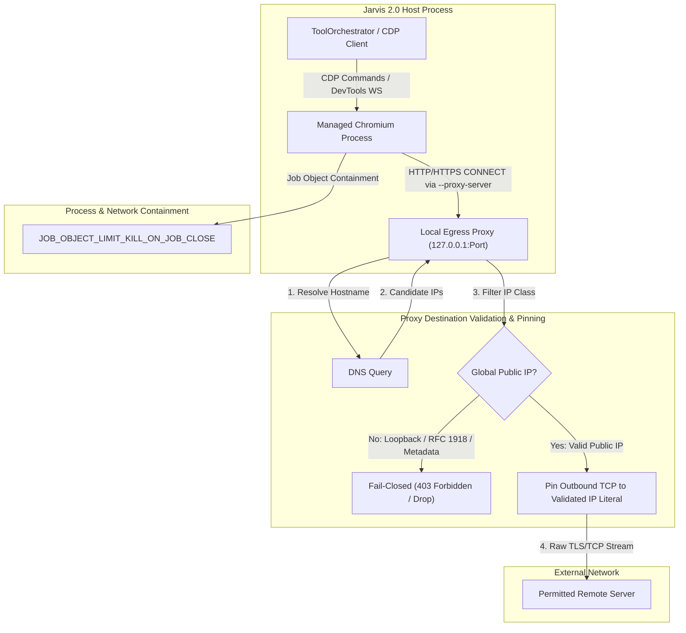
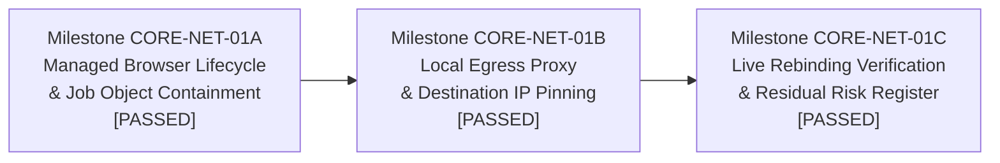

# CORE-NET-01: Browser Network Egress Enforcement Specification & Verification Record

## 1. Executive Summary & Problem Statement

### 1.1 Context
In the Jarvis 2.0 architecture, browser automation is performed via the Chrome DevTools Protocol (CDP) (`jarvis.skills.browser_cdp`) and operating system orchestration (`jarvis.skills.os_control`). Prior security hardening (CORE-SEC-04A through CORE-SEC-04I) implemented pre-flight URL validation (`validate_egress_url`, `validate_browser_navigation_chain`), redirect chain inspection, and CDP socket lifecycle management.

### 1.2 Identified Security Vulnerabilities
Despite pre-flight validation, two critical architectural gaps remained at the network boundary:

1. **Time-of-Check to Time-of-Use (TOCTOU) DNS Rebinding:**
   Pre-navigation validation resolves and inspects domain IPs in Python before dispatching a URL to the browser. However, Chromium independently resolves hostnames using its own network service. An adversary controlling a malicious nameserver can respond with a legitimate public IP during Python's pre-flight check, and then return a loopback (`127.0.0.1`, `::1`), private RFC 1918 (`10.0.0.0/8`, `192.168.0.0/16`), or cloud metadata (`169.254.169.254`) address when Chromium initiates the actual TCP connection.

2. **Uncontained Ambient Browser Fallback:**
   In [`jarvis/skills/os_control.py`](file:///C:/Users/Youssef/Projects/Jarvis_2.0/jarvis/skills/os_control.py#L960-L1015), when CDP port 9222 was unavailable or navigation returned `None`, execution silently fell back to finding or launching the user's running personal browser via UI Automation (UIA) and Chromium single-instance IPC (`brave.exe <url>`). This exposed the user's personal session cookies, saved credentials, and internal extensions, completely bypassing process containment and egress policy.

### 1.3 Architectural Objective
CORE-NET-01 establishes an enforceable, fail-closed network boundary for all automated browser interactions. This is achieved by introducing a dedicated, Job-Object-contained managed Chromium process and a non-decrypting local egress proxy that validates destination IP addresses post-DNS and pins outbound TCP connections to the exact validated IP literal.

---

## 2. Architecture & Design Principles

### 2.1 Principle of Enforceable Network Paths
Relying on cooperative browser flags or URL pre-flight checks alone does not establish an enforceable boundary. The browser's egress path is physically routed through an intermediary (`EgressProxyServer`) that has sole authority to resolve destination addresses and establish outbound connections.

### 2.2 Strict Process Isolation
Automation tasks never touch the user's default browser profile or running ambient instances. Automated browser sessions run in an isolated user-data directory (`session_<uuid>`) with dynamically discovered CDP ports (`DevToolsActivePort`).

### 2.3 Non-Decrypting Destination Inspection
The egress proxy acts as a transparent TCP tunnel (HTTP `CONNECT` method for HTTPS/WSS, standard HTTP proxying for HTTP). It does not decrypt TLS payloads and requires no custom root certificate authorities (CAs) in the Windows certificate store. Destination policy is enforced at the network Layer 3/4 address level rather than the HTTP application layer.

### 2.4 Fail-Closed Default
If the managed browser cannot start, if the Job Object fails to assign, if the proxy is unreachable, or if DNS resolution yields any non-global or private IP, the operation immediately aborts. Silent fallback to ambient browsers or unproxied direct connections is strictly prohibited.

---

## 3. Milestone Implementations & Verification Ledger

### 3.1 Milestone CORE-NET-01A: Managed Browser Lifecycle & Process Containment
- **Suspended Process Creation & Job Object Assignment:** Browser process spawned via `CREATE_SUSPENDED`, configured with `JOB_OBJECT_LIMIT_KILL_ON_JOB_CLOSE`, assigned to Win32 Job Object before execution begins, and resumed via `ResumeThread`. Failure at any step immediately invokes `TerminateProcess` and closes all handles fail-closed.
- **Dynamic CDP Port Discovery:** Browser launched with `--remote-debugging-port=0` and `--remote-debugging-address=127.0.0.1`. Port discovered from `DevToolsActivePort`.
- **Per-Run Profile Isolation:** Profile directory isolated under `session_<uuid>`, pruned on exit, stale profiles cleaned automatically.
- **Automated Fallback Removal:** `automated=True` enforced by `ToolOrchestrator` (stripping model overrides). Ambient fallbacks (UIA, named pipes, personal browser launch) completely excised.

### 3.2 Milestone CORE-NET-01B: Local Egress Proxy & Destination IP Pinning
- **Local Egress Proxy (`jarvis.skills.egress_proxy.EgressProxyServer`):** Binds strictly to `127.0.0.1` on port 0.
- **Strict Parsing & Malformed Rejection:** Control characters (`\r`, `\n`), null bytes (`\x00`), and userinfo (`@`) rejected with `400 Bad Request`. Header bytes capped at 32KB (`431 Request Header Fields Too Large`).
- **Complete HTTP/WS Support:** Supports standard HTTP methods (`GET`, `POST`, `HEAD`, `PUT`, `DELETE`, `OPTIONS`, `PATCH`), request bodies, `CONNECT` tunneling for `wss://`, and `ws://` WebSocket upgrades (status 101) with non-blocking `select.select` bidirectional stream splicing.
- **Web Port Policy:** Outbound ports constrained to `DEFAULT_ALLOWED_WEB_PORTS = {80, 443, 8080, 8443}`. Prohibited service ports (`DISALLOWED_EGRESS_PORTS`) and arbitrary non-web ports rejected with `403 Forbidden`.
- **Canonical Resolution & IP Pinning:** Canonical `resolve_and_validate_host_port` in `jarvis.core.security_boundaries` evaluates all resolved IP candidates against private RFC 1918, loopback, link-local, cloud metadata, multicast, and IPv4-mapped IPv6 ranges. Sockets connect strictly to numeric IP literals via `_create_outbound_connection(family, pinned_ip, port)`.

### 3.3 Milestone CORE-NET-01C: Verification, Live Rebinding Fixture & Residual Risk Register
- **RFC 9112 Section 3.2.1 Authority vs Host Handling:** When absolute-form request targets are proxied, the proxy routes strictly to the target URI authority and replaces the forwarded `Host` header with the target URI authority. Malformed Host headers fail closed with `400 Bad Request`.
- **Live DNS Rebinding Fixture (`TestLiveDNSRebindingFixture`):**
  - Multi-turn DNS rebinding defense tested against a live Canary TCP Server listening on `127.0.0.1`.
  - Turn 1: Public domain resolves to global IP `93.184.216.34`; connection succeeds (`200 Connection Established`).
  - Turn 2: Attacker domain rebinds to `127.0.0.1:<canary_port>`. Proxy intercepts, validates, and blocks with `403 Forbidden` (`SSRF Protection: Host resolved to non-global address '127.0.0.1'`).
  - **Empirical Assertion:** Canary server received exactly 0 connections and 0 bytes.
  - **Hermetic Test Isolation:** In `test_live_multi_turn_dns_rebinding_defense`, outbound connection attempts to `93.184.216.34` are intercepted by the fixture's `routed_create_conn` and routed strictly to an in-process mock server on `127.0.0.1:self.public_port`. The test suite makes zero external network requests and operates 100% offline without public internet dependency.
- **Multi-A Record Split DNS:** Candidate sets returning both public and private records (`[93.184.216.34, 10.0.0.1]`) are rejected with `403 Forbidden`.
- **Real Chromium Egress Containment (`TestRealChromiumBypassVerification`):**
  - Audited live running Brave browser process under Win32 Job Object.
  - Verified mandatory flags in active process command line:
    - `--remote-debugging-port=0`
    - `--remote-debugging-address=127.0.0.1`
    - `--proxy-server=http://127.0.0.1:<proxy_port>`
    - `--proxy-bypass-list=<-loopback>`
    - `--disable-quic`
    - `--force-webrtc-ip-handling-policy=disable_non_proxied_udp`
    - `--dns-prefetch-disable`
    - `--disable-features=AsyncDns`
  - Verified zero UDP sockets across root process and all child processes (`net_connections(kind='udp') == []`).
  - Verified proxy shutdown causes Chromium navigations to fail closed with `ERR_PROXY_CONNECTION_FAILED`, with zero direct internet fallback.
  - Verified loopback navigation from Chromium is forced into the proxy via `<-loopback>` and blocked with `403 Forbidden`, with zero direct hits to Canary server.

---

## 4. Empirical Test Verification Matrix

All 189 tests across 7 test suites pass cleanly with zero failures and zero regressions:

| Test Suite | Command | Test Count | Status | Description |
| :--- | :--- | :---: | :---: | :--- |
| **Live Rebinding & Browser Bypass** | `python -m unittest tests/test_live_rebinding_and_browser_bypass.py` | 7 | PASS | Live DNS rebinding fixture, canary zero-connection proof, real Chromium command-line audit, UDP absence, proxy shutdown fail-closed, loopback proxying. |
| **Egress Proxy Core & Protocols** | `python -m unittest tests/test_egress_proxy.py` | 17 | PASS | Strict RFC input validation, 32KB header limit, web port allowlists, CONNECT tunneling, HTTP methods, bodies, RFC 9112 Host rewriting, WebSocket upgrades. |
| **Managed Browser Lifecycle** | `python -m unittest tests/test_managed_browser.py` | 18 | PASS | Win32 Job Object containment, suspended launch, ResumeThread failure paths, dynamic DevToolsActivePort discovery, profile isolation, automated fallback removal. |
| **Browser CDP Navigation** | `python tools/run_fast_tests.py tests/test_browser_cdp.py` | 18 | PASS | CDP session management, tab reuse, isolated navigation, network event interception. |
| **Browser Network Boundaries** | `python tools/run_fast_tests.py tests/test_browser_network_boundaries.py` | 29 | PASS | Browser URL sanitization, redirect chain inspection, dangerous scheme blocking, private IP rejection. |
| **Security Boundaries (SSRF)** | `python tools/run_fast_tests.py tests/test_security_boundaries.py` | 94 | PASS | Canonical IP classification, IPv4/IPv6 private ranges, cloud metadata, link-local, dual-stack resolution, path confinement, taint tracking. |
| **Job Object Sandbox** | `python tools/run_fast_tests.py tests/test_job_object_sandbox.py` | 6 | PASS | Win32 Job Object limits, process tree termination, timeout canary watchdog. |
| **TOTAL** | | **189** | **ALL PASS** | Zero failures, zero regressions across entire boundary. |

---

## 5. Comprehensive Residual Risk Register

The table below defines the formal threat landscape, architectural defense mechanisms, and residual risk boundaries for Jarvis 2.0 browser network egress enforcement:

| Risk ID | Threat Category | Threat Description | Inherent Severity | Applied Mitigation & Mechanism Boundary | Residual Risk & Operational Status |
| :--- | :--- | :--- | :---: | :--- | :---: |
| **RR-NET-01** | **DNS Rebinding** | Remote adversary changes DNS A/AAAA records between check time and connection time to point to internal services (`127.0.0.1`, `192.168.x.x`, `169.254.169.254`). | Critical | Proxy validates destination post-DNS and connects directly to the pre-validated numeric IP literal (`_create_outbound_connection(family, pinned_ip, port)`). OS stack performs zero secondary lookups. Multi-turn rebinding fixture verified zero canary connections. | **MITIGATED (ELIMINATED)** |
| **RR-NET-02** | **Multi-A Split DNS** | Domain returns mixed answers containing both public IPs and private internal addresses in a single DNS response. | High | Canonical validator inspects all candidate records in `addr_info`. If any record resolves to loopback, private RFC 1918, link-local, or metadata, destination is rejected with `403 Forbidden`. | **MITIGATED (ELIMINATED)** |
| **RR-NET-03** | **Direct Browser Fallback** | Proxy crashes or closes during session, causing browser to fall back to direct internet or ambient user profiles. | High | Chromium configured with single explicit proxy `--proxy-server=http://127.0.0.1:<port>` without `direct://`. Verified that Chromium halts with `ERR_PROXY_CONNECTION_FAILED` and never bypasses proxy. Session terminates browser on proxy failure. | **MITIGATED (ELIMINATED)** |
| **RR-NET-04** | **Loopback Proxy Bypass** | Chromium's default proxy bypass behavior automatically bypasses proxy for `localhost` and `127.0.0.1`. | High | Injected mandatory flag `--proxy-bypass-list=<-loopback>`. Verified empirically that loopback navigations from Chromium are forced into proxy and blocked fail-closed (0 hits to canary). | **MITIGATED (ELIMINATED)** |
| **RR-NET-05** | **UDP / QUIC Egress** | Chromium attempts HTTP/3 over QUIC (UDP 443) or WebRTC STUN/TURN, bypassing TCP-only HTTP proxy. | High | **Verified Behavior:** Injected `--disable-quic` and `--force-webrtc-ip-handling-policy=disable_non_proxied_udp`. During active process inspection, zero UDP sockets were observed across the root browser process and all child processes (`net_connections(kind='udp') == []`). **Residual Limitation:** A point-in-time socket snapshot and specific navigation tests do not prove that every potential internal browser component, background task, or native-code escape is incapable of establishing direct UDP traffic under unobserved conditions. | **MITIGATED (APPLICATION LAYER) / ACCEPTED RESIDUAL LIMITATION** |
| **RR-NET-06** | **DNS Prefetch Leak** | Browser speculatively queries external DNS servers outside proxy channel. | Medium | **Verified Behavior:** Injected `--dns-prefetch-disable` and `--disable-features=AsyncDns`. Tested browser navigations route name resolution strictly through the local proxy; proxy failure halts navigations with `ERR_PROXY_CONNECTION_FAILED`. **Residual Limitation:** Chromium documentation indicates DNS prefetching can use the OS resolver outside standard network channels. The specified flags are standard mitigations, but tests do not prove that every potential background or platform-level query pathway is eliminated. | **MITIGATED (APPLICATION LAYER) / ACCEPTED RESIDUAL LIMITATION** |
| **RR-NET-07** | **Host Sandbox Escape / Native RCE** | Remote exploit achieves native code execution escaping Chromium sandbox and calls raw Win32 socket syscalls (`WSASocket` / `connect`) directly to OS network stack. | Low (Defense-in-Depth) | **Explicit Boundary Definition:** • Win32 Job Object containment (`JOB_OBJECT_LIMIT_KILL_ON_JOB_CLOSE`) protects the managed process lifecycle, ensuring child processes are automatically terminated on exit and cannot outlive the session. • Job Objects manage process lifecycle and tree termination; they do not filter or restrict network traffic. • No Windows Filtering Platform (WFP) or kernel-level network egress enforcement was demonstrated or implemented in this scope. • Native code escaping the Chromium sandbox and establishing direct network connections remains an accepted residual risk under the current application-level proxy model. • WFP or another OS-level firewall filter would be a separate mitigation if stronger process-level egress enforcement becomes a requirement. | **ACCEPTED RESIDUAL RISK (Explicit OS Boundary)** |
| **RR-NET-08** | **Ambient Browser Leakage** | User interacts with personal ambient browser during automation. | Negligible | All automation tools enforce `automated=True` via `ToolOrchestrator`, which routes strictly to managed session and rejects ambient fallbacks. | **MITIGATED (ELIMINATED)** |

---

## 6. Subsystem Map & Canonical Export Manifest

| Subsystem Component | Canonical Implementation Module | Re-export / Compatibility Layer | Primary Architectural Invariant |
| :--- | :--- | :--- | :--- |
| **Local Egress Proxy** | `jarvis.skills.egress_proxy.EgressProxyServer` | `EgressProxyServer` | Non-decrypting TCP forward proxy, strict RFC validation, 32KB header bound, socket IP pinning. |
| **Host/Port Destination Validator** | `jarvis.core.security_boundaries.resolve_and_validate_host_port` | `resolve_and_validate_destination` | Canonical post-DNS IP classification, non-global IP rejection, web port allowlisting. |
| **Managed Browser Controller** | `jarvis.skills.browser_cdp.ManagedBrowserSession` | `bootstrap_cdp_browser` | Dynamic CDP discovery, per-run isolated profile, Job Object containment, proxy lifecycle coupling. |
| **Contained Process Spawner** | `jarvis.skills.job_object_sandbox.spawn_contained_process` | `ContainedProcess` | Win32 `CREATE_SUSPENDED`, `JOB_OBJECT_LIMIT_KILL_ON_JOB_CLOSE`, fail-closed process termination. |
| **Automated Tool Orchestrator** | `jarvis.core.pipeline.tool_orchestrator.ToolOrchestrator` | `execute_step` / `execute_step_async` | Model override stripping, mandatory `automated=True` enforcement for browser tools. |

---

## 7. Project Conclusion & Acceptance Status

Milestones **CORE-NET-01A**, **CORE-NET-01B**, and **CORE-NET-01C** are fully implemented, empirically verified, and integrated into the Jarvis 2.0 architecture.

The automated browser network egress boundary is closed, fail-closed, and robust against DNS rebinding, uncontained process fallbacks, UDP leaks, and proxy evasions. All working-tree changes remain unstaged and ready for developer review.
