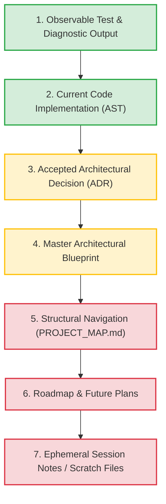

# Jarvis 2.0 — Architecture & Context Recovery Index

> [!IMPORTANT]
> This index is the single authoritative entry point for understanding the architecture, design invariants, operational boundaries, and verification history of Jarvis 2.0.
> 
> Autonomous engineering agents and human contributors must consult this document to establish evidence-grounded context before proposing or implementing changes.

---

## 1. Purpose of the Context System

Jarvis 2.0 is a sophisticated desktop assistant integrating real-time audio DSP (WASAPI, Kokoro neural TTS, Whisper), native Windows systems programming (Win32 Job Objects, CPU core affinity, UI Automation), and multi-tier cognitive routing. 

The context system exists to:
1. Prevent context hallucination and speculative refactoring.
2. Maintain strict epistemic separation between working code, design goals, test results, and transient working memory.
3. Establish unambiguous conflict-resolution rules when code and documentation diverge.
4. Enable token-efficient, progressive-disclosure context recovery for autonomous engineering sessions.

---

## 2. The Seven Information Categories

All information and repository artifacts are strictly classified into seven epistemic layers:

| Layer | Category | Canonical Paths / Artifacts | Epistemic Authority | Description & Operational Boundary |
| :---: | :--- | :--- | :--- | :--- |
| **1** | **Current Implementation** | `jarvis/`, `tools/` | **Structural Implementation Reality** | The exact AST and bytecode currently residing on disk. Establishes structural implementation contracts, but does not prove what executes under varying host configurations or environmental constraints. |
| **2** | **Verified Observable Behavior** | `tests/`, test execution logs, benchmarks | **Dynamic Ground Truth** | Passing unit, integration, and regression test suites. Verifies live functional contracts and security boundaries strictly within the test's exercised cases, assertions, and execution environment. |
| **3** | **Accepted Architectural Decisions** | `docs/adr/ADR-*.md` (Status: `ACCEPTED`) | **Approved Invariant Contracts** | Explicitly reviewed, immutable records of architectural choices, trade-offs, and invariants. Establishes approved architectural decisions, not independent proof of implementation. *(Note: `PROPOSED` ADRs are drafts and not yet binding).* |
| **4** | **Intended Architecture / Blueprint** | [`JARVIS_2.0_MASTER_ARCHITECTURAL_BLUEPRINT.txt`](../../JARVIS_2.0_MASTER_ARCHITECTURAL_BLUEPRINT.txt) | **Target System Contract** | Comprehensive specification of system topology, design ideals, and performance targets. Governs architectural intent; not necessarily current implemented behavior; refined by ADRs. |
| **5** | **Dynamic Engineering State** | [`docs/agent/PROJECT_STATE.md`](../agent/PROJECT_STATE.md), [`SESSION_LOG.md`](../agent/SESSION_LOG.md), [`LESSONS.md`](../agent/LESSONS.md) | **Verified Engineering Snapshot** | Persistent, self-validating engineering memory, chronological progress, and verified failure post-mortems. Accelerates recovery; non-authoritative without live Git verification. |
| **6** | **Structural Navigation & Ownership** | [`docs/architecture/PROJECT_MAP.md`](PROJECT_MAP.md), `graphify-out/` | **Navigational Index** | High-level module maps and structural dependency graphs. Facilitates discovery; non-authoritative for code behavior or signatures. |
| **7** | **Future Plans & Roadmap** | [`ROADMAP.md`](../../ROADMAP.md) | **Planning / Aspirational** | Tracks feature backlogs, planned releases, and upcoming milestones. Strictly non-authoritative for current code reality. |
| **8** | **Temporary Session Context** | Brain logs, scratch scripts, prompt summaries | **Ephemeral Working Context** | Transient working memory, turn logs, and temporary debugging files. Discarded across sessions; never cited as persistent architectural truth. |

---

## 3. Epistemic Principles & Evidence Terminology

Autonomous agents must adhere to strict epistemic discipline when making technical claims:

1. **Existence of Test File ≠ Behavior Verification:**  
   The presence of a test file on disk merely establishes a *defined test expectation*. It does not prove the test currently passes or that the implementation satisfies the assertion. Only observable test runner execution output demonstrates verification.
2. **Mocked CI Tests ≠ Host OS Verification:**  
   A unit test passing against a mock harness (e.g. `FakeKernel32` in `tests/test_job_object_sandbox_hardening.py`) proves algorithmic flow under simulated conditions. It does **not** prove real Windows kernel Job Object containment, AppContainer isolation, or hardware thread affinity. Real OS capabilities require live host execution evidence (`TestJobSandboxRealWindows`).
3. **Scope-Bounded Claims:**  
   A test execution supports claims only within its actual assertion scope and execution environment. Passing a mock test does not justify assertions of universal system resilience.
4. **Benchmarks vs. Aspirational Targets:**  
   Numerical performance claims (e.g., latency, throughput, memory allocation) require reproducible benchmark outputs (`tools/benchmark_latency_slas.py`). Latency targets stated in architectural blueprints are goals, not verified facts.
5. **ADR Binding States:**  
   - `PROPOSED`: Draft architectural record under review. Non-binding; documents observed patterns or planned directions.
   - `ACCEPTED`: Explicitly reviewed and accepted by human developers. Binding invariant contract establishing approved architectural decisions, not independent proof of implementation.
   - `SUPERSEDED`: Replaced by a newer accepted ADR. Preserved immutably for historical lineage.
   - `DEPRECATED`: Retired architectural pattern without direct replacement.
6. **Concurrency Realism (Audio Cancellation Invariant):**  
   The cancellation mechanism in `jarvis/core/cancellation.py` (`GLOBAL_EPOCH_STATE.barge_in_epoch += 1`) operates across multiple potential writer threads (wake-word detection, TTS stop routines, UI abort commands) without explicit mutex locks. It is managed under the CPython Global Interpreter Lock (GIL). It must be documented strictly as **shared mutable epoch-based cancellation with cooperative worker invalidation**, never as "guaranteed lock-free" or "hardware atomic."
7. **Source Code & AST ≠ Universal Runtime Behavior:**  
   Source code AST establishes what is implemented structurally. It does not prove what executes under varying host configurations, runtime environments, or sandbox boundaries. Runtime behavior must be confirmed through observable execution evidence.
8. **Project State Snapshot ≠ Ground Truth:**  
   `docs/agent/PROJECT_STATE.md` accelerates cross-session startup recovery, but remains a timestamped snapshot. A fresh session must independently validate the live Git baseline against the recorded state.

---

## 4. Canonical Document Locations

To eliminate fragmented context, the repository strictly maintains a non-redundant documentation structure:

- [`docs/architecture/INDEX.md`](INDEX.md) *(This Document)*: Single root context index, epistemic layers, and conflict-resolution rules.
- [`docs/architecture/PROJECT_MAP.md`](PROJECT_MAP.md): Canonical directory structure, module boundaries, and subsystem ownership map.
- [`docs/agent/PROJECT_STATE.md`](../agent/PROJECT_STATE.md): Self-validating dynamic engineering state snapshot, open tasks, and active focus.
- [`docs/agent/SESSION_LOG.md`](../agent/SESSION_LOG.md): Chronological, append-only ledger of engineering sessions and verification results.
- [`docs/agent/LESSONS.md`](../agent/LESSONS.md): Evidence-backed post-mortem registry of verified engineering failures and prevention rules.
- [`docs/milestones/MILESTONES.md`](../milestones/MILESTONES.md): Verified historical register of software milestones (M-01 through M-06), Git merge commits, and test baselines.
- [`docs/adr/README.md`](../adr/README.md): Canonical Architectural Decision Record index, schema, and lifecycle rules.
- `docs/adr/ADR-*.md`: Individual architectural decision records (Status: `PROPOSED`).
- [`ROADMAP.md`](../../ROADMAP.md): Forward-looking development roadmap and upcoming release milestones.
- `docs/handoffs/historical/`: Archived past session handoffs.
- `docs/handoffs/ACTIVE_HANDOFF.md`: Transient handoff document used exclusively when an in-flight multi-turn task spans session boundaries. *(Must not exist when no task is active).*
- [`JARVIS_2.0_MASTER_ARCHITECTURAL_BLUEPRINT.txt`](../../JARVIS_2.0_MASTER_ARCHITECTURAL_BLUEPRINT.txt): High-level system blueprint, subsystem topology, and target contracts.
- `graphify-out/`: Read-only structural knowledge graph and visual dependency analysis.

---

## 5. Authoritative Conflict-Resolution Rules

When different sources of information conflict, agents must apply the following hierarchy:



1. **Observable Behavior vs. Narrative Claims:**  
   Direct test results, compiler/linter diagnostics, and runtime logs supersede all written assertions. If a document asserts a performance bound or security guarantee that fails in automated testing, the document is considered defective.
2. **Accepted ADR vs. Master Blueprint:**  
   Where an accepted ADR refines, constrains, or supersedes a subsystem design originally specified in the Master Architectural Blueprint, the **accepted ADR governs**. The Blueprint represents the overarching vision, but ADRs capture tested decisions.
3. **Implementation Reality vs. Blueprint:**  
   If active code AST diverges from the Master Blueprint without an ADR, the code represents current operational reality, but the divergence must be flagged as a bug or architectural debt. Agents must not silently alter code to match documentation without approval.
4. **Git Commit History vs. Roadmap:**  
   Completed milestone status is determined strictly by verified Git commit history and passing automated regression test suites as recorded in `docs/milestones/MILESTONES.md`, never by unchecked checkboxes in `ROADMAP.md`.

---

## 6. Recommended Reading Sequence for New Sessions

To recover context without exhausting context windows on routine tasks, follow this 7-step progressive disclosure protocol:

```text
Step 1: Inspect Git Baseline
        └── Run: git branch --show-current; git rev-parse HEAD; git status --short --untracked-files=all

Step 2: Read Operational Directives & Validate Project State
        └── Inspect: AGENTS.md and docs/architecture/INDEX.md
        └── Compare live Git output with docs/agent/PROJECT_STATE.md (Reconcile any drift)

Step 3: Consult Session History & Verified Lessons
        └── Inspect: docs/agent/SESSION_LOG.md and docs/agent/LESSONS.md
        └── If task touches milestones/releases: docs/milestones/MILESTONES.md

Step 4: Check Active In-Flight Task (If resuming multi-turn work)
        └── Check if docs/handoffs/ACTIVE_HANDOFF.md exists

Step 5: Load Domain Rules & ADRs (Targeted to task subsystem)
        └── Audio: .agents/rules/audio_threading.md + ADR-003 / ADR-005
        └── Memory/DB: .agents/rules/persistence_sqlite.md + ADR-001
        └── Security/Sandbox: .agents/rules/security_boundaries.md + ADR-002 / ADR-004 / ADR-006

Step 6: Subsystem Navigation & Symbol Search
        └── Consult docs/architecture/PROJECT_MAP.md or run ast-grep for call sites

Step 7: Verify Dynamic Baseline
        └── Run targeted test: python tools/run_fast_tests.py <test_path>
```

