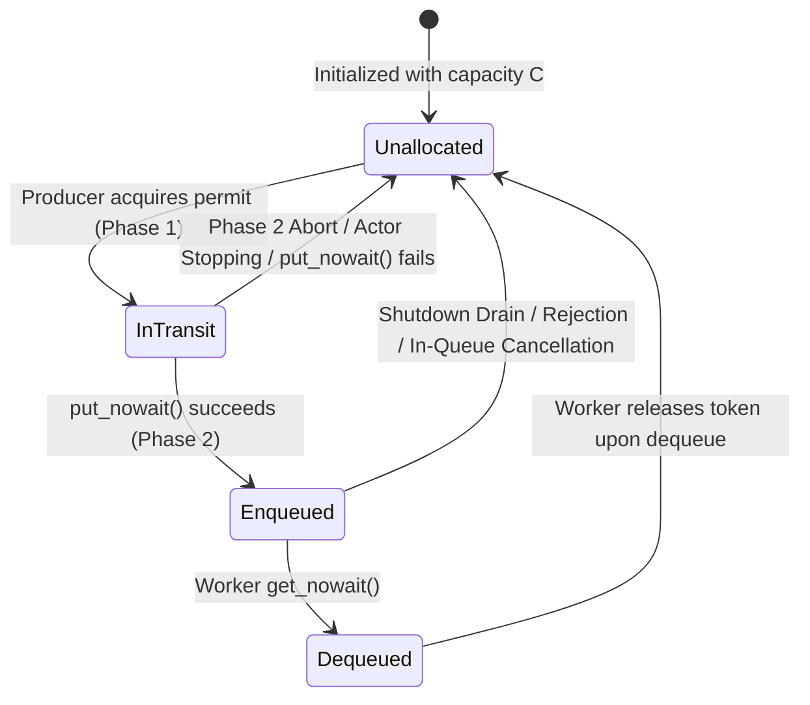
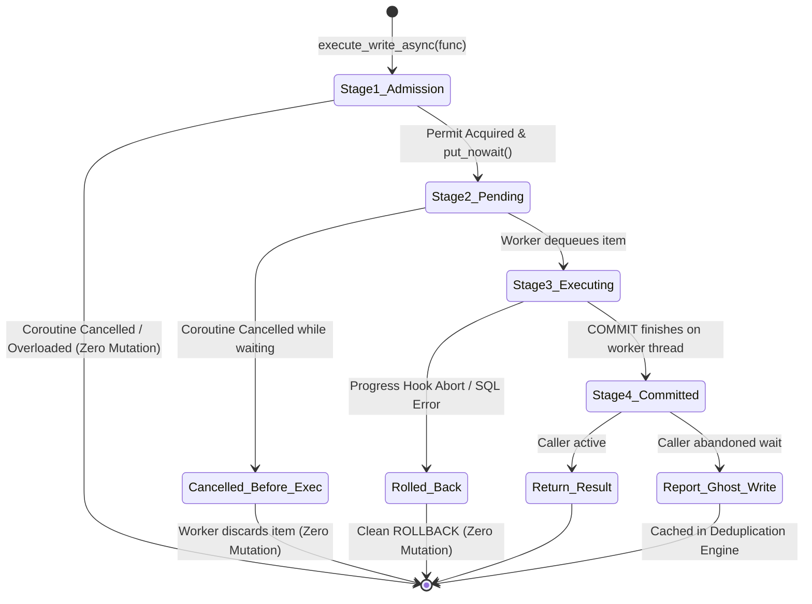
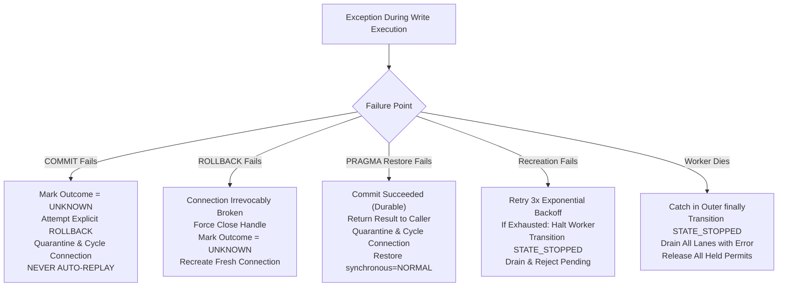

# SQLite Writer Ownership & Serialization Architecture — Formal Implementation Design

- **Status:** **DESIGN SPECIFICATION — IMPLEMENTATION NOT YET AUTHORIZED**
- **Target Repository:** `Jarvis_2.0`
- **Canonical Database Reference:** [`data/jarvis_memory.db`](file:///C:/Users/Youssef/Projects/Jarvis_2.0/data/jarvis_memory.db)
- **Author:** Software Engineering Collaborator (Antigravity)
- **Date:** 2026-11-02
- **Preceding Forensic Baseline:**
  - Audit Report: [`docs/reports/sqlite_writer_ownership_audit.md`](../reports/sqlite_writer_ownership_audit.md)
  - Decision Memo: [`docs/adr/ADR-001-decision-memo.md`](../adr/ADR-001-decision-memo.md)
  - Target Decision Record: [`docs/adr/ADR-001-sqlite-single-writer-wal.md`](../adr/ADR-001-sqlite-single-writer-wal.md) (`PROPOSED`)

---

## Executive Summary & Architectural Invariant

The forensic investigation established that Jarvis 2.0 maintains a **single canonical physical database file**: `data/jarvis_memory.db`. While interactive conversational memory writes are successfully serialized via [`SingleWriterActor`](../../jarvis/core/memory/sqlite_base.py#L41-L596), complete application-level writer exclusivity is not yet achieved because four direct-write paths ([`photo_manager.py`](../../jarvis/skills/photo_manager.py), [`reflex_macro_compiler.py`](../../jarvis/skills/reflex_macro_compiler.py), [`habit_graph.py`](../../jarvis/core/cognition/habit_graph.py)`::apply_exponential_decay()`, and [`sleep_consolidator.py`](../../jarvis/core/memory/sleep_consolidator.py)) open independent SQLite connections to the exact same file.

```mermaid
flowchart TD
    subgraph Clients["Subsystem Producers"]
        P_Int["Interactive Memory Producers\n(Dialogues, Reflexes, Tasks, Facts)"]
        P_Photo["Photo Manager Worker\n(Photo Indexing)"]
        P_Macro["Reflex Macro Compiler\n(Registrations & Telemetry)"]
        P_Sleep["Sleep Phase Consolidator\n(Serial Micro-Batches)"]
    end

    subgraph Admission["Two-Phase Lifecycle-Safe Admission (Deadlock-Free)"]
        Phase1["Phase 1: Reserve Capacity Outside _state_lock\n(Lane A Sem: 256 | Lane B Sem: 4)"]
        Phase2["Phase 2: Atomic State Check & put_nowait()\n(Under _state_lock; NEVER BLOCKS)"]
    end

    subgraph Lanes["Dual-Lane Fair Scheduler"]
        Lane_Int["Lane A: Interactive FIFO Queue\n(High Priority, Causal Reorder Window)"]
        Lane_Maint["Lane B: Maintenance FIFO Queue\n(Low Priority, Monotonic Serial Depth <= 1)"]
        Fairness["Workload Interleaver & Anti-Starvation Guard\n(20 Interactive : 1 Maintenance Ratio)"]
    end

    subgraph WorkerLoop["Single Persistent Worker Thread: JarvisSingleWriter"]
        Deduper["Idempotency & Deduplication Engine\n(Prevents Duplicate Replay on Uncertain Outcomes)"]
        PRAGMA_Ctrl["Durability Controller\n(Dynamic PRAGMA synchronous Switch & Restore)"]
        Hook_Ctrl["Progress Hook Manager\n(VDBE Abort Hooks, Sub-Millisecond Barge-In)"]
        Quarantine["Connection Quarantine & Recovery Manager\n(Rollback Verification & Reinitialization)"]
    end

    subgraph Storage["Canonical SQLite WAL Database"]
        DB[("data/jarvis_memory.db\n(Exclusive In-Process Writer Lock)")]
    end

    P_Int --> Phase1
    P_Photo --> Phase1
    P_Macro --> Phase1
    P_Sleep --> Phase1

    Phase1 --> Phase2
    Phase2 -->|Interactive Job| Lane_Int
    Phase2 -->|Maintenance Job| Lane_Maint

    Lane_Int --> Fairness
    Lane_Maint --> Fairness
    Fairness --> Deduper
    Deduper --> WorkerLoop

    WorkerLoop <--> PRAGMA_Ctrl
    WorkerLoop <--> Hook_Ctrl
    WorkerLoop <--> Quarantine
    WorkerLoop -->|Single Persistent Connection| DB

    classDef client fill:#1f2937,stroke:#4b5563,stroke-width:1px;
    classDef admission fill:#2d3748,stroke:#4a5568,stroke-width:2px;
    classDef lanes fill:#1e3a5f,stroke:#3b82f6,stroke-width:2px;
    classDef worker fill:#312e81,stroke:#6366f1,stroke-width:2px;
    classDef storage fill:#064e3b,stroke:#10b981,stroke-width:2px;

    class P_Int,P_Photo,P_Macro,P_Sleep client;
    class Phase1,Phase2 admission;
    class Lane_Int,Lane_Maint,Fairness lanes;
    class Deduper,WorkerLoop,PRAGMA_Ctrl,Hook_Ctrl,Quarantine worker;
    class DB storage;
```



This specification details the formal engineering design required to transition Jarvis 2.0 to **100% unified write serialization** across `data/jarvis_memory.db` without deadlocks, phantom writes, starvation, unrecoverable connection faults, or durability compromises.

---

## 1. Deadlock-Free Admission & Semaphore Accounting

### 1.1. Problem Statement: Mutual Lock Inversion
In the existing codebase ([`sqlite_base.py:382-406`](../../jarvis/core/memory/sqlite_base.py#L382-L406)), `SingleWriterActor.execute_write()` executes queue insertion while holding `_state_lock`:
```python
with self._state_lock:
    if self._state != self.STATE_RUNNING:
        raise ...
    self._queue.put(item)  # BLOCKS if queue is bounded and full!
```
Meanwhile, the worker loop ([`sqlite_base.py:242-252`](../../jarvis/core/memory/sqlite_base.py#L242-L252)) acquires `_state_lock` before checking state and retrieving its next item:
```python
while True:
    with self._state_lock:
        if self._state == self.STATE_STOPPED:
            break
    item = self._queue.get()  # Worker blocked from reaching get() if producer holds _state_lock!
```
If a bounded capacity (`maxsize`) is placed on `_queue`, a full queue induces an **irrecoverable deadlock**:
1. Producer A acquires `_state_lock` and blocks inside `_queue.put()` waiting for an open slot.
2. The worker finishes its active task and attempts `with self._state_lock:` before calling `_queue.get()`.
3. Producer A waits for the worker to pull an item; the worker waits for Producer A to release `_state_lock`.
4. Neither thread can proceed. All subsequent callers deadlock on `_state_lock`.

### 1.2. The Invariant: No Blocking Queue Operation Under `_state_lock`
To permanently eliminate mutual lock inversion:
- **Rule 1:** Waiting for queue capacity occurs strictly *outside* `_state_lock` via dedicated counting semaphores.
- **Rule 2:** Queue insertion under `_state_lock` is strictly non-blocking (`put_nowait()`).
- **Rule 3:** Shutdown signaling in `stop()` must NEVER call blocking `_queue.put(None)` under `_state_lock`. Shutdown uses `put_nowait(None)` or sets an atomic `threading.Event` (`_stop_event`).

### 1.3. Exact Token Ownership & Lifecycle State Machine
Each lane is governed by an admission semaphore:
- Lane A (Interactive): `self._interactive_sem = threading.Semaphore(256)`
- Lane B (Maintenance): `self._maintenance_sem = threading.Semaphore(4)`



Every semaphore token transitions across strictly defined states. Ownership is uniquely held by exactly one entity at any instant:

| Token State | Custodian | Invariant Guard |
| :--- | :--- | :--- |
| **`Unallocated`** | Semaphore internal pool (`sem._value`) | Available for acquisition by any caller thread. |
| **`In-Transit`** | Calling producer thread | Producer holds 1 permit. Guaranteed released in `except` / `finally` if enqueue fails. |
| **`Enqueued`** | In-flight queue item wrapper (`WriteEnvelope`) | Item carries `token_released: bool` and lane reference. Guarded by `item.lock`. |
| **`Dequeued`** | Worker thread | Worker calls `item.release_token()` immediately upon pulling from queue. |

### 1.4. Behavior Across Seven Operational Scenarios

1. **Successful Admission:**
   - Producer acquires permit via `sem.acquire(timeout=admission_timeout)`.
   - Producer acquires `_state_lock`.
   - State is verified `STATE_RUNNING`.
   - Enqueue executes via `lane_queue.put_nowait(envelope)`. Because capacity was reserved, `queue.Full` is mathematically impossible.
   - Producer releases `_state_lock`. Custody transfers to `WriteEnvelope`.
2. **Queue Insertion Failure:**
   - If an unexpected exception occurs (e.g., `MemoryError` during enqueue), the producer catches it while still in Phase 2.
   - Producer calls `sem.release()`, releases `_state_lock`, and propagates the error. Token is restored to pool. Zero leak.
3. **Actor Stopping After Capacity Acquisition:**
   - Producer acquires permit in Phase 1.
   - Producer acquires `_state_lock` in Phase 2 and observes `self._state != STATE_RUNNING`.
   - Producer immediately executes `sem.release()`, releases `_state_lock`, and raises `ActorStoppingError` or `ActorUnavailableError`. Token is restored to pool. Zero leak.
4. **Worker Dequeue:**
   - Worker thread calls `lane_queue.get_nowait()`.
   - Worker immediately executes `envelope.release_token()`.
   - Capacity is restored to the semaphore, immediately allowing the next waiting producer to enter Phase 2.
5. **Worker Crash:**
   - If worker loop crashes due to an unhandled exception, execution enters the worker's outer `finally:` block.
   - The actor transitions `self._state = STATE_STOPPED`.
   - The crash recovery handler calls `_drain_and_reject_all(error=ActorWorkerDiedError)`.
   - For every pending item drained from Lane A and Lane B, `envelope.release_token()` is executed. All permits return to the pool.
6. **Pending-Item Rejection (In-Queue Cancellation / Fast Stop):**
   - If an item is cancelled while waiting in queue (`cancel_evt.set()`), or if `stop(drain=False)` is executed:
   - When the item is popped (by worker or drain loop), `envelope.release_token()` is executed.
   - An internal atomic flag `token_released` ensures that subsequent calls to `release_token()` on the same envelope are no-ops. Double release is impossible.
7. **Shutdown with Full Queues:**
   - Queues are at capacity ($S = 0$, $Q = C$).
   - `stop()` acquires `_state_lock`, transitions `self._state = STATE_STOPPING`, and sets `self._stop_event`.
   - If `drain=False`, `_drain_and_reject_all()` drains all $C$ items, rejecting their futures and executing `envelope.release_token()` for each. $S$ returns to $C$.
   - Any producers currently blocked in `sem.acquire(timeout=admission_timeout)` wake up upon timeout or upon capacity release. If they acquire a released permit, they enter Phase 2, observe `STATE_STOPPING`, call `sem.release()`, and raise `ActorStoppingError`.
   - At shutdown completion, exactly $C$ permits exist in `sem._value`. Zero permits leaked; zero double-released.

### 1.5. Mathematical Proof of Token Conservation
Let $C$ be the fixed capacity of the lane ($C_A = 256, C_B = 4$).
Let $S(t)$ be the available semaphore count (`sem._value`).
Let $Q(t)$ be the count of envelopes currently residing in the queue.
Let $T(t)$ be the count of threads currently holding an acquired permit in-transit (between Phase 1 exit and Phase 2 completion).

$$\forall t \ge 0, \quad S(t) + Q(t) + T(t) = C$$

- **Phase 1 Acquire:** $S \to S - 1$, $T \to T + 1$. Sum is invariant.
- **Phase 2 Enqueue:** $T \to T - 1$, $Q \to Q + 1$. Sum is invariant.
- **Phase 2 Abort:** $T \to T - 1$, $S \to S + 1$. Sum is invariant.
- **Worker Dequeue:** $Q \to Q - 1$, $S \to S + 1$. Sum is invariant.
- **Rejection/Drain:** $Q \to Q - 1$, $S \to S + 1$. Sum is invariant.

Because all state transitions preserve the sum $C$, and every `release_token()` call is idempotently guarded by an atomic CAS/lock on the envelope:
$$\text{No token can ever leak, and no token can ever be released twice.}$$

---

## 2. Interactive Admission & Latency Gating

### 2.1. Separation of the Three Timing Budgets
Conflating admission wait, queue dwell time, and transaction execution under a single coarse timeout (such as the 10-second or 30-second timeout in [`sqlite_base.py:382`](../../jarvis/core/memory/sqlite_base.py#L382)) is an architectural defect. 

A user-facing conversational reflex or dialogue turn must **never block for 10 seconds** merely attempting to gain admission into a backlogged write queue. The architecture separates write latency into three decoupled, independently monitored budgets:

```mermaid
flowchart LR
    A["Caller Submits Write"] -->|admission_timeout\n(Default: 200ms)| B["Queue Admission\n(Semaphore Acquired)"]
    B -->|queue_wait_timeout\n(Default: 5.0s)| C["Worker Dequeues Item\n(Execution Starts)"]
    C -->|execution_timeout\n(Default: 5.0s)| D["COMMIT Finished\n(Caller Receives Result)"]
```

1. **Admission Waiting Time (`admission_timeout`):**
   - The time spent waiting in Phase 1 to acquire a capacity permit.
   - **Interactive Lane A:** Default `200 ms` (configurable between `50 ms` and `500 ms`). Ultra-latency reflex paths can specify `admission_timeout=0.0` (non-blocking / fail-fast).
   - **Maintenance Lane B:** Default `0.0 ms` (fail-fast; maintenance never blocks interactive producers).
   - If the timeout expires before capacity is available: Raises `ActorOverloadedError`. Zero queue insertion, zero database mutation.
2. **Queue Waiting Time (`queue_wait_timeout`):**
   - The dwell time the admitted envelope sits waiting in the queue before the worker pulls it.
   - **Interactive Lane A:** Default `5.0 s`.
   - **Maintenance Lane B:** Default `30.0 s`.
   - When the worker dequeues an item, it evaluates `time.monotonic() - envelope.enqueued_at > queue_wait_timeout`. If expired, the worker skips execution, marks `phase = "cancelled_before_execution"`, sets `QueueWaitTimeoutError`, and releases the token.
3. **Execution Timeout (`execution_timeout`):**
   - The time the transaction takes to execute on the worker thread once started (`conn.execute()` + `COMMIT`).
   - **Interactive Lane A:** Default `5.0 s`.
   - **Maintenance Lane B:** Default `30.0 s`.
   - Monitored by caller wait on `done_evt.wait(timeout=execution_timeout)` and enforced on the SQLite connection via a VDBE progress handler.

### 2.2. Explicit Overload Behavior by Subsystem

When `ActorOverloadedError` is raised, callers handle backpressure according to their operational criticality:

- **Conversational Memory & Dialogue Logging:**
  - Overload action: Catches `ActorOverloadedError`.
  - Non-blocking behavior: The conversational turn completes without speech stutter or audio dropout.
  - Critical dialogue facts are buffered into an in-memory transient ring buffer (`collections.deque(maxlen=100)`). A background recovery coroutine flushes the buffer to `SingleWriterActor` once the queue backlog clears.
- **Reflex Macro Compiler:**
  - Overload action: Catches `ActorOverloadedError`.
  - Telemetry logging is dropped. Macro execution continues in-memory without compiling or caching to disk during high contention.
- **PhotoManager Worker Thread:**
  - Overload action: Catches `ActorOverloadedError`.
  - `PhotoDBWorker` enters backoff: sleeps for `500 ms` (exponential backoff up to `5.0 s`), then retries admission. Image thumbnail generation and disk scanning pause to allow the database to recover.
- **TemporalHabitGraph Decay:**
  - Overload action: Catches `ActorOverloadedError`.
  - Skips the current decay pass. `last_decay_ts` is left unchanged. The next periodic pass calculates decay over the full elapsed duration, preserving mathematical accuracy with zero skew.
- **SleepPhaseConsolidator:**
  - Overload action: Catches `ActorOverloadedError`.
  - Halts the active maintenance pass gracefully. The durable checkpoint in `consolidation_checkpoints` remains intact. The consolidator retries during the next idle sleep window.

---

## 3. Cross-Lane Ordering & Asynchronous Lifecycle

### 3.1. Ordering Rules Within and Across Lanes

1. **Ordering Within Lane A (Interactive):**
   - Default: FIFO enqueue order.
   - Causal Turn Ordering: Callers can attach an optional `CausalToken(turn_id: str, turn_seq: int)`. If concurrent coroutines for the same `turn_id` arrive out of order (e.g. transcript log arrives after reflex update), the scheduler buffers `turn_seq=2` in a causal reorder window (maximum `50 ms`) until `turn_seq=1` is processed.
2. **Ordering Within Lane B (Maintenance):**
   - Strict FIFO. Because `SleepPhaseConsolidator` uses client-side serial dispatching, queue depth is normally $\le 1$.
3. **Dependencies Across Lanes:**
   - **Strict Physical Mutex:** Because all writes execute on the single `JarvisSingleWriter` worker thread, transactions from Lane A and Lane B **never execute concurrently**.
   - **Snapshot Isolation:** Maintenance reads and writes operate on committed data under SQLite WAL snapshot isolation. If Lane A modifies a row being processed by Lane B, Lane B sees the committed result upon beginning its next transaction.
   - **Idempotent Upserts:** All maintenance statements employ `INSERT ... ON CONFLICT DO NOTHING / UPDATE` clauses, guaranteeing zero schema corruptions if an interactive write modifies the same entity.

### 3.2. Fairness Under Sustained Mixed Workloads: 20:1 Deficit Interleaver
To guarantee that background maintenance passes cannot starve during heavy conversational streaming, the scheduler implements a **20:1 Anti-Starvation Interleaver**:

```python
# Worker scheduling selection loop:
if not interactive_queue.empty():
    if interactive_consecutive_count >= 20 and not maintenance_queue.empty():
        # Yield one slot to maintenance to prevent starvation
        item = maintenance_queue.get_nowait()
        interactive_consecutive_count = 0
    else:
        item = interactive_queue.get_nowait()
        interactive_consecutive_count += 1
elif not maintenance_queue.empty():
    item = maintenance_queue.get_nowait()
    interactive_consecutive_count = 0
```

- **Starvation Bound:** Under 100% saturated interactive load, a maintenance micro-chunk waits at most $20 \times \text{P99}_{\text{interactive}} \approx 20 \times 1.5\text{ ms} = 30\text{ ms}$. Maintenance starvation is mathematically impossible.

### 3.3. Asynchronous Coroutine Cancellation Across 4 Lifecycle Stages

> [!IMPORTANT]
> **Asyncio Threading Reality:**
> Cancelling an `asyncio` task or coroutine (e.g., via `asyncio.wait_for()`) **CANNOT stop or kill an OS worker thread** that is actively executing Python bytecode or C extensions (`sqlite3`). The OS thread continues executing until the statement completes, raises, or is aborted by an internal hook.

`execute_write_async` tracks writes across four distinct lifecycle stages to prevent phantom writes:



1. **Stage 1: Pre-Admission (Awaiting Semaphore):**
   - Coroutine cancelled while waiting for `admission_semaphore`.
   - Outcome: `asyncio.CancelledError` raised in caller. Item is never created or enqueued. Semaphore permit is not consumed. **Zero Mutation.**
2. **Stage 2: Pending in Queue (Awaiting Worker):**
   - Coroutine cancelled while envelope is sitting in queue.
   - Outcome: Caller's async wrapper sets `envelope.cancel_requested = True` under `envelope.lock`.
   - When the worker dequeues the envelope, it observes `cancel_requested == True`. It **skips execution entirely**, executes `envelope.release_token()`, and discards the item. **Zero Mutation.**
3. **Stage 3: In-Flight Execution (Worker Inside Callback):**
   - Coroutine cancelled while worker thread is inside `func(conn)`.
   - Outcome: Async wrapper sets `envelope.abort_requested = True`.
   - If the operation registered an abort callback, the VDBE progress handler returns `1`, causing SQLite to abort active statements in $< 1\text{ ms}$ with `sqlite3.OperationalError: interrupted`.
   - Context manager catches abort and executes `ROLLBACK`. Outcome: `not_executed`. **Zero Mutation.**
   - If statement already committed before abort took effect: Transaction has committed to WAL. Actor marks `status = "committed_post_cancellation"`. System logs `WriteCommittedAfterCancellationWarning`.
4. **Stage 4: Completion After Caller Abandons Wait:**
   - Caller timed out on `done_evt.wait()` and abandoned its wait.
   - Worker completes transaction commit, sets `envelope.result`, and stores the outcome in the actor's bounded deduplication cache.
   - The result is preserved so subsequent queries can confirm whether the mutation succeeded.

### 3.4. Deduplication & Idempotency Engine
To prevent accidental duplicate submissions following timeouts or uncertain outcomes, every write accepts an `idempotency_key: str = ""`.

- The actor maintains a thread-safe `LRUCache(maxsize=1024)` storing `(idempotency_key -> ExecutionRecord)`.
- When `execute_write` is invoked with an `idempotency_key`:
  1. **Cache Hit (Committed):** Returns previously committed result immediately without queue admission or database mutation.
  2. **Cache Hit (In-Flight):** Caller waits on the existing job's completion event rather than admitting a duplicate job.
  3. **Cache Hit (Unknown Outcome):** Raises `UnknownCommitOutcomeError`. **Refuses blind execution to prevent silent data duplication.**

---

## 4. Durability Controller & Failure Recovery

### 4.1. Per-Operation Durability Switching
`SingleWriterActor.execute_write()` accepts an explicit durability parameter:
`durability: Literal["NORMAL", "FULL"] = "NORMAL"`

- **`NORMAL` (Default, High-Throughput):** Omit WAL fsync on commit; flush on checkpoints. Preserves > 12,000 ops/s throughput for core memory, dialogue logging, and reflexes.
- **`FULL` (Power-Loss Durability):** Forces immediate WAL fsync on commit. Used by `PhotoManager` and `ReflexMacroCompiler`.

```python
# Executed by worker thread strictly between transactions:
orig_sync = 1  # Baseline is NORMAL (1)
if target_durability == "FULL":
    conn.execute("PRAGMA synchronous=FULL;")
try:
    with conn:  # BEGIN ... COMMIT (performs fsync if FULL)
        result = func(conn)
finally:
    if target_durability == "FULL":
        try:
            conn.execute("PRAGMA synchronous=NORMAL;")
        except Exception as restore_err:
            self._handle_compromised_connection(conn, restore_err)
```

### 4.2. Exact Failure Recovery Specifications



1. **Failed `COMMIT`:**
   - Trigger: `conn.commit()` or `__exit__` raises (e.g. disk I/O error, WAL write failure, OS file lock error).
   - In SQLite WAL mode, a failed commit leaves transaction persistence in an indeterminate state.
   - **Worker Action:**
     - Attempt explicit `conn.execute("ROLLBACK;")` inside `try...except`.
     - Set transaction outcome strictly to **`TransactionOutcome.UNKNOWN`**.
     - Mark connection handle as `COMPROMISED`. Close handle immediately (`conn.close()`).
     - Reconstruct a clean connection handle via `self._create_conn()` before pulling the next job.
     - **Strict Non-Replay Rule:** The actor worker and callers **STRICTLY NEVER** automatically replay a job marked `UNKNOWN`. It is propagated to the caller subsystem with full diagnostic context.
2. **Unknown Transaction Outcome:**
   - Any state where the worker cannot empirically verify whether WAL frames committed to disk prior to an error.
   - **System Action:**
     - Logged at `CRITICAL` severity with full operation diagnostics.
     - Stored in `idempotency_cache` with state `UNKNOWN`.
     - Subsystem must halt or perform an explicit read-reconciliation query before attempting any corrective action.
3. **Failed `ROLLBACK`:**
   - Trigger: `ROLLBACK` raises an exception (e.g. SQLite internal handle corruption, disk unavailable).
   - **Worker Action:**
     - Connection is permanently poisoned.
     - Immediately force-close the handle without issuing further SQL commands: `try: conn.close() except Exception: pass`.
     - Set `conn = None`. Mark transaction outcome as `UNKNOWN`.
     - Reconstruct fresh connection via `self._create_conn()`.
4. **Failed `PRAGMA` Restoration:**
   - Trigger: Transaction committed successfully under `PRAGMA synchronous=FULL;`, but `conn.execute("PRAGMA synchronous=NORMAL;")` in `finally:` raises an exception.
   - **Worker Action:**
     - The user's transaction **SUCCEEDED** (the commit committed durably to WAL).
     - Set `item.transaction_outcome = "committed"`; return the successful result to the caller.
     - Because connection is left in an unwanted state, mark connection as `COMPROMISED`.
     - Worker immediately cycles the connection: closes old handle, opens fresh connection with `PRAGMA synchronous=NORMAL`.
5. **Failed Connection Reconstruction:**
   - Trigger: `self._create_conn()` fails during worker startup or connection recycling (e.g. disk unmounted, invalid permissions, missing vector DLL).
   - **Worker Action:**
     - Worker attempts up to 3 retries with exponential backoff (`50 ms`, `150 ms`, `450 ms`).
     - If all 3 retries fail:
       - Worker transitions `_state = STATE_STOPPED` under `_state_lock`.
       - Worker executes `_drain_and_reject_all(error=ActorConnectionUnavailableError)`.
       - All held semaphore permits are released.
       - Worker thread logs fatal error and terminates. Subsequent callers fail immediately with `ActorUnavailableError`.
6. **Actor Worker Death:**
   - Trigger: Worker thread crashes due to unhandled fatal exception (`BaseException`, OOM).
   - **System Action:**
     - Caught in outer `finally:` block of `_worker_loop`.
     - Sets `_state = STATE_STOPPED`.
     - If `self._current_item` is not None: marks item failed with `ActorWorkerDiedError(outcome="unknown" if callback_started else "not_executed")`.
     - Invokes `_drain_and_reject_all(error=ActorWorkerDiedError)`.
     - Each drained item's semaphore permit is released (`envelope.release_token()`).
     - Closes `conn` if open.
7. **Shutdown with In-Flight Jobs:**
   - Trigger: `actor.stop(drain=True/False, timeout=3.0)` invoked.
   - **Action:**
     - Sets `_state = STATE_STOPPING` under `_state_lock`. New admissions immediately fail with `ActorStoppingError`.
     - Sets `_stop_event`. Does NOT execute blocking `_queue.put(None)`!
     - If `drain=False`: Immediately drains and rejects all pending items in Lane A and Lane B with `ActorStoppingError(outcome="not_executed")`. Releases their semaphore tokens.
     - If `drain=True`: Allows worker thread to process existing queued items until empty or until `timeout` expires.
     - If worker thread is still executing when `timeout` expires: registers progress handler returning 1 to abort active VDBE statement, joins worker thread, drains remaining items, and marks `STATE_STOPPED`.

---

## 5. Maintenance Recoverability: Idempotent Micro-Chunks

### 5.1. Proof of Recoverability per Operation

| Operation | Batch Granularity | Cross-Table Consistency Boundary | Durable Checkpoint Mechanism | Partial Completion Recovery |
| :--- | :--- | :--- | :--- | :--- |
| **Fact Pruning** | 20 Fact IDs per chunk | `facts` and `facts_vec` deleted in **same atomic transaction** | Table `consolidation_checkpoints` stores `last_pruned_fact_id` | If aborted, deleted IDs remain purged; next run resumes from `last_pruned_fact_id` or re-scans. Zero orphaned vectors. |
| **Pass A Entity Merge** | 25 Fact Pairs per chunk | Merges duplicate facts; re-points references | Table `consolidation_checkpoints` stores `last_merged_pair_id` | Fact pairs are compared by normalized `(category, key, value)`. Merged pairs no longer match duplicate criteria; safe to repeat. |
| **Pass A Relation Promotion** | 10 Relations per chunk | Promotes subject.predicate facts to `knowledge_edges` | Unique Partial Index: `CREATE UNIQUE INDEX uq_active_edges ON knowledge_edges(subject, predicate, object) WHERE valid_until IS NULL;` | `INSERT ... ON CONFLICT DO NOTHING` guarantees zero duplicate relations even if chunk is re-executed after crash. |
| **Pass B Workflow Distillation** | 5 Macros per chunk | Scans `interactions`; compiles to `compiled_reflex_macros` | SQL Upsert: `INSERT INTO compiled_reflex_macros VALUES (...) ON CONFLICT(macro_name) DO UPDATE SET occurrence_count = excluded.occurrence_count` | Deterministic SHA-256 macro naming guarantees safe re-runs without resetting historical telemetry. |
| **Habit Decay** | 50 Transitions per chunk | Decays `action_transitions` weights; prunes abandoned | Evaluates `last_decay_ts`. Only decays if `elapsed >= 600s`. Updates `last_decay_ts = now` | **Prevented Double-Decay:** Chunks committed have updated timestamps; aborted chunks retain old timestamps. Zero mathematical skew. |

### 5.2. Durable Consolidation Schema
```sql
CREATE TABLE IF NOT EXISTS consolidation_checkpoints (
    phase_name TEXT PRIMARY KEY,
    last_processed_id INTEGER NOT NULL DEFAULT 0,
    updated_at REAL NOT NULL
);
```

---

## 6. Migration Contracts & Interfaces

| Subsystem | Existing Path | Proposed Unified Actor Path | Durability Policy | Upstream Queue |
| :--- | :--- | :--- | :---: | :---: |
| **`ReflexMacroCompiler`** | Direct `sqlite3.connect()` on caller thread | `actor.execute_write(_macro_write, lane='interactive', durability='NORMAL')` | `NORMAL` (or `FULL` per Decision 1) | None |
| **`PhotoManager`** | Direct `sqlite3.connect()` in `PhotoDBWorker` | `actor.execute_write(_photo_write, lane='interactive', durability='NORMAL')` | `NORMAL` (or `FULL` per Decision 1) | **Retained** (`_db_queue`) |
| **`TemporalHabitGraph.decay`** | Direct `conn = self._get_connection()` | `actor.execute_write(_decay_write, lane='maintenance', durability='NORMAL')` | `NORMAL` | **Retained** (`_write_queue`) |
| **`SleepPhaseConsolidator`** | Direct interruptible connection (`isolation_level=None`) | Serial chunk dispatch via `actor.execute_write(_chunk, lane='maintenance', durability='NORMAL')` | `NORMAL` | Client-side serial admission |

---

## 7. Architectural Decision Register (ADR-001 Reconciliation)

| Decision ID | Decision Title | Status | Selected Architecture | Key Trade-Off Accepted |
| :---: | :--- | :--- | :--- | :--- |
| **DEC-001.1** | **Unified Database Scope** | Proposed | Single physical file: `data/jarvis_memory.db` | Replaces obsolete 5-database scope in ADR-001. |
| **DEC-001.2** | **Two-Phase Deadlock-Free Admission** | Proposed | Capacity semaphore outside lock; non-blocking `put_nowait()` under lock | Replaces blocking `put()` under `_state_lock`; eliminates mutual lock inversion deadlocks. |
| **DEC-001.3** | **Decoupled Three-Tier Latency Gating** | Proposed | Admission timeout (200ms) + Queue timeout (5s) + Execution timeout (5s) | Replaces coarse 10s/30s timeouts; prevents interactive callers from stalling on queue admission. |
| **DEC-001.4** | **Dual-Lane Fair Scheduling** | Proposed | Lane A (Interactive: 256) + Lane B (Maintenance: 4) with 20:1 interleaving | Guarantees interactive priority while preventing maintenance starvation; causal tokens preserve turn sequence. |
| **DEC-001.5** | **Per-Operation Durability Selection** | Proposed | Dynamic `PRAGMA synchronous` switching outside transactions | Avoids forcing all writers to `FULL` (which ruins throughput) or `NORMAL` (which lowers durability). |
| **DEC-001.6** | **Cancellable Chunked Maintenance** | Proposed | Serial chunk dispatch with temporary progress handler | Avoids multi-second worker lock monopolization; progress hook aborts in <1ms on user barge-in. |
| **DEC-001.7** | **Idempotent Deduplication Engine** | Proposed | LRU deduplication cache; unknown commit outcomes never auto-replayed | Prevents silent data duplication following timeouts or ambiguous commit outcomes. |

---

## 8. Comprehensive Verification & Regression Test Suite

Before any production Python code is mutated, the following explicit regression suites must be implemented and verified:

1. **`test_full_queue_without_deadlock`:**
   - Saturate Lane A to capacity (256 items).
   - Verify that producer 257 blocks on admission semaphore *outside* `_state_lock`.
   - Verify that worker thread acquires `_state_lock` and dequeues items without deadlocking.
   - Verify producer 257 acquires capacity and completes cleanly.
2. **`test_concurrent_admission_and_shutdown`:**
   - Launch 20 concurrent threads submitting writes while calling `actor.stop(drain=False)` and `actor.stop(drain=True)`.
   - Verify zero deadlocks occur, waiting threads receive `ActorStoppingError`, and actor transitions to `STATE_STOPPED`.
3. **`test_semaphore_token_conservation_under_faults`:**
   - Inject faults across Phase 1, Phase 2, queue insertion, worker dequeue, worker crash, and shutdown drain.
   - Empirically assert that $S(t) + Q(t) + T(t) \equiv \text{CAPACITY}$ across all states. Prove zero token leaks and zero double releases.
4. **`test_worker_termination_wakes_pending_admissions`:**
   - Force-terminate worker thread while producers are waiting for admission permits.
   - Verify that waiting producers wake and raise `ActorUnavailableError` within their admission timeout without hanging.
5. **`test_cross_lane_ordering_and_causal_tokens`:**
   - Submit writes tagged with `CausalToken(turn_id, seq)` out of chronological order.
   - Verify scheduler reorders and executes transactions in strict causal sequence.
6. **`test_maintenance_anti_starvation_ratio`:**
   - Continuously stream 200 interactive writes while 10 maintenance chunks are queued in Lane B.
   - Verify that the worker executes exactly 1 maintenance chunk for every 20 interactive writes (20:1 ratio observed).
7. **`test_interactive_overload_admission_timeout`:**
   - Saturate Lane A and submit an interactive write with `admission_timeout=0.2`.
   - Verify that `ActorOverloadedError` is raised in $\approx 200\text{ ms}$, rather than blocking for 10 or 30 seconds.
8. **`test_async_cancellation_stages_and_ghost_writes`:**
   - Cancel asyncio coroutines at Stage 1 (pre-admission), Stage 2 (in queue), Stage 3 (executing), and Stage 4 (post-commit race).
   - Verify zero phantom mutations occur for Stages 1 and 2; verify VDBE abort triggers clean rollback for Stage 3; verify `WriteCommittedAfterCancellation` is reported for Stage 4.
9. **`test_pragma_restoration_failure_quarantines_connection`:**
   - Inject an error into `conn.execute("PRAGMA synchronous=NORMAL;")` during post-transaction cleanup.
   - Verify caller receives the successful commit result, while the connection handle is quarantined, closed, and cleanly re-created before the next job.
10. **`test_uncertain_commit_never_replayed`:**
    - Inject an I/O error during transaction commit.
    - Assert that transaction outcome is marked strictly `UNKNOWN`.
    - Assert that neither the actor nor client auto-replays the job, and re-submitting with the same `idempotency_key` is refused with `UnknownCommitOutcomeError`.

---

## 9. Implementation Prerequisites & Approval Gate

### Current Milestone Status:
- **Forensic Investigation:** CLOSED.
- **Benchmarking Milestone:** FROZEN.
- **Writer Ownership Audit:** COMPLETE ([`docs/reports/sqlite_writer_ownership_audit.md`](../reports/sqlite_writer_ownership_audit.md)).
- **Implementation Design:** COMPLETE (This Document).
- **Production Code Changes:** **NOT AUTHORIZED.**
- **ADR-001 Status:** **`PROPOSED`** (Ratification deferred pending implementation verification).

### Prerequisite Approvals Required from Developer:
- [ ] **Approval 1 (Semaphore Accounting):** Confirmation of the mathematical token conservation model ($S + Q + T = C$) and non-blocking queue operations under `_state_lock`.
- [ ] **Approval 2 (Three-Tier Latency Gating):** Confirmation of the 200ms admission timeout for Lane A and subsystem overload shedding behavior.
- [ ] **Approval 3 (Async Lifecycle & Idempotency):** Confirmation of the 4-stage cancellation protocol, recognition that `asyncio.to_thread` does not kill running threads, and LRU deduplication engine.
- [ ] **Approval 4 (Failure Recovery & Non-Replay):** Confirmation of connection quarantine and the invariant that jobs with unknown commit outcomes are never auto-replayed.
- [ ] **Approval 5 (Dual-Lane Fair Scheduling):** Confirmation of the 20:1 anti-starvation ratio between Lane A (256) and Lane B (4).
- [ ] **Approval 6 (Branching Authorization):** Formal authorization to create feature branch `feat/sqlite-writer-unification` to begin Stage 1 implementation.
