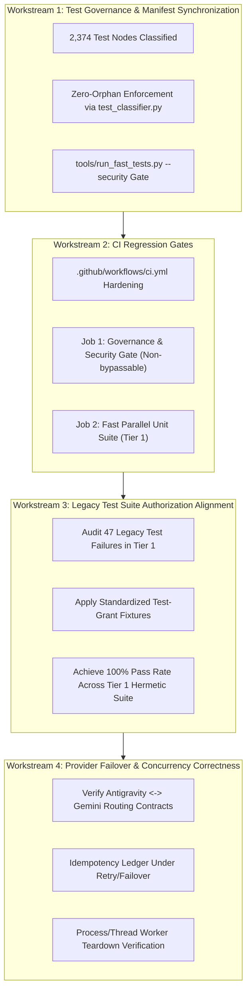

# Jarvis 2.0 — Milestone Plan: Reliability & Engineering Governance

**Document Identifier:** `MILESTONE-REG-01`  
**Target Git Branch:** `feat/reliability-engineering-governance`  
**Starting Commit Baseline:** `c59c0165314106f10689f5cbcda456957e9fe73f` (Parent: `8c395d3f2aa32effb5236ea716a4cba0b4803f8b`)  
**Status:** `ACTIVE / SPECIFICATION`  
**Author:** Antigravity Engineering Agent  
**Date:** 2026-11-09  

---

## 1. Executive Summary & Strategic Objectives

With Phase 2 Security Stabilization formally completed, accepted, and committed into permanent Git history (`c59c016`), the system now possesses rigorous kernel-level security primitives:
- Handle-relative directory confinement via `NtCreateFile` with `RootDirectory` and `FILE_OPEN_REPARSE_POINT`.
- Handle-bound atomic file rollback via `SetFileInformationByHandle` (`FileDispositionInfo`).
- Synchronized process-handle lifetime protection via `ProcessHandleRegistry.lease`.
- CDP browser execution binding via V8 `uniqueContextId` and SHA-256 script digests.
- Strict schema enforcement, immutable attachment hashing, and fail-closed dispatch gates.

The **Reliability and Engineering Governance** milestone transitions the repository from defensive perimeter stabilization to **comprehensive regression prevention, continuous verification governance, and system-wide reliability**.

### Core Governance Directives
1. **Frozen Security Perimeter Invariance:** The security boundaries implemented and certified in Phase 2 are permanently frozen. Production security logic (`jarvis/core/security_boundaries.py`, `jarvis/skills/job_object_sandbox.py`, `jarvis/skills/os_control.py`, `jarvis/skills/browser_cdp.py`, `jarvis/skills/email_manager.py`) must **not** be loosened, bypassed, or reopened.
2. **Zero-Orphan Test Governance:** Every test node across the entire repository (currently 2,374 nodes) must be deterministically accounted for in `data/test_classification_manifest.json` and governed by `tools/test_classifier.py`.
3. **Mandatory CI Security Regression Gate:** CI workflows (`.github/workflows/ci.yml`) must enforce automated orphan checks and execute the canonical 12-suite Phase 2 Security Regression Suite as a required status check.
4. **Hermetic Test Suite Stabilization:** Legacy unit tests failing due to unseeded authorization context must be updated using standardized test fixtures (`DualKeyApprovalManager` test grants) without altering production security semantics.
5. **Deterministic Provider Failover:** Multi-provider cognition (Antigravity Bridge <-> Gemini Fallback <-> Reflex Dispatcher) must reliably handle rate limits, timeouts, and auth errors with zero turn state loss and idempotency enforcement.

---

## 2. Architecture & Workstream Breakdown

---

## 3. Detailed Workstream Specifications

### Workstream 1: Test Governance & Manifest Synchronization
- **Scope:** Complete repository inventory (2,374 nodes across 6 operational tiers).
- **Deliverables:**
  1. Synchronized `data/test_classification_manifest.json` incorporating the 14 previously unmanifested suites (126 Phase 2 security tests + 50 core unit tests).
  2. Integrated `--security` flag in `tools/run_fast_tests.py` orchestrating the 12 canonical security suites under parent supervisor with XML reporting.
  3. Pre-commit / CI verification script: `python tools/test_classifier.py --check-orphaned` exiting 0 with 0 orphans, 0 duplicates.

### Workstream 2: CI Workflow Hardening (`.github/workflows/ci.yml`)
- **Scope:** GitHub Actions CI definition.
- **Deliverables:**
  1. Add `security-gate` job running on `windows-latest`.
  2. Enforce `python tools/test_classifier.py --check-orphaned` as a blocking pre-test step.
  3. Enforce `python tools/run_fast_tests.py --security -v` as the primary security status check.
  4. Sequence `fast-tests` parallel execution (Tier 1, 1,405 tests) dependent on security gate success.
  5. Add `merge_group` event trigger to support GitHub merge queues.
  6. **Mandatory Repository Policy Requirement:** The GitHub repository branch protection settings on `main` must require `Test Governance & Security Regression Gate` as a required status check before merging. YAML workflow declarations configure runner jobs, but branch-protection enforcement is governed at the repository configuration layer.

### 3.1 Architectural Clarification: Execution Classification vs. Parallel Eligibility
A core architectural principle governs test suite organization:
- **Execution Classification:** Whether a test is genuinely hermetic (Tier 1) or requires Windows OS integration (Tier 3). Tests exercising real Windows and NT kernel APIs (`NtCreateFile`, `DuplicateHandle`, Win32 process handles, and Job Objects) are Windows OS Integration tests according to the architectural taxonomy.
- **Parallel Eligibility:** Whether a test can safely execute alongside other tests concurrently without resource contention or handle collisions.
- **Governance Invariant:** Passing under `pytest-xdist -n 4` demonstrates safe parallel compatibility in a specific run, but does not reclassify an OS integration test as a hermetic unit test.
- **Security Runner Independence:** Regardless of their tier classification, all Phase 2 security suites remain permanently anchored in the dedicated `--security` runner (`tools/run_fast_tests.py --security`) to guarantee non-negotiable security regression enforcement on every run.

### Workstream 3: Legacy Test Authorization Alignment
- **Scope:** 47 failing tests across 22 historical test files in Tier 1.
- **Root Cause Analysis:** In Phase 2, `SkillRegistry.execute` was hardened with `evaluate_tool_execution` and `_active_auth_context` validation, causing unauthenticated legacy tests calling mutating tools (`execute_sandboxed_command`, `ast_search_codebase`, `check_code_diagnostics`, etc.) to fail closed with `SecurityBoundaryViolation`.
- **Remediation Strategy:**
  - **Do NOT weaken production code.** Production security gates must remain strictly fail-closed.
  - Update legacy test cases to utilize `with patch(...)` or `DualKeyApprovalManager` test authorization helpers to supply explicit mock permits during test execution.
  - Verify that each test asserts its specific functional behavior once legitimately authorized.

### Workstream 4: Real Provider Failover & Concurrency Lifecycle
- **Scope:** `jarvis/core/brain.py`, `jarvis/core/brain_gemini.py`, `jarvis/core/antigravity_bridge.py`, `tests/test_provider_routing_failover.py`.
- **Deliverables:**
  1. Verify candidate model rotation under HTTP 429 (Rate Limit) and 504 (Timeout).
  2. Verify fast-fail semantics under HTTP 401/403 (Authentication Failure) without infinite loops.
  3. Guarantee idempotency ledger state prevents duplicate tool side-effects across mid-turn provider failovers.
  4. Audit Win32 process and thread worker teardown to eliminate orphan subprocesses.

---

## 4. Verification & Acceptance Gates

| Gate ID | Verification Command | Required Acceptance Threshold |
| :--- | :--- | :--- |
| **GATE-01** | `python tools/test_classifier.py --check-orphaned` | `0 orphans`, `0 duplicates`, `Exit 0` |
| **GATE-02** | `python tools/run_fast_tests.py --security` | `191 passed`, `0 failed`, `1 env skip`, `Exit 0` |
| **GATE-03** | `python tools/run_fast_tests.py --fast -w 4` | `1,396+ passed`, `0 failed`, `Exit 0` |
| **GATE-04** | `python tools/diagnostics.py check jarvis/` | `0 AST violations`, `Exit 0` |
| **GATE-05** | `git diff --check` | `Clean diff`, `Zero trailing whitespace`, `No unstaged drift` |

---

## 5. Execution Sequence & Batch Boundaries

- **Batch 1 (Immediate):** Test Governance & Manifest Synchronization (Manifest exported, `--security` runner integrated and verified).
- **Batch 2:** CI Pipeline Hardening (`.github/workflows/ci.yml` updated with security gate and orphan checks).
- **Batch 3:** Legacy Test Authorization Alignment (Fixing 47 legacy tests in batches of 5–8 files).
- **Batch 4:** Full Tier 1 Regression Verification (Achieving green Tier 1 suite).
- **Batch 5:** Provider Failover & Concurrency Verification.
- **Batch 6:** Milestone Closeout, Audit Report & Engineering Handoff.

