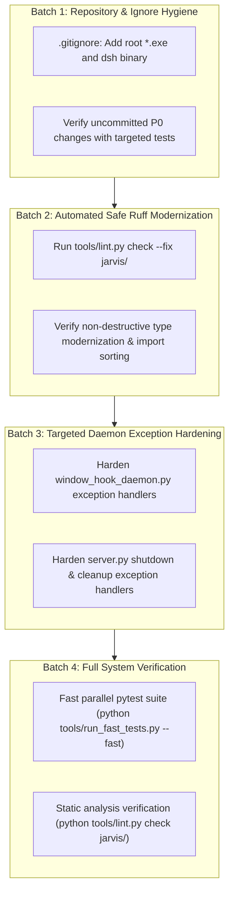

# Implementation Plan: Code Quality Modernization & Repository Hardening

## Goal Description
Execute the core engineering improvements identified in the codebase assessment:
1. **Repository & Git Hygiene:** Exclude untracked binaries (`dsh-latest-windows-x64.exe`) via `.gitignore` and establish an empirical clean verification baseline for all 12 uncommitted modified files and the new P0 authorization test suite (`tests/test_p0_action_bound_authorization.py`).
2. **Safe Static Code Hygiene & Ruff Modernization:** Apply automated, non-destructive Ruff linter fixes (`tools/lint.py check --fix jarvis/`) across `jarvis/` to modernize Python 3.12 type annotations, sort imports, organize `__all__`, and remove redundant code expressions.
3. **Targeted Exception Hardening:** Replace broad `except Exception: pass` blocks in critical daemon paths ([`window_hook_daemon.py`](file:///C:/Users/Youssef/Projects/Jarvis_2.0/jarvis/vision/window_hook_daemon.py) and [`server.py`](file:///C:/Users/Youssef/Projects/Jarvis_2.0/jarvis/ui/server.py)) with specific error types or explicit debug loggers, satisfying static hygiene invariants while preventing crash loops.

---

## User Review Required

> [!IMPORTANT]
> The automated Ruff pass will touch formatting and type hints across dozens of files in `jarvis/` (modernizing `Optional[T]` to `T | None`, `Dict` to `dict`, sorting imports). Because these are strictly non-semantic AST transformations, no behavioral or architectural changes are introduced.

> [!NOTE]
> Untracked binary `dsh-latest-windows-x64.exe` (289 MB) will be ignored via `.gitignore` to prevent repository bloat and accidental git commits.

---

## Proposed Changes



---

### Component 1: Repository Hygiene & Git Ignore

#### [MODIFY] [`.gitignore`](file:///C:/Users/Youssef/Projects/Jarvis_2.0/.gitignore)
- Add entries for standalone Windows executable binaries placed in the workspace root (`*.exe` or `dsh-latest-windows-x64.exe`) so large binaries are never committed.

```diff
--- .gitignore
+++ .gitignore
@@ -37,6 +37,9 @@
 data/models/
 *.onnx
 
+# Standalone binaries & desktop shell executables
+/*.exe
+
 # Browser debug runtime profiles & cache
 data/browser_debug_profile/
```

---

### Component 2: Automated Static Modernization (`jarvis/`)

#### [MODIFY] Modules across `jarvis/`
- Execute `python tools/lint.py check --fix jarvis/`.
- Safe transformations include:
  - Modernizing `typing.Optional[T]` to `T | None` (`UP045`).
  - Modernizing `typing.Dict`, `typing.Set`, `typing.List` to standard built-in generics (`UP006`, `UP035`).
  - Alphabetical sorting of imports (`I001`) and `__all__` symbols (`RUF022`).
  - Removal of unnecessary generator expressions and literal conversions (`C401`, `C408`).
  - Removal of unused local variables in trivial helper scopes (`F841`).

---

### Component 3: Targeted Daemon Exception Hardening

#### [MODIFY] [`jarvis/vision/window_hook_daemon.py`](file:///C:/Users/Youssef/Projects/Jarvis_2.0/jarvis/vision/window_hook_daemon.py)
- Replace blind `except Exception: pass` in `_get_window_title` with explicit `except (OSError, ValueError): pass` and explanatory docstring.
- Narrow `PostThreadMessageW` exception handling in `stop()` to `(OSError, AttributeError)` with structured debug logging.

```python
    def _get_window_title(self, hwnd: int) -> str:
        """Extracts window title via GetWindowTextW in <0.05ms."""
        if sys.platform != "win32" or not hwnd:
            return ""
        try:
            length = ctypes.windll.user32.GetWindowTextLengthW(hwnd)
            if length > 0:
                buf = ctypes.create_unicode_buffer(length + 1)
                ctypes.windll.user32.GetWindowTextW(hwnd, buf, length + 1)
                return buf.value.strip()
        except (OSError, ValueError):
            # Window destroyed, handle invalid, or access denied during title query
            pass
        return ""
```

#### [MODIFY] [`jarvis/ui/server.py`](file:///C:/Users/Youssef/Projects/Jarvis_2.0/jarvis/ui/server.py)
- Replace blind `except Exception: pass` in `stop()` cleanup blocks with typed exceptions:
  - `asyncio.CancelledError`, `RuntimeError`, `OSError` during event loop shutdown.
  - Explanatory comments where graceful best-effort teardown is intentional.

---

## Verification Plan

### Automated Tests
1. **Targeted P0 Authorization Suite:**
   ```powershell
   python tools/run_fast_tests.py tests/test_p0_action_bound_authorization.py
   ```
2. **Targeted Subsystem Suites:**
   ```powershell
   python tools/run_fast_tests.py tests/test_browser_cdp.py
   python tools/run_fast_tests.py tests/test_browser_network_boundaries.py
   python tools/run_fast_tests.py tests/test_security_boundaries.py
   ```
3. **Full Tier 1 Parallel Test Gate:**
   ```powershell
   python tools/run_fast_tests.py --fast
   ```
   *Expected outcome: 1,340+ passed, 0 failures.*

### Static Code Analysis
4. **Ruff Diagnostics Gate:**
   ```powershell
   python tools/lint.py check jarvis/
   ```
   *Verify reduction of error count by ~1,800+ violations.*

### Git State Verification
5. **Clean Working Tree Manifest:**
   ```powershell
   git status --short
   ```
   *Verify that untracked binaries are ignored and working tree modifications are cleanly accounted for.*
