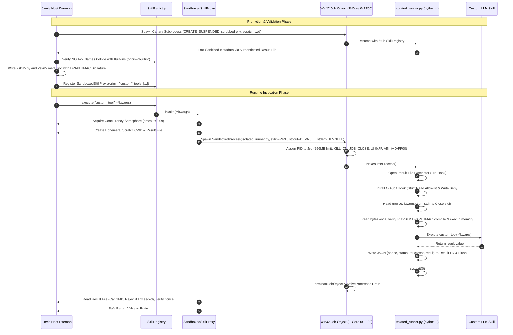

# Implementation Plan: P0 Security — Out-of-Process Sandbox for Self-Evolution (v4)

## Goal Description
Isolate untrusted LLM-generated Python skills in Jarvis 2.0 (`jarvis/skills/self_evolution.py` and `jarvis/core/evolution/sandbox.py`) by replacing in-process execution with an out-of-process execution harness.

Dynamic skills currently execute inside the host daemon via `importlib.util.spec_from_file_location` and `spec.loader.exec_module` across three paths:
1. Promotion (`SkillSandbox.validate_and_promote`)
2. Startup loading (`load_all_custom_skills`)
3. Rollback (`SkillSandbox.rollback_snapshot`)

Executing dynamic code inside the host daemon enables crash propagation, state tampering, and uncontained execution. This implementation introduces an isolated child runner (`isolated_runner.py`) running with Python isolated mode (`python -I`), environment scrubbing, scratch working directory confinement, host-enforced timeouts via Win32 Job Object termination, DPAPI HMAC sidecar signing, atomic single-read compilation, and a normalized filesystem read allowlist.

---

## User Review Required

> [!IMPORTANT]
> **Threat Model & Security Boundary Caveats:**
> - **What this provides:** Crash and exception isolation from the host daemon, CPU and RAM starvation prevention (256MB cap, E-core pinning `0xFF00`, `BELOW_NORMAL_PRIORITY_CLASS`), process tree termination (`KILL_ON_JOB_CLOSE`), UI window/clipboard denial (`0xFF`), host pipe OOM defense (`DEVNULL`), single-read memory compilation (no TOCTOU), DPAPI HMAC sidecar authentication against planted workspace files, and normalized audit-hook read allowlisting.
> - **Filesystem Read Control:** The audit hook enforces a strict **read allowlist** (permitting reads only under `sys.prefix`, `sys.base_prefix`, the ephemeral scratch dir, and the skill's own file path), normalized via `os.path.realpath(os.path.normcase(...))`. Running in an ephemeral scratch CWD is a path convention; the normalized allowlist is the security control. Complete kernel-level DACL read isolation against files readable by the active Windows user token requires an AppContainer or low-integrity execution token (designated as a P1 follow-up).

> [!WARNING]
> **Pure-Compute Capability Model:**
> Custom skills are restricted to pure compute. All `jarvis.*` imports are blocked by AST analysis and by a custom `sys.meta_path` finder in the runner, with the sole exception of a synthetic stub module `jarvis.skills.base` providing `@SkillRegistry.register`. The legacy custom skill `jarvis/skills/custom/see_screen.py` is deleted, as `inspect_screen` is already a canonical built-in tool in `jarvis.skills.screen_vision` with built-in reflexes.

---

## Architecture & Data Flow



---

## Detailed Design & Proposed Changes

### 1. Isolated Child Runner (`jarvis/core/evolution/isolated_runner.py`) [NEW]
Standalone zero-dependency standard-library script executed via `python -I`:
- **Stubbed Registry Injection:** Injects a mock `jarvis.skills.base` stub before loading custom code.
- **Import Blocker (`sys.meta_path`):** Blocks all imports starting with `jarvis.` other than the pre-populated stub.
- **Strict Normalized Read Allowlist in Audit Hook:**
  - Opens `--result-file` in `'w'` mode *before* installing the hook.
  - Inlined PEP 578 audit hook:
    - Normalizes tested paths with `os.path.realpath(os.path.normcase(...))` and handles `int` FDs and `bytes` paths.
    - Write deny: Rejects any open mode containing `'w'`, `'a'`, `'+'`, `'x'`.
    - Read allowlist: Only permits reading files whose normalized realpath starts with:
      1. `sys.prefix` (Python standard library & runtime)
      2. `sys.base_prefix`
      3. The ephemeral scratch directory
      4. The skill module's own realpath
    - Audits and restricts `os.listdir` and `os.scandir` to the allowlist roots.
    - Blocks `subprocess`, `socket`, `ctypes`, `winreg`, and frame introspection.
- **Atomic Single-Read Compilation (No TOCTOU):**
  - Reads raw bytes once: `code_bytes = Path(module_path).read_bytes()`.
  - Computes `sha256(code_bytes)` and verifies against `--expected-hash`.
  - Compiles in memory: `code_obj = compile(code_bytes, str(module_path), "exec")`.
  - Executes: `exec(code_obj, custom_mod.__dict__)`. Never invokes `spec_from_file_location`.
- **Pre-Serialized Result Protocol:**
  - Pre-serializes `{ "nonce": nonce, "status": "success", "result": result }`.
  - Checks length `<= 1048576` bytes (1MB) before writing to result FD.

---

### 2. Sidecar HMAC Authentication & Path Protection (`jarvis/core/evolution/sandbox.py`, `jarvis/skills/dev_shell.py`, `jarvis/core/security_boundaries.py`) [MODIFY]
- **Path Confinement Protection:**
  - `jarvis/skills/custom/` is added to `PROTECTED_WORKSPACE_PATHS` in `jarvis/core/security_boundaries.py`.
  - Generic developer tools (`write_file`, `patch_file` in `dev_shell.py`) are strictly forbidden from writing or modifying files inside `jarvis/skills/custom/`.
- **DPAPI-Backed HMAC Sidecar Signing:**
  - The host maintains a machine-local HMAC secret protected by Windows DPAPI (`win32crypt.CryptProtectData`) stored outside the workspace at `~/.jarvis_sec/evolution_hmac.dat`.
  - When a skill is promoted, `<clean_name>.meta.json` is signed with `hmac_sha256(code_bytes, hmac_key)`.
  - On startup or execution, sidecars without a valid DPAPI HMAC signature are rejected, preventing planted workspace files from executing.

---

### 3. Registry Origin Tracking, Load Order & Symmetrical Collision Guard (`jarvis/skills/base.py`, `jarvis/skills/self_evolution.py`) [MODIFY]
- **Origin Field:** `SkillMetadata.origin` (`"builtin"` or `"custom"`).
- **Symmetrical Collision Guard:**
  - A custom tool attempting to register under an existing built-in name raises `PermissionError`.
  - A built-in tool attempting to register over an existing custom tool logs a warning and takes precedence, invalidating the custom shadow.
- **Explicit Startup Loading:**
  - Remove the module import-time `load_all_custom_skills()` call from `jarvis/skills/self_evolution.py`.
  - Introduce `init_custom_skills()` invoked explicitly during orchestrator startup *after* all built-in skills have registered.

---

### 4. Process Sandboxing & Host Governance (`jarvis/skills/job_object_sandbox.py`, `jarvis/core/evolution/sandbox.py`) [MODIFY]
- **E-Core Pinning & Priority:**
  - Sandboxed children are created with `requested_affinity=0xFF00` (E-cores) and `BELOW_NORMAL_PRIORITY_CLASS` (0x00004000) to ensure zero starvation of P-core audio/TTS workers.
  - UI Restrictions: `0x000000FF` (`JOB_OBJECT_UILIMIT_ALL`).
- **Host Concurrency & Disk Flood Guard:**
  - `_SANDBOX_CONCURRENCY_SEMAPHORE = threading.Semaphore(4)`. Invocation uses `acquire(timeout=2.0)`. On timeout, returns `"Error: Sandbox is busy executing concurrent tasks."`.
  - Semaphore released and scratch directories deleted in `finally:` blocks.
  - Host polls result file size during the 10.0s run window and kills the job immediately if size exceeds 1MB.
  - Scratch CWD directory names use a dedicated random identifier (not the IPC nonce).

---

### 5. Test Suite Updates & Migrations (`tests/`) [MODIFY]
- **Stub Contract Tests:**
  - Verify decorated skill loads under stub registry.
  - Verify `sys.modules['jarvis.skills.base']` is the stub.
  - Verify `import jarvis.skills.os_control` is denied by `sys.meta_path`.
- **Audit Hook Behavior Tests:**
  - Verify runner's own pre-opened result file write succeeds.
  - Verify file reads outside allowlist fail, including `\\?\`, 8.3 short names, and case variants.
- **Collision & Planted Skill Tests:**
  - Verify custom tool named after a built-in is rejected at startup.
  - Verify a planted skill dropped via generic `write_file` or missing DPAPI HMAC signature fails to load.
- **Resource & Concurrency Tests:**
  - Verify scratch directory is cleaned up after a timeout.
  - Verify semaphore busy path returns error and a crashed call releases its slot.
  - Verify AST check ensures no `exec_module` in `jarvis/` outside `isolated_runner.py`.
- Non-Windows: Win32 Job Object containment tests decorated with `@unittest.skipUnless(sys.platform == "win32", ...)`.

---

## Verification Plan

### Automated Tests
1. **Targeted Sandbox Security Suite:**
   ```powershell
   python tools/run_fast_tests.py tests/test_self_evolution_sandbox.py
   ```
2. **Self-Evolution Lifecycle Suite:**
   ```powershell
   python tools/run_fast_tests.py tests/test_self_evolution.py
   ```
3. **Stage 1 Security Regression Suite:**
   ```powershell
   python tools/run_fast_tests.py tests/test_stage1_security_hardening.py
   ```
4. **Fast Non-Hardware Suite:**
   ```powershell
   python tools/run_fast_tests.py --fast
   ```

### Manual Verification
1. Run `python -c "from jarvis.skills.self_evolution import init_custom_skills; init_custom_skills(); import sys; assert not any(m.startswith('jarvis.skills.custom.') for m in sys.modules)"`.
2. Confirm `inspect_screen` remains fully operational from `jarvis.skills.screen_vision`.
